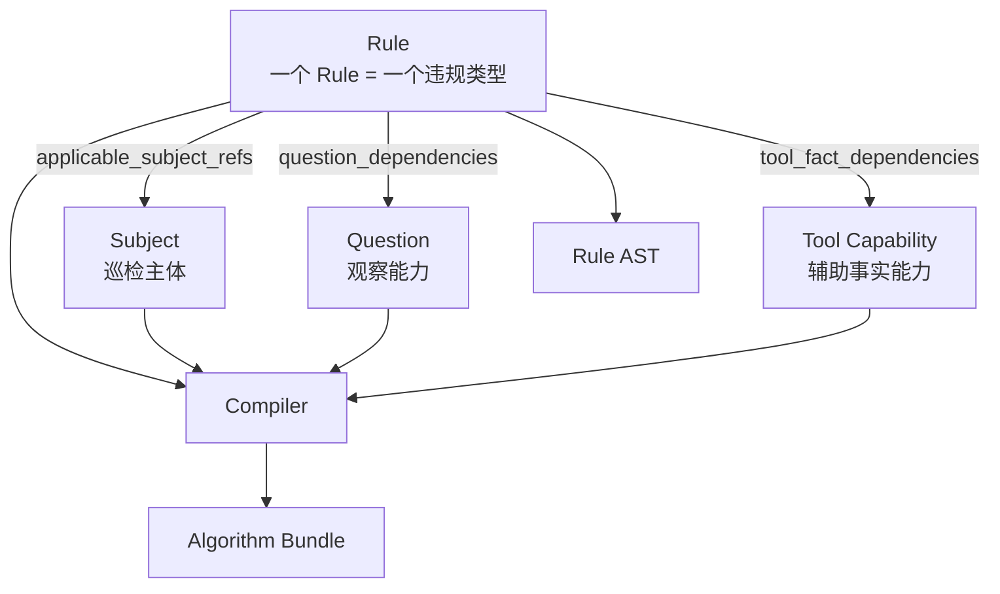
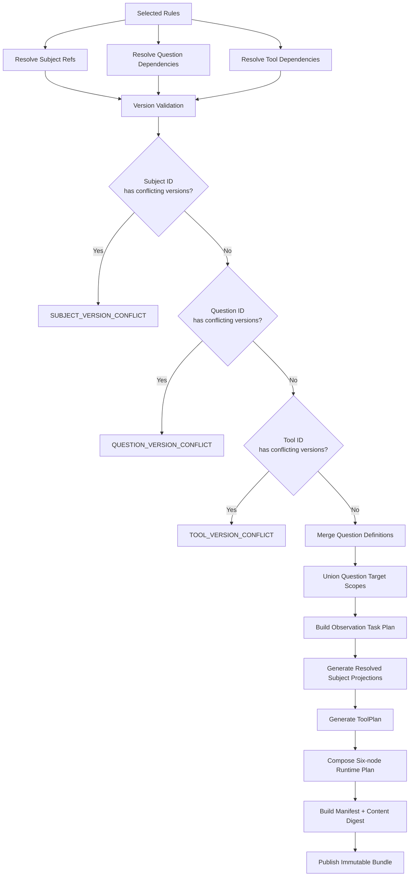

# D03 Domain Model Amendment V1.1

> 文档类型：Domain Model Amendment  
> 适用基线：D03 Prompt Domain Model V1.0  
> 修订版本：V1.1  
> 日期：2026-11-26  
> 状态：用户确认的领域架构基线，待 Schema 与工程契约验收  
> 修订范围：2.1 Business Domain、2.2 Algorithm Capability Domain，以及相关编译、执行和资产治理关系。

---

# 0. Amendment Overview

## 0.1 修订目标

本次修订从领域职责和业务依赖关系出发，精简原 D03 Domain Model 中存在的概念重叠、重复所有权和不必要的中间领域对象。

核心目标：

1. 统一主体身份，取消 Entity 作为独立核心领域资产。
2. 取消 Violation 独立资产，由 Rule 直接表达一个违规类型。
3. 取消 Applicability 独立领域对象，改为 Rule 内部声明适用主体。
4. 取消 Subject 对 Question 的所有权关系。
5. 将 Question 定义为独立、可复用、独立版本化的算法能力资产。
6. 将 Target Scope 纳入 Rule 的 Question Dependency。
7. 将 Profile 和 ToolPlan 降级为 Compiler 编译期产物。
8. 建立 Rule 主导的单向写入、双向引用查询和影响面门禁体系。
9. 保持一张图像四个模型节点各一次全量联合调用的执行原则。

## 0.2 四个核心领域对象

系统的核心领域资产收敛为四个：

| 对象 | 所属域 | 核心职责 |
|---|---|---|
| Subject | Business Domain | 定义巡检主体 |
| Question | Algorithm Capability Domain | 定义客观事实观察能力 |
| Rule | Algorithm Capability Domain | 定义独立违规类型、适用主体和确定性判定 |
| Tool Capability | Algorithm Capability Domain | 定义辅助事实生产能力 |

四个对象之间不存在循环所有权。

## 0.3 核心引用关系



引用方向统一为：

- Rule → Subject
- Rule → Question
- Rule → Tool Capability

不建立 Subject → Rule 的权威写入关系。

反向查询通过统一引用索引实现，不改变权威数据归属。

## 0.4 不属于四个核心领域对象的概念

| 概念 | 新定位 |
|---|---|
| Entity | 历史兼容标识；新模型统一使用 Subject |
| Violation | Rule 所表达的业务语义，不独立建模 |
| Applicability | 不再独立建模 |
| Profile | Compiler 编译期配置投影 |
| Resolved Profile | Compiler 产生的主体执行配置 |
| Facet | 暂不独立建模，可作为分类或标签 |
| Output Field | Question 内部定义 |
| Rule AST | Rule 的确定性执行表达 |
| ToolPlan | Compiler 生成的执行计划 |
| Target Registry | 单图执行期对象 |
| Assignment Matrix | 单图执行期组合结果 |
| Observation Facts | Runtime 事实 |
| Tool Facts | Runtime 事实 |

Region 保留为外部业务空间上下文，不属于上述四个核心算法领域资产。

---

# 1. 2.1 Business Domain

## 1.1 Subject

### 定义

Subject 是系统需要识别、定位和观察的巡检主体类型。

Subject 只描述主体本身，不负责定义违规类型，也不负责定义观察任务和判断逻辑。

示例：

- bicycle
- electric_bicycle
- motorcycle
- motor_vehicle
- person
- goods
- fire_extinguisher
- fire_hydrant

### 标准数据结构

所有核心资产引用统一使用 AssetVersionRef，不再定义 SubjectVersionRef 等重复引用类型。

```python
from dataclasses import dataclass, field
from typing import Optional


@dataclass(frozen=True)
class AssetVersionRef:
    asset_id: str
    version: str
    content_hash: str


@dataclass
class SubjectDefinition:
    subject_id: str
    version: str

    name: str
    description: str

    subject_type: str
    parent_subject_id: Optional[str] = None

    metadata: dict = field(default_factory=dict)

    # 必填，与 Question / Rule / Tool 保持一致
    content_hash: str

    lifecycle_status: str = "published"
```

### 关键语义

1. Subject 是独立资产。
2. Subject 不拥有 Question。
3. Subject 不拥有 Rule。
4. Subject 不维护 `rule_refs` 权威关系。
5. Subject 不维护独立 Profile Registry。
6. Subject 的历史 Entity ID 可以通过迁移映射查询。
7. Subject 版本变更不自动修改任何引用它的 Rule。
8. Subject 的 Grounding 实现配置由能力中心治理，并在编译时解析。
9. Subject 的所有跨资产引用统一使用 AssetVersionRef。

Subject 的分类层级可以通过 `parent_subject_id` 表达。

是否需要多层分类、分类继承以及父子版本兼容规则，属于后续技术契约。

---

# 2. 2.2 Algorithm Capability Domain

## 2.1 Question

### 定义

Question 是独立版本化的视觉观察能力。

它定义：

- 观察什么客观事实。
- 观察的语义范围。
- 具体 Prompt。
- 输出字段。
- 字段类型和合法状态。

Question 不定义违规类别，也不负责最终裁决。

Question 的设计目标是按照视觉观察语义粒度复用，而不是为了减少资产数量强行合并不同视觉任务。

例如：

| Question | 适用观察语义 |
|---|---|
| nonmotor_parking_state | 非机动车停车状态 |
| human_control_state | 人员是否控制车辆 |
| motor_vehicle_wheel_contact | 机动车车轮接地点 |
| goods_boundary_relation | 货物与边界的空间关系 |
| fire_extinguisher_state | 灭火器可见状态 |

同一个 Question 可以被多个 Rule 引用。

例如 `nonmotor_parking_state` 可以被自行车、电动自行车、三轮车相关的多个 Rule 复用。

不要求机动车与非机动车共用一个语义差异过大的通用 Question。

### 标准数据结构

```python
from dataclasses import dataclass, field


@dataclass
class OutputFieldDefinition:
    field_key: str
    name: str

    data_type: str
    required: bool

    description: str = ""
    enum_values: list[str] = field(default_factory=list)

    nullable: bool = False
    unknown_allowed: bool = True

    nested_fields: list["OutputFieldDefinition"] = field(
        default_factory=list
    )


@dataclass
class QuestionDefinition:
    question_id: str
    version: str

    name: str
    description: str

    observation_definition: str

    structured_prompt: dict

    output_fields: list[OutputFieldDefinition]

    content_hash: str
    lifecycle_status: str = "published"

    metadata: dict = field(default_factory=dict)
```

### 关键语义

1. Question 是独立资产，不隶属于 Subject 或 Rule。
2. Question 的 Prompt 和 Output Fields 保持内嵌关系。
3. Output Field 随 Question Version 版本化。
4. `field_key` 在 Question 内保持稳定。
5. Question 不负责违规判定。
6. Question 不直接绑定 Target Scope。
7. Question 不声明 Tool Capability 依赖。
8. Question 可以被多个 Rule 共享。
9. 同一个 Question ID 的不同版本属于不同功能定义。
10. 一个 Bundle 中，同一个 Question ID 只能存在一个有效版本。

### Question 的复用边界

Question 的复用原则：

> 相同视觉观察语义可以复用；不同视觉观察语义不强制合并。

Question 的复用与 Rule 的复用相互独立。

例如：

```text
Rule A ──┐
         ├── Question: nonmotor_parking_state
Rule B ──┘
```

两条 Rule 可以共享同一 Question Definition。

共享的是观察能力定义，不是某张图像的事实结果。

---

## 2.2 Rule

### 定义

Rule 是一个独立的违规类型及其完整判定能力定义。

**一个 Rule 就代表一个独立的违规类型。**

例如：

- nonmotor_vehicle_illegal_parking
- motor_vehicle_illegal_parking
- road_occupying_vendor
- goods_blocking_road
- unauthorized_electrical_wiring

Rule 是违规语义、事实依赖和确定性判定逻辑的统一权威资产。

Rule 不只是 AST，也不只是违规名称。

### Rule 的标准数据结构

```python
from dataclasses import dataclass, field


@dataclass(frozen=True)
class QuestionDependency:
    question_ref: AssetVersionRef

    # Object / Object Group / Both
    target_scope: str

    # 当前 Rule 对该 Question 的依赖要求
    required: bool = True


@dataclass(frozen=True)
class ToolFactDependency:
    tool_ref: AssetVersionRef

    required_fact_keys: list[str]

    required: bool = True


@dataclass
class RuleDefinition:
    rule_id: str
    version: str

    name: str
    description: str

    # 一个 Rule 对应一个独立违规类型
    violation_semantics: dict

    # Rule 拥有 Subject 引用关系
    applicable_subject_refs: list[AssetVersionRef]

    # Question 事实依赖及 Target Scope
    question_dependencies: list[QuestionDependency]

    # 唯一的 Tool 依赖声明位置
    tool_fact_dependencies: list[ToolFactDependency]

    # N06 候选生成所需的违规语义投影
    candidate_definition: dict

    # Rule 确定性判定表达
    ast_definition: dict

    content_hash: str

    lifecycle_status: str = "published"

    metadata: dict = field(default_factory=dict)
```

### Rule 的核心职责

Rule 包含五个部分：

1. 违规语义定义。
2. 适用 Subject 引用。
3. Question Dependencies。
4. Tool Fact Dependencies。
5. Candidate Definition 与 Rule AST。

其中：

- `candidate_definition` 供 N06 产生违规候选。
- `ast_definition` 供确定性规则引擎执行最终裁决。
- `question_dependencies` 负责声明所需观察事实。
- `tool_fact_dependencies` 负责声明所需辅助事实。
- `applicable_subject_refs` 负责声明该违规适用于哪些主体。

**V1.1 中仅 Rule 有权声明 `tool_fact_dependencies`。Question 只负责视觉观察，不声明工具调度依赖。**

### Rule 与 Subject 的关系

Rule 是关系的权威写入方。

```text
Rule: nonmotor_vehicle_illegal_parking
    |
    +-- applicable_subject_refs
            |
            +-- bicycle@1.0
            +-- electric_bicycle@1.2
            +-- tricycle@1.0
```

不同 Subject 共享同一个 Rule 时：

- 不复制 Rule。
- 不复制 Question。
- 不产生 Subject 级别的特殊 Rule 开关。
- 不产生不同 Subject 的 Rule 阈值变体。
- 不创建 Applicability 资产。

如果未来某个 Subject 确实需要不同违规逻辑，应当创建独立 Rule，而不是通过隐藏的 Subject 特殊参数修改原 Rule 的语义。

### Rule 版本治理

Rule 是独立版本化资产。

Rule 的以下内容变化必须产生新的功能版本：

- 违规语义。
- `applicable_subject_refs`。
- `question_dependencies`。
- `target_scope`。
- `tool_fact_dependencies`。
- `candidate_definition`。
- `ast_definition`。

已发布 Rule Version 不可覆盖。

Rule 引用的 Subject、Question、Tool Version 必须显式锁定。

---

## 2.3 Tool Capability

### 定义

Tool Capability 是系统通过视觉模型、识别模型、测量算法和确定性计算产生辅助事实的能力定义。

例如：

- SAM3 Segmentation
- Keypoint Detection
- OCR
- Depth Estimation
- Geometry Computation

Tool Capability 是独立算法资产。

ToolPlan 不是 Tool Capability，而是 Compiler 根据 Rule 的工具事实依赖生成的执行计划。

### 标准数据结构

```python
@dataclass
class ToolOutputDefinition:
    fact_key: str
    data_type: str
    description: str


@dataclass
class ToolCapabilityDefinition:
    tool_id: str
    version: str

    name: str
    description: str

    input_schema: dict
    output_schema: list[ToolOutputDefinition]

    implementation_ref: str
    implementation_version: str

    content_hash: str

    lifecycle_status: str = "published"
    metadata: dict = field(default_factory=dict)
```

### 关键语义

1. Tool Capability 独立资产化。
2. Rule 可以引用 Tool Capability 的精确版本。
3. 仅 Rule 声明 Tool Fact Dependencies。
4. Tool Capability 不拥有 Rule。
5. Tool Capability 不拥有 Subject。
6. ToolPlan 由 Compiler 根据全部有效 Rule 的工具事实依赖生成。
7. Runtime 只执行 Bundle 固化的 ToolPlan。
8. Tool Run 和 Tool Facts 属于 Runtime 执行记录。

ToolPlan 不提供独立业务编辑入口，不维护独立 Candidate / Published 生命周期。

---

# 3. 算法实现与编译产物

以下对象仍然存在，但不属于四个核心领域对象。

## 3.1 Prompt Master / Shared Component

沿用 D03 M02 / M03：

- Question 继续内含结构化 Prompt。
- Master 独立版本化。
- Shared Component 独立版本化。
- Master 显式引用组件版本及顺序。
- Renderer 按 Master 约定和节点策略组合逻辑请求。

不因本次领域精简改变现有资产结构。

## 3.2 ModelBinding / Renderer / Adapter

继续作为独立版本化工程配置和执行组件。

| 组件 | 职责 |
|---|---|
| ModelBinding | 模型选择和推理参数 |
| Renderer | 确定性生成 Logical Request |
| Adapter | 转换为 Physical Model Request |

## 3.3 Profile

Profile 不再作为独立领域资产。

Compiler 根据 Rule 所引用的 Subject 以及相应定位实现配置，生成编译期主体配置投影。

```text
Rule
  |
  +-- applicable_subject_refs
            |
            v
       Subject Versions
            |
            v
        Compiler
            |
            v
    Resolved Subject Profile
```

Profile 不再拥有独立 ID 生命周期、Candidate 或发布流程。

## 3.4 ToolPlan

Compiler 仅汇总全部有效 Rule 的 `tool_fact_dependencies`，生成 ToolPlan。

```text
Rule A Tool Dependencies ──┐
                           │
Rule B Tool Dependencies ──┼──> Compiler
                           │       |
Rule C Tool Dependencies ──┘       v
                              ToolPlan
                                  |
                                  v
                            Bundle Manifest
```

Question 不声明工具依赖，也不参与 ToolPlan 的直接生成。

ToolPlan 的完整 Schema、依赖合并和工具执行顺序属于 D05 技术契约。

---

# 4. 核心领域不变量（Domain Invariants）

## 4.1 身份与所有权

| ID | 不变量 |
|---|---|
| INV-001 | Subject 是统一的巡检主体定义，不再建立独立 Entity 核心对象。 |
| INV-002 | Question 是独立算法能力资产，不隶属于 Subject 或 Rule。 |
| INV-003 | 一个 Rule 代表一个独立违规类型。 |
| INV-004 | 不建立独立 Violation Registry。 |
| INV-005 | 不建立独立 Applicability 领域对象。 |
| INV-006 | Rule 是 `applicable_subject_refs` 的唯一权威写入方。 |
| INV-007 | Subject 不维护 `rule_refs` 权威关系。 |
| INV-008 | Profile 不具有独立领域资产生命周期。 |
| INV-009 | Rule AST 是 Rule 的执行表达，不是独立业务资产。 |
| INV-010 | ToolPlan 是 Compiler 编译产物，不是独立算法资产。 |

## 4.2 Question 复用与事实身份

| ID | 不变量 |
|---|---|
| INV-011 | 同一 Question ID + Version + Content Hash 表示同一功能定义。 |
| INV-012 | Question 可以被多个 Rule 引用。 |
| INV-013 | 编译期允许合并重复 Question Definition 的 Prompt 模板。 |
| INV-014 | Prompt 合并不得改变 Question 的独立身份和输出字段归属。 |
| INV-015 | Runtime Fact 去重键必须为 `(target_instance_id, question_id)`。 |
| INV-016 | 同一 Target Instance 的相同 Question 被多个 Rule 引用时，只观测一次。 |
| INV-017 | 不同 Target Instance 的同一 Question 必须分别产生事实。 |
| INV-018 | 一个 Fact 可以被多个 Rule 消费，但不得丢失原始 Question 和 Target 身份。 |
| INV-034 | 同一 Bundle 中，同一 Question ID 的所有 Rule 依赖必须引用相同 Question Version 和 Content Hash。 |

## 4.3 Rule 依赖与版本

| ID | 不变量 |
|---|---|
| INV-019 | Rule 的 Subject、Question、Tool 引用必须锁定具体版本。 |
| INV-020 | 共享资产新版本发布不得静默替换已发布 Rule 的引用。 |
| INV-021 | Rule 只有通过自身新版本才能主动升级共享依赖。 |
| INV-022 | 同一 Bundle 中同一个 Question ID 只能存在一个 Question Version。 |
| INV-023 | 同一 Question ID + Version 对应的 Content Hash 必须一致。 |
| INV-024 | 不同 Question ID 不允许仅因 Prompt 文本相似而合并身份。 |
| INV-025 | Question Output Field 的修改必须进行下游 Rule AST 兼容性检查。 |
| INV-026 | 被有效 Rule 引用的共享资产禁止物理删除。 |
| INV-035 | 同一 Bundle 中，同一 Subject ID 只能存在一个 Subject Version。 |
| INV-036 | 同一 Bundle 中，同一 Tool ID 只能存在一个 Tool Version；默认禁止多版本并存。 |
| INV-037 | Question 的 Tool 依赖声明不属于 V1.1 支持范围，所有 Tool Fact Dependencies 统一归 Rule。 |
| INV-038 | 同一 Question 被多个 Rule 以不同 Target Scope 引用时，Compiler 必须合并其观测范围，Runtime 仍按 Rule 各自声明的 Scope 消费 Fact。 |

## 4.4 管理平台治理

| ID | 不变量 |
|---|---|
| INV-027 | Rule 装配页唯一拥有 Rule 本体及其引用关系的写入权。 |
| INV-028 | 能力中心唯一拥有 Subject / Question / Tool 本体及版本的写入权。 |
| INV-029 | Rule 装配页不得直接覆写共享资产本体。 |
| INV-030 | 能力中心不得直接修改 Rule 的 Subject / Question / Tool 引用关系。 |
| INV-031 | 反向引用查询通过统一 Reference Index 实现。 |
| INV-032 | 资产发布前必须进行引用影响分析。 |
| INV-033 | 被有效 Rule 引用的资产只能 Deprecated，不允许物理删除。 |

---

# 5. 版本锁定与引用索引

## 5.1 显式版本引用

所有跨资产引用统一使用 `AssetVersionRef`，必须包含：

- asset_id
- version
- content_hash

Subject、Question、Rule、Tool Capability 的引用均不得使用只包含 ID 的非锁定引用。

禁止只保存 asset_id 并在运行时自动解析 Latest。

例如：

```json
{
  "asset_id": "nonmotor_parking_state",
  "version": "1.2.0",
  "content_hash": "sha256:..."
}
```

Subject 的自身定义也必须具有非空 `content_hash`，与 Question、Rule、Tool Capability 保持一致。

Rule 发布后，其依赖版本不可被外部资产更新自动修改。

## 5.2 Rule 依赖锁定示例

```yaml
rule_id: nonmotor_vehicle_illegal_parking
version: 1.0.0

applicable_subject_refs:
  - asset_id: bicycle
    version: 1.0.0
    content_hash: sha256:subject_bicycle

  - asset_id: electric_bicycle
    version: 1.2.0
    content_hash: sha256:subject_ebike

question_dependencies:
  - question_ref:
      asset_id: nonmotor_parking_state
      version: 1.0.0
      content_hash: sha256:q_parking

    target_scope: Object

  - question_ref:
      asset_id: human_control_state
      version: 1.1.0
      content_hash: sha256:q_control

    target_scope: Object

tool_fact_dependencies:
  - tool_ref:
      asset_id: geometry_compute
      version: 1.0.0
      content_hash: sha256:geometry

    required_fact_keys:
      - parking_region_relation

candidate_definition:
  definition_ref: candidate_nonmotor_parking_v1

ast_definition:
  ast_ref: rule_nonmotor_parking_ast_v1
```

上述 YAML 是结构示例，不是最终 Manifest Schema。

## 5.3 Asset Reference Index

Reference Index 是由权威资产引用关系派生的查询索引。

它不拥有业务关系，也不能反向修改 Rule。

建议支持：

```text
Subject
   |
   v
Referenced Rules
   |
   v
Question / Tool Dependencies
   |
   v
Published Rules
   |
   v
Algorithm Builds / Bundles
   |
   v
Deployment Bindings
```

反向查询必须能够回答：

1. 某 Subject 被哪些 Rule 引用？
2. 某 Question 被哪些 Rule 引用？
3. 某 Tool Capability 被哪些 Rule 引用？
4. 某 Question 的字段被哪些 Rule AST 使用？
5. 某共享资产的版本变更会影响哪些 Rule？
6. 这些 Rule 又进入了哪些有效 Bundle / Build？

Reference Index 必须能够根据权威引用数据重建。

索引自身不得成为第二个写入事实源。

---

# 6. N02–N06 Runtime 消费契约

## 6.1 N02：全图联合触发

### 输入

- 原始 Image。
- Region Context。
- Bundle 中的 Subject 配置。
- 全部适用 Rule Definition。
- Rule 的违规候选定义及触发所需投影。
- 相关版本和引用信息。

### 处理

一次全图 Omni-JEV 调用。

N02 负责：

1. 识别当前图像可能涉及的 Subject。
2. 识别可能涉及的 Rule。
3. 产生后续 Grounding 所需的主体引用。
4. 产生后续节点需要的 Rule / Question 引用。

N02 不负责：

- 实例级定位。
- 重新定义 Question。
- 修改 Rule 依赖。
- 最终违规裁决。

### 输出

- Matched Subject References。
- Matched Rule References。
- Question Dependency References。
- 必要的场景和执行上下文引用。

N02 的具体 Selection Definition 和完整结构化输出 Schema 仍需 D05 定义。

**调用约束：每图一次联合 JEV。**

## 6.2 N03：全图联合 Grounding

### 输入

- 原始 Image。
- N02 命中的全部 Subject。
- 对应 Subject 的精确版本。
- Bundle 中编译生成的 Grounding 配置投影。

### 处理

一次联合 Grounding 请求。

所有命中 Subject 的定位任务必须进入同一个 Logical Request。

禁止：

- 按 Subject 拆分请求。
- 按 Profile 拆分请求。
- 对每个 Grounding Prompt 单独调用模型。

### 输出

```text
GroundingResult
  ├── Objects
  │    ├── object_instance_id
  │    ├── subject_ref
  │    ├── bbox
  │    └── visual_evidence
  │
  └── Object Groups
       ├── group_instance_id
       └── member_object_ids
```

Object 与 Group 的稳定身份及跨 Subject 共享对象的去重规则需要在 D05 明确。

Profile 不作为持久领域资产，也不要求 N03 维护独立 Profile Registry。

**调用约束：每图一次联合 Grounding。**

## 6.3 N04：全图联合观察

这是本次 Amendment 的重点。

N04 必须严格区分编译期 Definition 去重、Target Scope 合并和运行期 Fact 去重。

### A. 编译期：Question Definition 合并

Compiler / Composition 阶段：

1. 收集所有适用 Rule 的 Question Dependencies。
2. 按 Question ID、Version、Content Hash 确定定义身份。
3. 合并重复 Question Definition 的 Prompt 模板。
4. 保留每条 Rule 对 Question 的依赖来源。
5. 生成统一的 N04 联合请求 Schema。

编译期去重的对象是 Question Definition，不是图像事实。

同一个 Question 被多条 Rule 引用时，不应在 Prompt 中重复定义同一观察任务。

但是，合并 Prompt 不得丢失 Question ID、Version、Output Field 和 Rule Dependency Provenance。

### B. 跨 Rule Target Scope 编译合并

同一 Bundle 中，不同 Rule 可以引用相同 Question，但声明不同的 Target Scope。

例如：

```text
Rule A
  └── Q1
       └── Target Scope: Object

Rule B
  └── Q1
       └── Target Scope: Object Group
```

Compiler 必须对同一 Question 的观测范围取并集。

```text
Q1
  ├── Rule A: Object
  └── Rule B: Object Group

Compiled Observation Scope:
  └── Object ∪ Object Group
       = Both
```

合并规则：

| Rule A Scope | Rule B Scope | 编译后的 Question Observation Scope |
|---|---|---|
| Object | Object | Object |
| Object Group | Object Group | Object Group |
| Object | Object Group | Both |
| Object | Both | Both |
| Object Group | Both | Both |
| Both | Both | Both |

该并集仅作用于 Question 在当前 Bundle 的联合观测计划。

不得因此修改原 Rule 的 Question Dependency，也不得把 Rule A 的 Target Scope 扩展成 Object Group。

### C. 运行期：Target Instance 级 Fact 去重

Runtime 的唯一语义去重键：

```python
fact_dedup_key = (
    target_instance_id,
    question_id,
)
```

不使用以下键代替：

- question_id
- rule_id + question_id
- subject_id + question_id
- target_scope + question_id
- question_id + rule_id + object_id

原因：

一个 Question 的观察结果属于某个具体目标实例，而不是属于某条 Rule。

Target Scope 决定一个 Rule 可以消费哪些目标的事实，不改变 Fact 的身份定义。

例如：

```text
Rule A: Object
Rule B: Object Group

Question Q1:
  ├── Fact(O1, Q1)
  ├── Fact(O2, Q1)
  └── Fact(G1, Q1)
```

- Rule A 只消费 Object 命名空间中的 `(O1, Q1)`、`(O2, Q1)`。
- Rule B 只消费 Object Group 命名空间中的 `(G1, Q1)`。
- 同一 Target + Question 如果被多个 Rule 引用，只产生一个 Fact。
- Object 和 Object Group 即使存在成员关系，也不合并其 Fact。

因此：

```text
(O1, Q1) != (G1, Q1)
```

不同目标实例必须分别产出各自绑定的事实。

### D. 去重示例

假设：

```text
Rule A: 非机动车违停
  ├── Q1: nonmotor_parking_state
  │     └── Target Scope: Object
  └── Q2: human_control_state
        └── Target Scope: Object

Rule B: 盲道占用
  ├── Q1: nonmotor_parking_state
  │     └── Target Scope: Object Group
  └── Q3: tactile_paving_relation
        └── Target Scope: Object Group
```

同一张图有：

- Object O1：电动自行车。
- Object O2：自行车。
- Object Group G1：由 O1、O2 组成的目标组。

编译后的 Question Observation Scope：

| Question | Rule Sources | 合并 Scope |
|---|---|---|
| Q1 | Rule A、Rule B | Both |
| Q2 | Rule A | Object |
| Q3 | Rule B | Object Group |

运行期有效事实任务：

| Target | Question | Rule Sources |
|---|---|---|
| O1 | Q1 | Rule A |
| O2 | Q1 | Rule A |
| G1 | Q1 | Rule B |
| O1 | Q2 | Rule A |
| O2 | Q2 | Rule A |
| G1 | Q3 | Rule B |

共 6 个事实任务。

特别注意：

- Q1 的 Prompt Definition 只合并一次。
- Q1 的 Object 和 Object Group 观测范围取并集。
- Rule A 只消费 O1、O2 的 Q1。
- Rule B 只消费 G1 的 Q1。
- G1 的成员事实不能代替 O1、O2 的独立事实。
- 所有事实仍在一次全图 VLM 请求中产生。

### E. Fact 标准结构

```python
@dataclass
class ObservationFact:
    target_instance_id: str
    question_id: str

    question_version: str
    question_content_hash: str

    values: dict

    fact_status: str
    evidence: list[dict]

    source_rule_refs: list[str]

    image_execution_id: str
```

说明：

- `source_rule_refs` 保留该事实被哪些 Rule 引用。
- `image_execution_id` 用于限定单图执行命名空间。
- `fact_dedup_key` 严格使用 `(target_instance_id, question_id)`。
- Question Version 由 Bundle 统一锁定，因此不需要放入语义去重键。
- Rule 消费 Fact 时，必须根据自身原始 Target Scope 过滤目标命名空间。

如果两个 Rule 对同一 Target 使用同一 Question，但其 Question Version 不同，必须在编译阶段阻断，不能进入运行期再决定采用哪个版本。

### F. 输出完整性

N04 必须对预期 Observation Task 和实际返回 Fact 进行完整对账。

需要区分：

- known
- unknown
- missing
- error
- request_failed
- parse_failed

合法 unknown 不等于执行失败。

不得通过删除 Target、Assignment 或 Required Field 使联合请求表面成功。

### G. 调用约束

N04 每张图像只发起一次全量联合 VLM Logical Request。

禁止按：

- Rule
- Subject
- Object
- Object Group
- Question
- Assignment

拆分模型调用。

## 6.4 N05：ToolPlan 执行

### 输入

- Bundle 固化的 ToolPlan。
- N03 Grounding Results。
- 全部适用 Rule 声明的 Tool Fact Dependencies。
- 对应 Tool Capability 精确版本。

### 处理

N05 执行编译好的工具计划。

ToolPlan 的唯一业务依赖来源是 Rule 的 `tool_fact_dependencies`。

Question 不声明 Tool 依赖，不直接参与 ToolPlan 的生成。

允许：

- 多个工具执行。
- 同一个工具处理多个目标。
- 批量处理。
- 独立 Tool Run。

禁止：

- 根据 N06 的最终违规结论临时决定是否调用工具。
- 根据模型输出动态改变 Tool Definition。
- 使用未锁定版本的 Tool Capability。

### 输出

- Tool Runs。
- Tool Facts。
- Tool Execution Status。
- Target Association。
- Tool Provenance。

ToolPlan 的生成策略、工具批量调度及错误传播属于 D05。

N05 不属于四个模型节点的调用预算。

## 6.5 N06：全图联合候选生成

### 输入

- 原始 Image 或规定的视觉输入。
- 全部适用 Rule 的 Candidate Definition。
- N03 Grounding Results。
- N04 Observation Facts。
- Rule 所声明且 N06 输入契约要求的 Tool Facts。

### 处理

一次全图 Omni-JEV 联合请求。

N06 负责识别图像中可能涉及的全部违规候选。

N06 不负责：

- 修改 Rule。
- 重建 Question Definition。
- 产生最终确定性裁决。
- 绕过 Rule AST。

### 输出

```text
ViolationCandidates
  ├── candidate_id
  ├── rule_ref
  ├── target_instance_id
  ├── evidence_refs
  ├── candidate_reason
  └── confidence
```

最终是否必须等待 N05、工具失败如何影响 N06，仍需根据候选输入契约明确。

但无论等待关系如何，N06 都只能执行一次全图联合调用。

## 6.6 Rule AST 确定性裁决

Rule AST 读取：

- N06 Candidates。
- N04 Observation Facts。
- N05 Tool Facts。
- Rule Version。
- Region / Scene Context。

按照 Rule Definition 进行确定性求值。

输出：

- Final Decision。
- Decision Reason。
- Uncertain。
- Confidence。
- Rule Trace。
- Fact Provenance。

Rule AST 不产生额外模型调用。

---

# 7. Bundle Compiler 契约

Compiler 是四核心对象到六节点执行配置之间的唯一组合入口。

## 7.1 输入

Compiler 消费：

1. 已发布 Subject Version。
2. 已发布 Question Version。
3. 已发布 Rule Version。
4. 已发布 Tool Capability Version。
5. Master / Shared Component。
6. ModelBinding。
7. Renderer / Adapter。
8. Region / Scene Context。
9. 节点执行计划和约束。

所有资产引用必须解析到精确版本。

## 7.2 编译阶段



## 7.3 多版本冲突检查

多版本冲突检查是强制编译门禁。

### A. Subject Version Conflict

同一个 Bundle 内：

```text
subject_id -> exactly one version
```

必须满足：

\[
\forall s,\quad |Versions(s)|=1
\]

例如：

```text
Rule A
  └── bicycle@1.0.0

Rule B
  └── bicycle@1.1.0
```

编译器必须阻断：

```text
SUBJECT_VERSION_CONFLICT
```

原因：

同一 Subject 在同一 Bundle 内必须使用统一的主体定义和 Grounding 配置，保障 N03 一次联合 Grounding 的身份一致性。

不允许按 Rule 分组加载不同 Subject Version。

### B. Question Version Conflict

设 Bundle 中所有 Rule 的 Question Dependencies 构成集合：

\[
D_Q = \bigcup_{r \in Rules} QDependencies(r)
\]

对每一个 Question ID：

\[
Versions(q) =
\{version(d)\mid d \in D_Q,\ question(d)=q\}
\]

必须满足：

\[
\forall q,\quad |Versions(q)|=1
\]

否则：

```text
QUESTION_VERSION_CONFLICT
```

例如：

```text
Rule A
  └── Q1@1.0.0

Rule B
  └── Q1@1.1.0
```

同一个 Bundle 同时包含 Q1 的两个版本。

处理结果：

- 不允许自动选 Latest。
- 不允许按 Rule 分组分别执行。
- 不允许将两个版本的输出合并。
- 不允许在 N04 运行时自行选择版本。
- 必须先统一 Rule 依赖版本，再重新编译。

### C. Tool Version Conflict

同一个 Bundle 内：

```text
tool_id -> exactly one version
```

必须满足：

\[
\forall t,\quad |Versions(t)|=1
\]

例如：

```text
Rule A
  └── geometry_compute@1.0.0

Rule B
  └── geometry_compute@1.1.0
```

默认阻断：

```text
TOOL_VERSION_CONFLICT
```

V1.1 不允许同一个 Bundle 为同一 Tool ID 同时加载多个版本。

如果未来确实需要并存，应作为新的架构决策，不能由 Runtime 或 Compiler 自动放宽。

### D. 统一冲突原则

三类冲突采用相同的处理原则：

| 冲突类型 | 检查范围 | 错误码 | 默认处理 |
|---|---|---|---|
| Subject 同 ID 多版本 | 全 Bundle | SUBJECT_VERSION_CONFLICT | 阻断 |
| Question 同 ID 多版本 | 全 Bundle | QUESTION_VERSION_CONFLICT | 阻断 |
| Tool 同 ID 多版本 | 全 Bundle | TOOL_VERSION_CONFLICT | 阻断 |

上述检查针对同一个 Bundle 的完整依赖闭包，而不是单条 Rule 内部。

相同资产版本但 Content Hash 不一致，属于完整性错误，也必须阻断。

### E. 其他编译校验

| 校验项 | 预期 |
|---|---|
| Rule Subject 引用缺失 | 阻断 |
| Subject Version 不存在 | 阻断 |
| Subject 同 ID 多版本 | SUBJECT_VERSION_CONFLICT |
| Question Version 不存在 | 阻断 |
| Question 同题多版本 | QUESTION_VERSION_CONFLICT |
| Tool Version 不存在 | 阻断 |
| Tool 同 ID 多版本 | TOOL_VERSION_CONFLICT |
| 同版本 Content Hash 不一致 | 完整性错误并阻断 |
| Rule AST 引用不存在的 Question | 阻断 |
| Rule AST 引用不存在的 field_key | 阻断 |
| Rule AST 字段类型不兼容 | 阻断 |
| Tool Fact Schema 不兼容 | 阻断 |
| Deprecated 资产新引用 | 按发布策略检查 |
| Bundle 依赖不完整 | 阻断 |

## 7.4 Question Definition 编译期合并

编译器按 Question 身份去重：

```text
(question_id, version, content_hash)
```

相同定义只展开一次。

然后由 N04 Renderer 生成联合 Prompt。

不同 Question 的 Prompt 模板可以组合在同一个请求中，但不得丢失各自的：

- Question ID。
- Version。
- Output Fields。
- Schema。
- 适用 Target。
- Rule 来源。

Definition Merge 不是 Question 资产合并。

两个不同 Question ID 即使文本相同，也不能直接合并成同一资产。

## 7.5 Question Target Scope 编译并集

对同一 Question ID，收集当前 Bundle 中全部 Rule 的 Question Dependency Scope：

\[
Scope(q)=\bigcup_{r \in Rules} Scope(r,q)
\]

定义：

- Object ∪ Object = Object
- Object Group ∪ Object Group = Object Group
- Object ∪ Object Group = Both
- Scope ∪ Both = Both

Compiler 将并集结果固化到 N04 的联合 Observation Plan。

但必须同时保留：

1. 每个 Rule 的原始 Target Scope。
2. 合并后的 Question Observation Scope。
3. 每条 Rule 的 Question Dependency 来源。
4. 每个 Target Instance 对应的预期 Fact。
5. 每条 Rule 最终可消费的 Target 范围。

编译期合并只扩大 Question 的联合观测覆盖范围，不改变 Rule 本身的适用范围。

运行期按以下方式处理：

```text
Compiled Question Scope
          |
          v
   N04 Joint Observation
          |
          v
    Observation Facts
          |
          v
   Rule-specific Scope Filter
          |
          v
   Rule-specific Fact Set
```

不得把 Question Scope 的并集结果直接赋值回所有 Rule。

## 7.6 Manifest 必须锁定

Manifest 至少需要记录：

- Rule ID / Version / Hash。
- Subject ID / Version / Hash。
- Question ID / Version / Hash。
- Tool ID / Version / Hash。
- Master / Component 版本。
- ModelBinding。
- Renderer / Adapter 版本。
- Compiled Profile Projection。
- ToolPlan。
- N04 联合观察配置。
- 每个 Question 的合并 Target Scope。
- 每个 Rule 的原始 Question Target Scope。
- 完整依赖闭包。
- Bundle Content Digest。

Bundle 是完整执行配置，不允许 Runtime 通过回源重新拼装。

---

# 8. 管理平台写入权与引用治理

## 8.1 单向写入

| 对象 | 唯一写入方 | 只读引用方 |
|---|---|---|
| Subject | 能力中心 | Rule 装配页、Compiler、Runtime |
| Question | 能力中心 | Rule 装配页、Compiler、Runtime |
| Tool Capability | 能力中心 | Rule 装配页、Compiler、Runtime |
| Rule | 算法装配页 | 能力中心反向引用视图、Compiler、Runtime |
| Rule Subject References | 算法装配页 | 能力中心反向查询 |
| Rule Question Dependencies | 算法装配页 | 能力中心反向查询 |
| Rule Tool Dependencies | 算法装配页 | 能力中心反向查询 |
| Rule AST | 算法装配页 | Compiler、Runtime |
| ToolPlan | Compiler | Runtime、Inspector |

算法装配页不得直接修改共享 Subject / Question / Tool 本体。

如果需要微调：

- 在能力中心创建新版本。
- 或在能力中心克隆为新资产。
- Rule 装配页选择新的资产版本。
- Rule 创建新的 Candidate / Version。
- 重新完成依赖检查、实验、Review 和发布。

## 8.2 双向穿透查询

虽然写入权单向，但查询必须双向。

例如：

```text
Rule Assembly
  ├── 查看 Subject Definition
  ├── 查看 Question Definition
  └── 查看 Tool Capability

Capability Center
  ├── Subject → Referencing Rules
  ├── Question → Referencing Rules
  ├── Tool → Referencing Rules
  └── Asset → Impacted Bundles
```

反向引用只展示和跳转，不允许直接修改 Rule 的归属和依赖。

## 8.3 资产影响面门禁

共享资产发布前必须查询 Reference Index。

变更分类：

| 变更类型 | 示例 | 治理要求 |
|---|---|---|
| Metadata Only | 展示名称、描述等非功能属性 | 审计，不触发功能升级 |
| Compatible | 不破坏已有消费者契约的变更 | 影响分析，按策略决定是否需要回归 |
| Breaking | 删除 Field、改变类型、删除枚举值等 | 必须识别并审查下游 Rule AST |
| Deprecation | 停止推荐新引用 | 保留历史版本和引用 |
| Deletion | 物理删除 | 被有效 Rule 引用时禁止 |

兼容性不能仅凭字段是否新增来判断，必须结合 Canonical Schema、Rule AST 的实际依赖检查。

## 8.4 删除保护

被任何有效 Rule Version 引用的 Subject、Question 或 Tool Capability：

- 禁止物理删除。
- 只能标记 Deprecated。
- 历史 Rule 引用继续可解析。
- 历史 Bundle 保留原始版本。
- 新 Rule / Bundle 是否允许引用 Deprecated 版本，由发布策略决定。

---

# 9. D03 V1.0 冻结关系迁移

本 Amendment 不覆盖原始 D03 V1.0。

新旧关系采用明确的替代记录。

| 原决策 | V1.1 处理 |
|---|---|
| M01：Entity 拥有 Question | SUPERSEDED：取消 Entity 所有权，Question 独立资产化 |
| M02：Master / Shared Component | RETAINED：不变 |
| M03：Question 内含 Prompt / Output Fields | RETAINED：不变 |
| M04：Rule 引用 Question + Field | RETAINED + EXTENDED：增加 Question 精确版本锁定 |
| M05：功能版本治理 | EXTENDED：覆盖 Rule 的完整功能版本 |
| M06：Question Candidate | RETAINED：保留 Question Candidate 治理 |
| M07：Master Candidate | RETAINED：不变 |
| M08：Renderer / Adapter | RETAINED：不变 |
| M09：ModelBinding | RETAINED：不变 |
| M10：Snapshot | RETAINED：不变 |
| M11：Experiment / Run / Attempt | RETAINED：扩展 Rule 实验适用范围 |
| M12：Evaluation / Release Policy | RETAINED：不变 |
| M13：Review / Approval | RETAINED：扩展 Rule 发布治理 |
| M14：Change Record | RETAINED：增加四类核心资产引用影响 |
| M15：Bundle Manifest | EXTENDED：锁定 Rule、Subject、Question、Tool 的完整版本闭包 |

### Entity 历史迁移

历史 Entity ID 必须保留映射：

```text
Legacy Entity ID
       |
       v
Subject ID Mapping
       |
       v
New Subject Definition
```

不直接删除旧记录，也不把历史 Entity ID 当作新模型的 Subject ID 强制覆盖。

历史 Question 所属 Entity 的关系应转为历史迁移信息，不再作为新版本 Question 的所有权关系。

### Profile 历史迁移

历史 Profile Registry 不应直接物理删除。

新模型中：

- 不创建新的独立 Profile 资产。
- 旧 Profile 通过映射转换成 Subject 配置及编译输入。
- Resolved Profile 转为 Compiler Projection。
- 旧 Bundle 继续引用原有不可变执行配置。

---

# 10. 领域验收标准

## 10.1 核心关系验收

- [ ] 一个 Rule 对应一个独立违规类型。
- [ ] 一个 Rule 可以引用多个 Subject。
- [ ] 一个 Subject 可以被多个 Rule 引用。
- [ ] 一个 Rule 可以引用多个 Question。
- [ ] 一个 Question 可以被多个 Rule 共享。
- [ ] Subject 不维护 Rule 的权威写入关系。
- [ ] Question 不归属 Subject。
- [ ] Applicability 不存在独立资产身份。
- [ ] Profile 不存在独立资产发布生命周期。
- [ ] ToolPlan 由 Compiler 生成。

## 10.2 N04 验收

- [ ] 编译期重复 Question Definition 只合并一次。
- [ ] 同一 Target + Question 被多个 Rule 引用时只产生一个 Fact。
- [ ] 不同 Target + 同一 Question 必须产生独立 Fact。
- [ ] 同一 Object 与 Object Group 不因成员关系而错误合并。
- [ ] Fact 去重键严格为 `(target_instance_id, question_id)`。
- [ ] 同一 Question ID 的多版本在 Bundle 编译期阻断。
- [ ] 跨 Rule 不同 Target Scope 按并集生成联合观测范围。
- [ ] Rule 只消费自己声明 Scope 对应的 Fact。
- [ ] 所有 Fact 均保留 Rule 来源。
- [ ] 全部 Observation 通过一次全图 VLM 请求完成。
- [ ] 不允许通过拆分请求规避容量限制。

## 10.3 Bundle 验收

- [ ] 所有 Rule 依赖均锁定具体版本。
- [ ] 所有 Subject 依赖均锁定具体版本。
- [ ] 所有 Question 依赖均锁定具体版本。
- [ ] 所有 Tool 依赖均锁定具体版本。
- [ ] Manifest 包含完整依赖闭包。
- [ ] 同题多版本冲突可确定性检测。
- [ ] 同 Subject 多版本冲突可确定性检测。
- [ ] 同 Tool 多版本冲突默认阻断。
- [ ] 编译失败能够输出明确冲突来源。
- [ ] 已发布 Rule 不会因共享资产升级而自动改变。

## 10.4 平台治理验收

- [ ] Rule 装配页拥有 Rule 唯一写入权。
- [ ] 能力中心拥有 Subject / Question / Tool 唯一写入权。
- [ ] 双向引用查询可用。
- [ ] 共享资产发版前进行影响分析。
- [ ] Breaking Change 可以定位下游 Rule AST。
- [ ] 被有效 Rule 引用的资产禁止物理删除。
- [ ] 历史引用和 Bundle 可以回查。

---

# 11. Open Technical Contracts

以下事项不能由本次领域决策直接推导，必须在 D05 补充。

| ID | OPEN 项 | 最小补充要求 |
|---|---|---|
| V11-O01 | Subject Grounding 配置结构 | 明确 Subject 与 Grounding Prompt / ModelBinding 的编译映射 |
| V11-O02 | Rule Candidate 生命周期 | 明确 Rule Draft、Candidate、Review、Approval、Publish |
| V11-O03 | Question Definition Merge Schema | 明确多 Question Prompt 的合并顺序、Section 和统一输出信封 |
| V11-O04 | N04 Fact 完整性协议 | 明确 known、unknown、missing、error 和部分响应 |
| V11-O05 | N06 Tool Facts 依赖 | 明确是否等待 N05 以及失败传播 |
| V11-O06 | ToolPlan 生成策略 | 明确 Rule 工具依赖合并和执行顺序 |
| V11-O07 | Subject 分类继承 | 明确 parent_subject_id 是否影响引用解析和 Grounding |
| V11-O08 | Deprecated 引用策略 | 明确新 Rule 和新 Bundle 是否允许引用 Deprecated Version |
| V11-O09 | Rule AST 类型系统 | 明确 Field / Tool Fact 的静态类型检查 |
| V11-O10 | Reference Index 一致性 | 明确索引重建、发布事务及历史引用查询 |
| V11-O11 | Region Context | 明确 Region / Scene 对 Rule 适用范围的影响位置 |
| V11-O12 | N02 Selection Projection | 明确 Rule 触发定义及选择语义的编译来源 |

OPEN 不代表需要推翻四核心对象模型。

---

# 12. Final Domain Baseline

D03 V1.1 的核心关系最终定义为：

```text
Subject
   ↑
   │ applicable_subject_refs
   │
  Rule
   ├── question_dependencies
   │       └── Question
   │             └── Output Fields
   │
   ├── tool_fact_dependencies
   │       └── Tool Capability
   │
   ├── candidate_definition
   │
   └── rule_ast
```

Compiler 将以上定义及其精确版本组合为：

```text
Algorithm Bundle
  ├── Rule Definitions
  ├── Subject Definitions
  ├── Question Definitions
  ├── Tool Capability Definitions
  ├── Question Joint Composition
  ├── Compiled Target Scope Union
  ├── Resolved Subject Profile Projections
  ├── Compiled ToolPlan
  ├── ModelBinding
  ├── Renderer / Adapter
  └── Manifest
```

Runtime 使用同一个 Image Execution Context 执行：

```text
N01 → N02 → N03 → N04 / N05 → N06 → Rule AST
```

其中：

- N02：一次全图 JEV。
- N03：一次全图 Grounding。
- N04：一次全图 VLM。
- N05：0..N 次 Tool Runs。
- N06：一次全图 JEV。
- Rule AST：确定性裁决，不增加模型调用。

最终原则：

1. 业务主体由 Subject 定义。
2. 每个 Rule 代表一个独立违规类型。
3. Rule 是所有业务依赖引用关系的权威写入方。
4. Question 是独立、可共享、可版本化的观察能力。
5. Tool Capability 是独立的辅助事实生产能力。
6. Profile 和 ToolPlan 都是 Compiler 的编译期产物。
7. 同一图像中，同一 Target + Question 只产生一个事实。
8. 所有 Rule、Subject、Question、Tool 依赖必须精确锁定版本。
9. Bundle 编译不得接受同一 Question ID 的多版本冲突。
10. Bundle 编译不得接受同一 Subject ID 或 Tool ID 的多版本冲突。
11. 同一 Question 跨 Rule 的 Target Scope 在编译期取并集，Rule 运行时按原始 Scope 消费对应 Fact。
12. 所有资产变更均必须通过单向写入、双向穿透和影响面门禁治理。

**本 Amendment 作为 D03 V1.0 的新增修订基线，不覆盖历史冻结原文。原 M01 的替代记录、Rule 版本治理状态和 D05 技术契约应在正式发布时分别登记。**