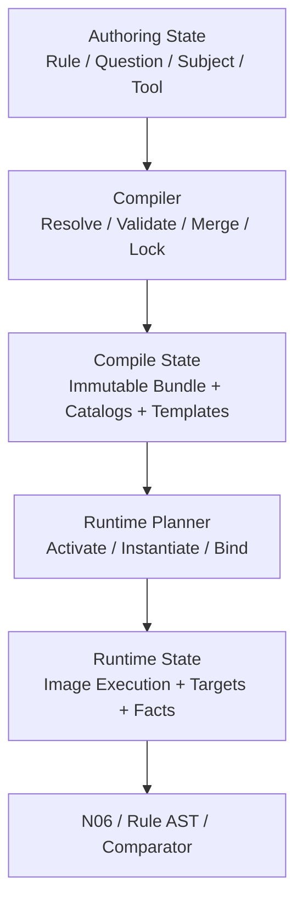
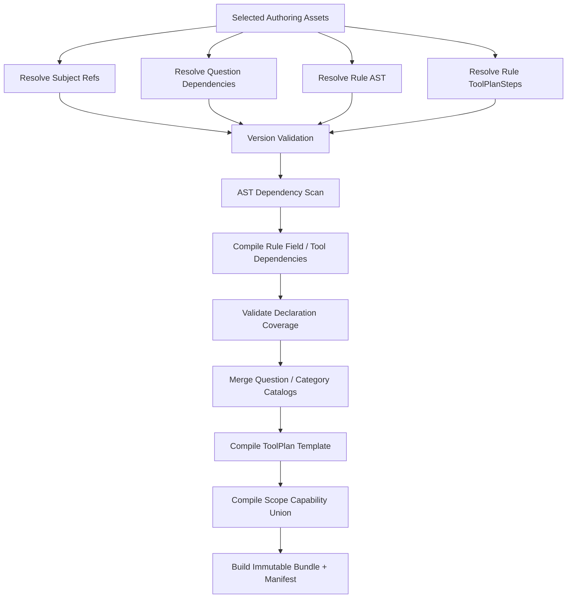

# D05 Technical Contracts — Batch 01 R2.2.2

> 文档类型：Technical Contract  
> 基线版本：R2.2.1  
> 修订版本：R2.2.2  
> 状态：Frozen — Errata Revision  
> 适用基线：D03 Domain Model Amendment V1.1  
> 核心范围：V11-O05、V11-O03、V11-O04

---

# R2.2.1 → R2.2.2 Revision Changelog

| ID | 涉及章节 | 修订内容 |
|---|---|---|
| P1-1 | 0.4.1、0.4.3、0.4.5 | Clean Frame 路径 B 改为以 Planner 的 Rule-Target Evaluation Set 为空为判断依据；无论 N03 是否定位到其他主体，均跳过 Rule 工具 |
| P1-2 | 3.3.1、3.3.2、3.4.1–3.4.6、11.7、12.1 | 统一 `source_rule_ids`；编译期和运行期去重均纳入 `precondition_digest` |
| P1-3 | 4.3、5.3、6.4、12.2 | 明确 Category 级隔离、Target 级失败和图像级失败的边界；TargetASTSummary 按 Category : Rule = 1:1 直接分桶 |
| P1-4 | 6.3、6.4、12.2 | 补齐 Comparator 状态机死区，明确多 Rule 不确定性谓词、Non-violation 一致性及 Top-K 判定 |
| P1-5 | 10.6、12.5 | 删除 `N04_RETRY_EXHAUSTED` 独立错误码，改为根因错误码 + `retry_exhausted` 运维状态 |
| P1-6 | 12.1、12.2、12.5 | 增加工具去重、TARGET 精确绑定、Category 隔离、Comparator 和 Clean Frame 验收用例 |
| P1-7 | 14.4 | 更新最终架构原则 36、42 |

**未改变的冻结约束：**

- D05-B01-01 ～ D05-B01-18。
- Authoring / Compile / Runtime 三态分层。
- Category : Rule = 1:1。
- TargetKind 仅 OBJECT / OBJECT_GROUP。
- N04 / N05 并行。
- N06 必须消费 N04 Observation Facts 和 N05 Tool Facts。
- N06 / Rule AST 双路径独立判断。
- N04 Retry 不重复执行 N05。
- D03 Domain Model Amendment V1.1 不变。
- Subject / Question / Tool 三类版本冲突阻断。

---

# 0. Architecture Overview

## 0.1 设计目标

本批技术契约解决三个核心问题：

| 编号 | 契约 | 目标 |
|---|---|---|
| V11-O05 | N05 / N06 Dependency | 明确工具事实与违规类别判断的依赖关系 |
| V11-O03 | N04 Joint Observation | 建立确定性的多 Question 联合观察 Schema |
| V11-O04 | Fact Completeness | 建立事实状态、对账、失败传播和 AST 消费协议 |

同时建立全局三态数据契约。

## 0.2 全局三态分层铁律

所有数据结构、Schema、引用关系和执行配置必须严格归属以下三层之一。

### A. Authoring State：声明态

归属：

- Subject Definition
- Question Definition
- Rule Definition
- Tool Capability Definition
- Prompt Master / Shared Component

职责：表达单资产的业务语义、能力定义和局部依赖意图。

允许：

- 资产自身 ID / Version / Content Hash。
- 对其他资产的精确版本引用。
- 单资产内部 Prompt / Schema / AST。
- Rule 对 Subject / Question / Tool 的局部引用。
- Rule 自身 ToolPlanSteps 声明。

禁止：

- 跨 Rule 合并结果。
- Bundle 级 Question / Category Catalog。
- 跨 Rule Scope Union。
- 编译生成的 ToolPlan。
- `image_execution_id`。
- `target_instance_id`。
- 单图 Task Index、Fact、Invocation、Attempt。

### B. Compile State：编译态

归属：

- Immutable Algorithm Bundle
- CompiledRuleSpecs
- BundleQuestionCatalog
- BundleCategoryCatalog
- CompiledRuleQuestionBinding
- CompiledRuleFieldDependency
- CompiledRuleToolDependency
- CompiledToolPlanTemplate
- Compiled Scope Capability
- ModelBinding / Renderer / Adapter Lock
- Bundle Manifest

职责：对声明态资产进行确定性解析、校验、合并、去重、版本锁定和索引固定。

允许：

- 多 Rule 组合。
- 跨 Rule Question Definition 去重。
- 跨 Rule ToolPlan 合并。
- Category / Rule 映射校验。
- Scope Capability Union。
- AST 静态依赖索引。
- 固定 Question / Category Catalog Index。
- 编译摘要和 Content Hash。

禁止：

- `image_execution_id`。
- 运行期 Object / Object Group ID。
- 单图 Target Instance。
- 单图 Observation Fact / Tool Fact。
- 单图 Invocation / Attempt ID。

### C. Runtime State：运行态

归属：

- Image Execution Context
- TargetPlanningSnapshot
- TargetInstance
- ObservationTask Catalog
- ExecutableToolPlan
- N04 / N05 / N06 Execution
- ObservationEnvelope
- ToolExecutionEnvelope
- RuleJudgment
- TargetASTSummary
- DecisionComparison
- Evidence Bundle

职责：根据当前图像、Bundle 编译产物、N02 命中结果和 N03 定位结果实例化执行任务。

允许：

- `image_execution_id`。
- `target_instance_id`。
- 运行期 Target Index。
- 编译态静态 Catalog 引用。
- 运行期 Task / ToolPlan Entry。
- Fact、Invocation、Attempt。
- 执行状态及对账结果。

### 0.2.1 三态依赖关系



### 0.2.2 强制约束

1. Authoring 不保存跨 Rule 合并态。
2. Compile 不保存单图运行实例。
3. Runtime 不重新解析声明态资产来动态拼装 Bundle。
4. Runtime 不修改编译态 Catalog Index。
5. Runtime 只能激活编译态允许的 Rule / Question / Category / Tool。
6. 跨层数据通过明确的 Projection、Reference 或 Snapshot 转换。
7. 相同声明态输入、Compiler Version 和编译策略必须产生确定性的编译态结果。
8. 相同 Bundle 与相同 Runtime 输入必须产生相同 Planner 任务结构。

## 0.3 核心架构决定

以下 18 项保持冻结：

| ID | 冻结决定 |
|---|---|
| D05-B01-01 | N06 必须消费 N04 Observation Facts 和 N05 Tool Facts |
| D05-B01-02 | N04 与 N05 在 N03 完成后并行执行 |
| D05-B01-03 | N06 必须等待 N04 最终 Attempt 和 N05 最终执行结果 |
| D05-B01-04 | Rule AST 独立消费 N04 Observation Facts 和 N05 Tool Facts |
| D05-B01-05 | N06-JEV 与 Rule AST 是两套独立判断机制 |
| D05-B01-06 | Decision Comparator 在 Target 级比较两套判断 |
| D05-B01-07 | N06 的类别判断不得作为 Rule AST 的执行白名单 |
| D05-B01-08 | N04 Raw Model Output 与 Runtime Envelope 分离 |
| D05-B01-09 | N04 Fact 去重键为 `(target_instance_id, question_id)` |
| D05-B01-10 | Rule AST 的事实依赖下沉到 Field 级 |
| D05-B01-11 | Required Fact Failure 优先于 Boolean Short-Circuit |
| D05-B01-12 | N04 Retry 不触发 N05 重复执行 |
| D05-B01-13 | N04 最终失败时整图返回推理失败 |
| D05-B01-14 | Category 与 Rule 固定为 1:1 映射 |
| D05-B01-15 | N06 输出 Target-level Category Ranking |
| D05-B01-16 | Rule AST 输出 Rule-level Judgment，并产生 TargetASTSummary |
| D05-B01-17 | TargetKind 仅支持 OBJECT / OBJECT_GROUP |
| D05-B01-18 | N05 允许产生 Target-independent 的全图共享 Tool Facts |

## 0.4 Clean Frame：零命中 / 零有效评估短路契约

### 0.4.1 定义

Clean Frame 表示当前图像没有形成任何有效违规评估任务。

必须区分：

- **路径 A：** N02 零 Rule 命中。
- **路径 B：** N02 有 Rule 命中，但 Planner 生成的 `rule_target_evaluations` 为空。

路径 B 涵盖：

1. N03 零 Target。
2. N03 检出一个或多个 Target，但这些 Target 均不匹配命中 Rule 的 `applicable_subject_refs`。

不能仅依据 N03 是否检出 Target 判断是否存在有效违规评估任务。

### 0.4.2 路径 A：N02 零 Rule 命中

条件：

```python
len(matched_rule_set) == 0
```

处理：

1. N02 正常完成。
2. 生成空 Matched Rule Set。
3. N03 标记 `SKIPPED_CLEAN_FRAME`。
4. Planner 生成空 Target Candidate Set。
5. Planner 生成空 Rule-Target Evaluation Set。
6. N04 跳过。
7. N05 跳过所有 Rule 声明的工具步骤。
8. N06 跳过。
9. Rule AST 跳过。
10. Comparator 跳过。
11. 直接生成零违规成功结果。

### 0.4.3 路径 B：N02 命中 Rule，但有效评估集为空

条件：

```python
len(matched_rule_set) > 0 and len(rule_target_evaluations) == 0
```

处理：

1. N02 正常完成。
2. N03 正常完成，可能产生零个或多个 Target。
3. Planner 校验 `applicable_subject_refs`。
4. Planner 生成空 `rule_target_evaluations`。
5. N04 跳过。
6. N05 跳过所有 Rule 声明的工具步骤，包括 GLOBAL 与 TARGET。
7. N06 跳过。
8. Rule AST 跳过。
9. Comparator 跳过。
10. 直接生成零违规成功结果。

N02 命中 Rule 且 N03 检出无关主体，不构成有效违规评估实例，不得触发任何 Rule 级工具执行。

### 0.4.4 BundleSceneHooks

Bundle 允许定义与违规裁决无关的帧级旁路能力：

```python
class SceneHookScope(StrEnum):
    FRAME = "frame"
    SCENE = "scene"


@dataclass(frozen=True)
class BundleSceneHook:
    hook_id: str
    hook_version: str
    scope: SceneHookScope
    execution_ref: str
    required: bool
```

示例：

- 图像脱敏。
- 场景打标。
- 非违规裁决所需的通用图像预处理。

BundleSceneHooks 不属于 Rule ToolPlan。

Rule 声明的 `tool_scope=GLOBAL` 工具仍然属于 Rule ToolPlan，Clean Frame 时必须跳过。

BundleSceneHooks 的执行由其自身策略控制，不改变 Clean Frame 的零违规语义。

### 0.4.5 返回结果

```json
{
  "image_execution_id": "img-exec-001",
  "status": "succeeded",
  "execution_outcome": "clean_frame",
  "violation_count": 0,
  "target_count": 0,
  "rule_evaluation_count": 0,
  "reason": "NO_MATCHED_RULES_OR_NO_ACTIVE_EVALUATIONS"
}
```

当路径 B 由 N03 检出目标但主体不匹配触发时：

- `target_count` 保留 N03 实际产生的 TargetInstance 数量。
- `rule_evaluation_count` 必须为 0。

### 0.4.6 空执行轨迹

必须记录：

- Image Execution ID。
- Bundle ID / Version / Digest。
- N02 命中结果。
- N03 是否执行及结果。
- Planner Version。
- 空或非空 Target Candidate Set Hash。
- 空 Rule-Target Evaluation Set Hash。
- 各节点 Skip 原因。
- BundleSceneHooks 执行情况。
- 最终 Inference Result。

Clean Frame 是正常成功路径，不是失败路径。

## 0.5 Image Quality Policy

`ImageQualityStatus.DEGRADED` 的放行策略由 Bundle 编译态 `ImageQualityPolicy` 决定。

```python
class DegradedImageAction(StrEnum):
    CONTINUE = "continue"
    REJECT = "reject"


@dataclass(frozen=True)
class ImageQualityPolicy:
    policy_version: str
    degraded_action: DegradedImageAction
    minimum_resolution: tuple[int, int] | None
    minimum_usable_area_ratio: float | None
    allowed_blur_range: tuple[float, float] | None
    allowed_occlusion_ratio: float | None
    content_hash: str


class ImageQualityStatus(StrEnum):
    ACCEPTED = "accepted"
    DEGRADED = "degraded"
    REJECTED = "rejected"
```

| 状态 | Bundle Policy | 行为 |
|---|---|---|
| ACCEPTED | 任意 | 正常进入后续流程 |
| DEGRADED | CONTINUE | 允许继续，记录质量降级 |
| DEGRADED | REJECT | 返回 REJECTED |
| REJECTED | 任意 | 停止违规推理 |

图像质量拒识不属于 N04 推理故障。

---

# 1. Target Identity and Category Mapping

## 1.1 TargetKind

```python
class TargetKind(StrEnum):
    OBJECT = "object"
    OBJECT_GROUP = "object_group"
```

不引入 IMAGE、SCENE 或 GLOBAL_TARGET。

全图级工具执行结果与违规裁决目标是两个不同概念。

## 1.2 大面积违规的目标表达

积水、大面积垃圾、施工区、烟雾等具有空间范围的异常，仍然属于标准 Target。

由 N03 负责定位：

| 场景 | N03 输出 |
|---|---|
| 局部积水 | OBJECT |
| 大面积积水 | 大尺寸 OBJECT Box |
| 多块垃圾组成的整体 | OBJECT_GROUP |
| 施工区域 | OBJECT 或 OBJECT_GROUP |
| 烟雾区域 | OBJECT Box |
| 多个烟雾区域 | OBJECT_GROUP 或多个 OBJECT |

不允许因为目标范围较大，就绕过 N03 使用 IMAGE Target。

目标定位必须保留空间证据和 Grounding Provenance。

## 1.3 图像质量前置门禁

以下问题不进入 N03–N06 违规裁决链路：

- 镜头遮挡。
- 图像严重模糊。
- 黑屏。
- 图像损坏。
- 图像不可用。
- 图像质量不满足最低观察条件。

这些问题归属于 N01 / N02 的图像质量前置检查。

DEGRADED 的处理使用 Bundle 编译态 ImageQualityPolicy。

---

# 2. Violation Category 与 Rule Mapping

## 2.1 一对一关系

**One Violation Category = One Rule**

Category 与 Rule 固定 1:1。

Category 是 N06 分类输出和业务结果展示使用的稳定类别标识，不额外建立第五个核心领域资产。

Rule 是该类别的权威定义。

声明态 Rule Definition：

```python
@dataclass
class RuleDefinition:
    rule_id: str
    version: str
    category_id: str

    name: str
    description: str

    applicable_subject_refs: tuple["AssetVersionRef", ...]

    question_dependencies: tuple["QuestionDependency", ...]

    tool_plan_steps: tuple["ToolPlanStepDefinition", ...]

    candidate_definition: dict
    ast_definition: dict

    content_hash: str
```

Category 与 Rule 必须双向唯一：

```text
category_id -> exactly one rule_id
rule_id     -> exactly one category_id
```

## 2.2 Category Mapping

Category Mapping 是 Compiler 从 Rule Definition 生成的只读映射投影。

```python
@dataclass(frozen=True)
class CategoryRuleBinding:
    category_id: str
    rule_ref: "AssetVersionRef"
```

不建立独立 Category Registry 写入入口。

---

# 3. V11-O05：N05 / N06 Dependency Contract

## 3.1 N06 与 N05 的关系

N06 必须消费 N04 Observation Facts 和 N05 Tool Facts。

N04 与 N05 在 N03 完成后并行执行。

N06 和 Rule AST 在各自输入准备完成后独立执行。

N05 不消费 N04 Observation Facts。

## 3.2 N05 ToolPlan 三态结构

```text
Authoring
RuleDefinition.tool_plan_steps
          |
          v
Compile
CompiledToolPlanTemplate
          |
          v
Runtime
ExecutableToolPlan / ToolPlanEntry
```

### 3.2.1 Authoring：Rule ToolPlanSteps

```python
class ToolScope(StrEnum):
    GLOBAL = "global"
    TARGET = "target"


@dataclass(frozen=True)
class ToolPlanStepDefinition:
    step_key: str
    tool_ref: "AssetVersionRef"
    tool_scope: ToolScope
    input_binding: dict
    precondition_expression: dict | None
    depends_on_step_keys: tuple[str, ...]
```

字段语义：

| 字段 | 语义 |
|---|---|
| step_key | Rule 内部稳定步骤标识 |
| tool_ref | 精确锁定 Tool Capability |
| tool_scope | GLOBAL / TARGET |
| input_binding | 工具输入绑定表达 |
| precondition_expression | 工具执行前置条件 |
| depends_on_step_keys | 当前 Rule 内的工具步骤依赖 |

`ToolPlanStepDefinition` 不包含：

- `required_fact_keys`。
- `target_instance_id`。
- `image_execution_id`。
- Tool Run ID。
- Runtime Entry ID。

工具产出完整性由 Tool Capability Output Schema 决定。

Rule 对某个 Tool Fact 是否 Required，由 Compiler 从 Rule AST 静态扫描生成 `CompiledRuleToolDependency`。

## 3.3 Compiler：CompiledToolPlanTemplate

### 3.3.1 编译态结构

```python
@dataclass(frozen=True)
class CompiledToolPlanStep:
    template_step_id: str

    tool_ref: "AssetVersionRef"

    tool_scope: ToolScope

    input_binding: dict
    param_digest: str

    precondition_expression: dict | None
    precondition_digest: str

    dependency_template_step_ids: tuple[str, ...]

    expected_output_fact_keys: tuple[str, ...]

    source_rule_ids: tuple[str, ...]


@dataclass(frozen=True)
class CompiledToolPlanTemplate:
    steps: tuple[CompiledToolPlanStep, ...]

    compiled_tool_plan_digest: str

    compiler_version: str
```

禁止包含：

- `required_fact_keys`。
- `image_execution_id`。
- `target_instance_id`。
- `tool_run_id`。
- 运行期 Entry ID。
- 单图执行状态。

`expected_output_fact_keys` 只描述 Tool Capability 预期产出的事实键，不承担 Rule 级 Required / Optional 语义。

### 3.3.2 编译期去重键

```python
compiled_step_dedup_key = (
    tool_id,
    tool_scope,
    param_digest,
    precondition_digest,
)
```

`precondition_digest` 由规范化后的 `precondition_expression` 计算。

无前置条件时使用固定空摘要：

```python
NO_PRECONDITION_DIGEST = sha256(
    canonical_json(None)
)
```

必须保证规范化和 Hash 算法固定。

**相同 Tool、相同参数，但前置条件不同，不得合并为同一个编译态步骤。**

例如：

```text
Rule A:
  Tool = SAM3
  Params = P1
  Precondition = subject_type == bicycle

Rule B:
  Tool = SAM3
  Params = P1
  Precondition = subject_type == goods
```

两者参数摘要相同，但前置条件摘要不同，必须生成两个独立 CompiledToolPlanStep。

合并时：

- 合并 `source_rule_ids`。
- 合并合法依赖来源。
- 保留工具版本锁定。
- 不改变 Rule 原始依赖关系。

`expected_output_fact_keys` 只来自 Tool Capability Output Schema，不参与 Rule Required 判断。

### 3.3.3 依赖映射

Compiler 将 Rule 局部 step 依赖映射为编译态步骤依赖。

Compiler 必须验证：

1. 每个 step_key 唯一且在 Rule 内可解析。
2. 每个 dependency step_key 存在。
3. 依赖步骤与当前 Rule 所属关系合法。
4. 编译后 DAG 无环。
5. Tool Version 精确匹配。
6. 输出 Fact Schema 满足 Tool Capability 定义。
7. 合并后没有产生自依赖。
8. 不存在非法跨 Rule 局部 step 引用。

存在环时：

```text
TOOL_PLAN_CYCLE
```

必须阻断 Bundle 编译。

## 3.4 Runtime：Planner 实例化 ExecutableToolPlan

Planner 只消费编译态只读视图：

- CompiledToolPlanTemplate。
- CompiledRuleSpecs。
- N02 Matched Rule Set。
- N03 TargetInstance Catalog。
- Rule-Target Evaluation Set。

### 3.4.1 步骤激活

只有存在有效 Rule-Target Evaluation 的来源 Rule 才能激活对应步骤。

```python
active_evaluated_rule_ids = {
    evaluation.rule_ref.asset_id
    for evaluation in rule_target_evaluations
}
```

仅当：

```python
set(step.source_rule_ids) & active_evaluated_rule_ids
```

非空时，步骤才进入当前 Image Execution。

若 `rule_target_evaluations` 为空，直接走 Clean Frame 路径 B，生成空 ExecutableToolPlan。

### 3.4.2 TARGET / GLOBAL 实例化

```python
def resolve_target_bindings(
    step: CompiledToolPlanStep,
    rule_target_evaluations: tuple["RuleTargetEvaluation", ...],
) -> tuple[str | None, ...]:

    active_evaluated_rule_ids = {
        evaluation.rule_ref.asset_id
        for evaluation in rule_target_evaluations
    }

    active_source_rules = (
        set(step.source_rule_ids) & active_evaluated_rule_ids
    )

    if not active_source_rules:
        return ()

    if step.tool_scope == ToolScope.GLOBAL:
        return (None,)

    targets = {
        evaluation.target_instance_id
        for evaluation in rule_target_evaluations
        if evaluation.rule_ref.asset_id in active_source_rules
    }

    return deterministic_sort(targets)
```

TARGET 工具只能绑定其来源命中 Rule 对应的 Rule-Target Evaluation Targets。

禁止将未命中 Rule 对应的 N03 Target 绑定到共享 TARGET 工具步骤。

例如：

```text
Rule A → bicycle
Rule B → goods

Matched Rules = {Rule A}
```

共享 TARGET 工具只允许绑定 Rule A 对应的有效 Target，不得因为 N03 同时定位到 goods，就将 goods Target 一并绑定。

### 3.4.3 运行期去重键

```python
runtime_tool_dedup_key = (
    target_instance_id,
    tool_id,
    input_binding_hash,
    precondition_digest,
)
```

相同运行期去重键只执行一次。

`precondition_digest` 必须参与运行期去重，禁止将前置条件不同的 CompiledToolPlanStep 错误合并为单个 ToolPlanEntry。

### 3.4.4 ToolPlanEntry

```python
@dataclass(frozen=True)
class ToolPlanEntry:
    entry_id: str

    template_step_id: str

    tool_ref: "AssetVersionRef"

    target_instance_id: str | None

    input_binding: dict
    input_binding_hash: str

    precondition_expression: dict | None
    precondition_digest: str

    dependency_entry_ids: tuple[str, ...]
```

不包含 `required` 或 `required_fact_keys`。

`entry_id` 是当前 Image Execution 的唯一运行步骤身份。

### 3.4.5 ExecutableToolPlan

```python
@dataclass(frozen=True)
class ExecutableToolPlan:
    image_execution_id: str

    compiled_tool_plan_digest: str

    runtime_tool_plan_hash: str

    entries: tuple[ToolPlanEntry, ...]
```

该结构只属于 Runtime。

### 3.4.6 两类哈希

| 哈希 | 所属层 | 作用 |
|---|---|---|
| compiled_tool_plan_digest | Compile | 固定 Bundle 工具模板及编译态依赖 |
| runtime_tool_plan_hash | Runtime | 固定当前图像实例化后的执行步骤及输入绑定 |

```text
compiled_tool_plan_digest =
Hash(
    sorted compiled steps
    + tool versions
    + dependency DAG
    + source Rule IDs
    + parameter digests
    + precondition digests
)
```

```text
runtime_tool_plan_hash = Hash(
    compiled_tool_plan_digest
    + image_execution_id
    + instantiated entries
    + target bindings
    + input_binding_hashes
    + precondition_digests
)
```

两类 Hash 必须分别记录，不得互相替代。

## 3.5 Rule Tool Fact Dependencies：AST 单一真相源

声明态 Rule 不人工维护第二份工具事实依赖列表。

Compiler 扫描 Rule AST 中的 Tool Fact References，生成：

```python
@dataclass(frozen=True)
class CompiledRuleToolDependency:
    rule_ref: "AssetVersionRef"

    tool_ref: "AssetVersionRef"

    fact_key: str

    target_scope: str

    required: bool

    source_ast_path: str
```

`required` 来自 Rule AST 中对应 Fact Reference 的声明语义。

Compiler 必须检查：

1. AST 引用的 Tool ID 已被 Rule 的 ToolPlanSteps 声明。
2. AST 引用的 Fact Key 存在于 Tool Capability Output Schema。
3. AST 所要求的 Target Scope 与 ToolPlanStep Scope 兼容。
4. AST 的 GLOBAL Fact 引用必须指向 GLOBAL Tool Scope。
5. AST 的 TARGET Fact 引用必须能够实例化到有效 Target。
6. 每个 Tool Fact Reference 都能够映射到具体 ToolPlanStep。
7. 不允许 AST 引用未声明的 Tool Fact。
8. 不允许 ToolPlanStep 声明的工具版本与 AST 解析版本不一致。

违规时阻断：

```text
UNDECLARED_TOOL_FACT
TOOL_FACT_SCHEMA_MISMATCH
TOOL_SCOPE_MISMATCH
TOOL_DEPENDENCY_UNRESOLVED
```

### 工具输出完整性与 Rule Required 语义分离

工具执行产出完整性依据：

- Tool Capability Output Schema。
- 编译态派生的 `expected_output_fact_keys`。

Rule 的失败传播依据：

- `CompiledRuleToolDependency.required`。

| 机制 | 解决的问题 |
|---|---|
| expected_output_fact_keys | 工具是否完整产生其声明输出 |
| CompiledRuleToolDependency.required | 某条 Rule 是否必须消费该事实 |

共享工具步骤可以被多个 Rule 复用，但各 Rule 的 Required 语义独立。

## 3.6 N05 强类型状态

```python
class ToolExecutionStatus(StrEnum):
    PLANNED = "planned"
    RUNNING = "running"

    SUCCEEDED = "succeeded"
    SUCCEEDED_NO_FACT = "succeeded_no_fact"

    SKIPPED_PRECONDITION_UNMET = (
        "skipped_precondition_unmet"
    )

    FAILED = "failed"
    PLAN_ERROR = "plan_error"


class PreconditionStatus(StrEnum):
    SATISFIED = "satisfied"
    NOT_SATISFIED = "not_satisfied"
    UNKNOWN = "unknown"
    INVALID = "invalid"


class ToolFactStatus(StrEnum):
    KNOWN = "known"
    UNKNOWN = "unknown"
    ERROR = "error"


class N05ExecutionStatus(StrEnum):
    PLANNED = "planned"
    RUNNING = "running"

    COMPLETED = "completed"
    PARTIAL_FAILED = "partial_failed"

    FAILED = "failed"
    SKIPPED = "skipped"


N05_TERMINAL_STATES = frozenset({
    N05ExecutionStatus.COMPLETED,
    N05ExecutionStatus.PARTIAL_FAILED,
    N05ExecutionStatus.FAILED,
    N05ExecutionStatus.SKIPPED,
})
```

## 3.7 ToolFactRecord 与 ToolExecutionEnvelope

```python
@dataclass(frozen=True)
class ToolFactRecord:
    fact_id: str

    target_instance_id: str | None

    tool_ref: "AssetVersionRef"

    fact_key: str
    value: object | None

    fact_status: ToolFactStatus

    provenance: dict


@dataclass(frozen=True)
class ToolExecutionOutcome:
    entry_id: str
    tool_run_id: str

    tool_ref: "AssetVersionRef"

    target_instance_id: str | None

    status: ToolExecutionStatus

    output_fact_refs: tuple[str, ...]

    precondition_result: PreconditionStatus | None

    error_code: str | None
    error_message: str | None


@dataclass(frozen=True)
class ToolExecutionEnvelope:
    image_execution_id: str

    compiled_tool_plan_digest: str
    runtime_tool_plan_hash: str

    execution_status: N05ExecutionStatus

    outcomes: tuple[ToolExecutionOutcome, ...]

    facts: tuple[ToolFactRecord, ...]
```

全图共享事实：

```text
target_instance_id = None
```

表示生产范围是当前图像共享上下文，不产生虚拟 Target。

## 3.8 N05 运行态完成条件

N05 必须覆盖 ExecutableToolPlan 中全部 Entry。

| Entry 执行情况 | N05ExecutionStatus |
|---|---|
| 全部成功或有效空结果 | COMPLETED |
| 没有执行步骤 | SKIPPED |
| 部分成功、部分失败 | PARTIAL_FAILED |
| 全部失败或 ToolPlan 整体非法 | FAILED |
| 尚有步骤执行中 | RUNNING |

GLOBAL Tool 与 TARGET Tool 之间的依赖必须保留在 Runtime DAG 中。

## 3.9 工具状态传播

| N05 Entry 状态 | N06 | Rule AST |
|---|---|---|
| SUCCEEDED | 正常使用 Fact | 正常使用 Fact |
| SUCCEEDED_NO_FACT | 有效空结果 | 有效空结果 |
| SKIPPED_PRECONDITION_UNMET | 不适用状态 | 根据自身依赖条件处理 |
| FAILED | 标记证据不完整 | 按 CompiledRuleToolDependency.required 处理 |
| PLAN_ERROR | 计划异常 | 对应依赖 FAILED |

---

# 4. Target-level N06 Judgment

## 4.1 判断粒度

N06 以 Target 为主要输出粒度。

每个 Target 输出：

- 候选违规类别排序列表。
- Rank。
- Score。
- Reasoning。
- 视觉证据引用。
- Observation Fact 引用。
- Tool Fact 引用。
- Non-violation Score。
- Top Verdict。

允许同一 Target 对应多个候选违规类别。

## 4.2 N06RawModelOutput

```python
class TopVerdict(StrEnum):
    VIOLATION = "violation"
    NON_VIOLATION = "non_violation"
    UNCERTAIN = "uncertain"


@dataclass(frozen=True)
class RawRankedCategory:
    category_index: int

    rank: int
    score: float

    reasoning: str

    visual_evidence_indices: tuple[int, ...]
    observation_evidence_indices: tuple[int, ...]
    tool_evidence_indices: tuple[int, ...]


@dataclass(frozen=True)
class RawTargetJEVResult:
    target_index: int

    ranked_categories: tuple[RawRankedCategory, ...]

    non_violation_score: float

    top_verdict: TopVerdict


@dataclass(frozen=True)
class N06RawModelOutput:
    results: tuple[RawTargetJEVResult, ...]
```

模型不返回：

- Image Execution ID。
- Target Instance ID。
- Rule Version。
- Evidence Completeness。
- Tool Execution Status。
- Runtime Invocation ID。
- Attempt ID。

这些由 Runtime 还原。

## 4.3 静态 Category Catalog 与运行期激活范围

N06 的 `category_index` 必须绑定 Bundle 编译态完整 `BundleCategoryCatalog`。

不得根据当前 N02 命中 Rule 动态重新编号。

编译态：

```text
BundleCategoryCatalog
  C0 → category_A
  C1 → category_B
  C2 → category_C
  C3 → category_D
```

运行态：

```text
Active Rule-Target Evaluation Set
  O1 → category_A
  O1 → category_C
  O2 → category_B
```

如果 N06 输出当前 Target 不在激活集合中的 Category：

### 情况 A：Catalog 内但未激活

- 隔离该条 Category 结果。
- 记录 `CATEGORY_OUT_OF_ACTIVE_SCOPE`。
- 保留原始模型输出用于审计。
- 该 Target 的其他合法类别正常进入 Comparator。

### 情况 B：Catalog 外非法索引

- 该 Target 整体标记 `ComparisonStatus.JEV_FAILED`。
- 不参与该 Target 的正常类别比较。
- 其他合法 Target 继续比较。

Category 级未激活越界不得升级为 Target 级失败。

## 4.4 Category Ranking 约束

每个 Target：

- 只允许当前 Bundle Category Catalog 中的类别。
- Rank 必须唯一。
- Score 必须在合法范围。
- 同一 Category 不允许重复。
- Non-violation Score 必须存在。
- Top Verdict 必须存在。
- 所有证据索引必须映射到输入证据 Catalog。
- 类别必须属于该 Target 的 Active Evaluation Set。

同一 Target 内出现重复类别、Rank / Score 越界或非法证据索引，均属于 Target 级结构违约。

## 4.5 TargetJEVJudgment

```python
class EvidenceCompleteness(StrEnum):
    COMPLETE = "complete"
    PARTIAL = "partial"
    UNAVAILABLE = "unavailable"


@dataclass(frozen=True)
class CategoryEvidenceStatus:
    category_id: str

    completeness: EvidenceCompleteness

    required_observation_refs: tuple[str, ...]
    required_tool_fact_refs: tuple[str, ...]

    unavailable_fact_refs: tuple[str, ...]
    skipped_fact_refs: tuple[str, ...]


@dataclass(frozen=True)
class CategoryScore:
    category_id: str

    rank: int
    score: float

    reasoning: str

    visual_evidence_refs: tuple[str, ...]
    observation_fact_refs: tuple[str, ...]
    tool_fact_refs: tuple[str, ...]

    evidence_status: CategoryEvidenceStatus


@dataclass(frozen=True)
class TargetJEVJudgment:
    target_instance_id: str
    target_kind: str

    ranked_categories: tuple[CategoryScore, ...]

    non_violation_score: float

    top_verdict: TopVerdict

    image_execution_id: str
    invocation_id: str
```

Evidence Completeness 必须按候选类别计算。

Runtime 根据 N04 / N05 最终 Envelope 和 CompiledRuleSpecs 确定性计算。

模型不得自报完整性。

---

# 5. Rule AST：Rule-level Judgment

## 5.1 底层求值粒度

保持：

\[
(rule\_id,target\_instance\_id)
\rightarrow RuleJudgment
\]

每条 Rule 独立执行。

不允许一条 Rule 的 Fact Failure 直接导致其他 Rule 失败。

## 5.2 RuleJudgment

```python
class RuleJudgmentStatus(StrEnum):
    TRIGGERED = "triggered"
    NON_TRIGGERED = "non_triggered"
    UNCERTAIN = "uncertain"
    FAILED = "failed"


@dataclass(frozen=True)
class RuleJudgment:
    rule_ref: "AssetVersionRef"

    category_id: str

    target_instance_id: str

    status: RuleJudgmentStatus

    consumed_fact_refs: tuple[str, ...]
    unavailable_fact_refs: tuple[str, ...]

    rule_trace_ref: str

    error_code: str | None

    image_execution_id: str
```

状态语义：

| Status | 含义 | error_code |
|---|---|---|
| TRIGGERED | 规则确定性触发 | None |
| NON_TRIGGERED | 规则确定性未触发 | None |
| UNCERTAIN | 合法事实不足以形成确定结论 | None |
| FAILED | 规则执行失败 | 必须提供 |

Required Fact 缺失、非法或不可用时：

```text
RuleJudgment.status = FAILED
RuleJudgment.error_code = REQUIRED_FACT_UNAVAILABLE
```

不得将 FAILED 同时标记为 UNCERTAIN。

## 5.3 TargetASTSummary

```python
@dataclass(frozen=True)
class TargetASTSummary:
    target_instance_id: str
    image_execution_id: str

    triggered_categories: tuple[str, ...]
    non_violation_categories: tuple[str, ...]
    uncertain_categories: tuple[str, ...]
    failed_categories: tuple[str, ...]

    rule_judgment_refs: tuple[str, ...]

    category_coverage: dict
```

Category 与 Rule 严格为 1:1 映射。

每个 `(category_id, target_instance_id)` 仅对应唯一一条底层 RuleJudgment。

直接按 RuleJudgment.status 分桶：

1. TRIGGERED → `triggered_categories`。
2. NON_TRIGGERED → `non_violation_categories`。
3. UNCERTAIN → `uncertain_categories`。
4. FAILED → `failed_categories`。

不存在多规则覆盖优先级。

`rule_judgment_refs` 保留底层审计引用。

---

# 6. Decision Comparator：Target-level Comparison

## 6.1 对齐主键

```python
comparison_key = (
    image_execution_id,
    target_instance_id,
)
```

Comparator 比较：

- N06 Target-level Category Ranking。
- TargetASTSummary。

底层保留 `per_category_diffs`。

## 6.2 DecisionComparison

```python
class ComparisonStatus(StrEnum):
    AGREE_TOP1 = "agree_top1"
    AGREE_NON_VIOLATION = "agree_non_violation"
    AGREE_TOPK_RANK_DIFF = "agree_topk_rank_diff"

    CATEGORY_CONFLICT = "category_conflict"
    EXISTENCE_CONFLICT = "existence_conflict"

    AST_PARTIAL_FAILED = "ast_partial_failed"
    AST_FAILED = "ast_failed"

    JEV_MISSING_TARGET = "jev_missing_target"
    JEV_FAILED = "jev_failed"
    AST_MISSING = "ast_missing"
    BOTH_MISSING = "both_missing"

    JEV_UNCERTAIN = "jev_uncertain"
    AST_UNCERTAIN = "ast_uncertain"
    BOTH_UNCERTAIN = "both_uncertain"

    CATEGORY_SET_PARTIAL_MATCH = "category_set_partial_match"


@dataclass(frozen=True)
class CategoryDiff:
    category_id: str

    jev_rank: int | None
    jev_score: float | None

    ast_status: RuleJudgmentStatus | None

    rule_judgment_ref: str | None

    diff_type: str


@dataclass(frozen=True)
class DecisionComparison:
    image_execution_id: str
    target_instance_id: str

    comparison_status: ComparisonStatus

    jev_top_verdict: TopVerdict | None

    jev_ranked_categories: tuple[str, ...]
    jev_active_categories: tuple[str, ...]

    ast_triggered_categories: tuple[str, ...]
    ast_non_violation_categories: tuple[str, ...]
    ast_uncertain_categories: tuple[str, ...]
    ast_failed_categories: tuple[str, ...]

    category_coverage: dict

    per_category_diffs: tuple[CategoryDiff, ...]

    needs_review: bool
```

## 6.3 有效违规候选集

Comparator 不使用原始完整排序列表直接进行集合判断。

先由 Ranking Policy 产生：

\[
J_{active}=RankingPolicy(ranked\_categories)
\]

Ranking Policy 包含：

- Top-K 截断。
- 最低候选分数阈值。
- Category 激活范围检查。

当：

```python
top_verdict == TopVerdict.NON_VIOLATION
```

时，RankingPolicy 必须产出空 `J_active`：

\[
J_{active}=()
\]

如果 RankingPolicy 独立于 `top_verdict` 截断并产出非空 `J_active`，视为 Target 级语义矛盾，在 Priority 5 判定为 `JEV_FAILED`。

定义：

\[
J=J_{active}
\]

\[
A=AST_{triggered}
\]

## 6.4 Comparator 判定优先级

必须采用固定优先级，确保每个 Target 只有一个主状态。

### Priority 0：Identity Validation

检查：

- Image Execution ID。
- Bundle Digest。
- Target Instance ID。
- Category Mapping Digest。

身份不一致时产生协议错误，不进入业务比较。

### Priority 1：双方缺失

| N06 | AST | 状态 |
|---|---|---|
| Missing | Missing | BOTH_MISSING |

### Priority 2：单侧缺失

| N06 | AST | 状态 |
|---|---|---|
| Missing | 有结果 | JEV_MISSING_TARGET |
| 有结果 | Missing | AST_MISSING |

`JEV_MISSING_TARGET` 表示 N06 成功返回，但遗漏 Planner 预期 Target。

`JEV_FAILED` 表示 N06 图像级执行失败，或存在 Target 级语义违约；两者的 API 传播规则见第 10.6 节。

### Priority 3：执行失败

| N06 | AST | 状态 |
|---|---|---|
| 图像级 N06 执行 / 解析失败 | 任意 | 整图 Inference FAILED，N06_FAILED，不产生最终 Comparator 结果 |
| N06 正常，但单 Target 存在 Catalog 外非法索引、重复类别或结构违约 | 任意 | 该 Target 标记 JEV_FAILED |
| 正常 | AST 全部激活 Rule FAILED | AST_FAILED |
| 正常 | AST 部分激活 Rule FAILED | AST_PARTIAL_FAILED |

AST 部分失败时，保留已成功产生的 Category 判断。

### Priority 4：不确定性

多 Rule 场景下，AST 整体不确定谓词：

```python
ast_is_uncertain = (
    len(ast_triggered_categories) == 0
    and len(ast_uncertain_categories) > 0
)
```

如果 `ast_triggered_categories` 非空，说明 AST 已形成确定性违规触发结论，不命中 Priority 4。

其他未确定类别仍保留在 `ast_uncertain_categories` 和 `per_category_diffs` 中。

| N06 | AST | 状态 |
|---|---|---|
| UNCERTAIN | ast_is_uncertain=True | BOTH_UNCERTAIN |
| UNCERTAIN | ast_is_uncertain=False | JEV_UNCERTAIN |
| 确定结果 | ast_is_uncertain=True | AST_UNCERTAIN |

### Priority 5：违规存在性检查

在没有更高优先级失败或不确定状态时：

| N06 Top Verdict | J | A | 状态 |
|---|---|---|---|
| NON_VIOLATION | 空 | 空 | AGREE_NON_VIOLATION |
| NON_VIOLATION | 空 | 非空 | EXISTENCE_CONFLICT |
| NON_VIOLATION | 非空 | 任意 | JEV_FAILED |
| VIOLATION | 非空 | 空 | EXISTENCE_CONFLICT |
| VIOLATION | 空 | 任意 | JEV_FAILED |

其中：

- NON_VIOLATION 与非空 J 直接构成 N06 Target 级语义矛盾。
- VIOLATION 与空 J 构成 N06 Target 级语义违约。
- 两者均不升级为图像级 N06_FAILED。

### Priority 6：类别集合覆盖关系

仅在 N06 与 AST 均明确判断存在违规时执行。

设：

\[
J=J_{active}
\]

\[
A=AST_{triggered}
\]

| 条件 | 状态 |
|---|---|
| J 与 A 无交集 | CATEGORY_CONFLICT |
| J 与 A 有交集，但 A 不完全包含于 J | CATEGORY_SET_PARTIAL_MATCH |
| A 完全包含于 J，且 J 与 A 不相等 | 进入 Priority 7 |
| J 与 A 完全相等 | 进入 Priority 7 |

### Priority 7：Top-1 / Top-K 排序比较

Top-1 严格定义为：

\[
Top1=J_{active}[0]
\]

不得使用原始 `ranked_categories[0]` 代替。

进入 Priority 7 时已经满足 A 非空且 A 包含于 J。

| 条件 | 状态 |
|---|---|
| J == A（此时有效 Top1 必然属于 A） | AGREE_TOP1 |
| A 真包含于 J（J != A） | AGREE_TOPK_RANK_DIFF |

`AGREE_TOPK_RANK_DIFF` 表示：

AST 触发类别均进入 N06 有效候选集，但存在额外有效候选类别或首位排序不完全一致。

例如：

```text
A = {C1}
J = [C1, C2]
```

即使 Top1 属于 A，只要 J 存在 A 之外的额外有效候选类别，仍归类为 `AGREE_TOPK_RANK_DIFF`，用于区分精确一致与存在冗余候选。

### Comparator 状态优先级汇总

```text
P0 Identity Validation
   ↓
P1 BOTH_MISSING
   ↓
P2 JEV_MISSING_TARGET / AST_MISSING
   ↓
P3 JEV_FAILED / AST_FAILED / AST_PARTIAL_FAILED
   ↓
P4 BOTH_UNCERTAIN / JEV_UNCERTAIN / AST_UNCERTAIN
   ↓
P5 AGREE_NON_VIOLATION / EXISTENCE_CONFLICT / JEV_FAILED
   ↓
P6 CATEGORY_CONFLICT / CATEGORY_SET_PARTIAL_MATCH
   ↓
P7 AGREE_TOP1 / AGREE_TOPK_RANK_DIFF
```

Comparator 按顺序执行，命中后停止生成主状态，但保留所有 `per_category_diffs`。

## 6.5 多类别集合覆盖

\[
AST\_Alignment\_Precision@K =
\frac{|J\cap A|}{|J|}
\]

\[
AST\_Alignment\_Recall@K =
\frac{|J\cap A|}{|A|}
\]

AST 不是 Ground Truth。

这些指标衡量 N06 与确定性规则的对齐程度，不是业务真实准确率。

当 A 为空时，不计算 Recall@K，使用 Non-violation 对齐指标。

Comparator 不拥有最终裁决权。

---

# 7. V11-O03：N04 Joint Observation Contract

## 7.1 三个索引空间

N04 使用：

1. BundleQuestionCatalog。
2. Runtime Target Catalog。
3. Runtime Observation Task Catalog。

必须区分静态 Question Index 与运行期激活范围。

## 7.2 BundleQuestionCatalog：编译态静态全集

Compiler 对 Bundle 内所有 Question Definition：

- 版本解析。
- 冲突检查。
- Definition 去重。
- Prompt Template 合并。
- Output Schema 固定。
- Index 分配。

```python
@dataclass(frozen=True)
class CompiledQuestionEntry:
    question_index: int
    question_ref: "AssetVersionRef"
    prompt_template: dict
    output_schema: dict
    content_hash: str


@dataclass(frozen=True)
class BundleQuestionCatalog:
    entries: tuple[CompiledQuestionEntry, ...]
    catalog_digest: str
```

`question_index` 在 Bundle 内固定。

不允许 Runtime 根据当前命中 Rule 重新编号。

## 7.3 Runtime Target Catalog

Target 由 Planner 根据 N03 结果生成。

```python
@dataclass(frozen=True)
class TargetInstance:
    target_instance_id: str

    target_kind: TargetKind

    subject_ref: "AssetVersionRef"

    bbox: tuple[float, float, float, float] | None

    member_target_ids: tuple[str, ...]

    visual_anchor: str

    image_execution_id: str
```

| TargetKind | BBox |
|---|---|
| OBJECT | 必须存在，不能为空 |
| OBJECT_GROUP | 允许 None，或使用成员 Object BBox 计算 Union BBox |

Group BBox 不能替代成员身份。

## 7.4 Set-of-Marks 视觉锚定

N04 使用：

- 原始 Image。
- N03 BBox / Group Membership 派生的 Set-of-Marks 视觉视图。
- BundleQuestionCatalog。
- Runtime Target Catalog。

Object 使用 O0001、O0002 等唯一标识。

Object Group 使用 G0001 等独立标识，同时保留成员 Object 标签。

不得仅用 Union BBox 代替 Group Membership。

所有标注保持原图坐标体系，并记录 Overlay Renderer Version 和 Image Hash。

## 7.5 Target Scope：静态与动态分离

### 编译期

对同一 Question，Compiler 收集 Bundle 内全部 Rule 的原始 Scope，生成编译态 Scope Capability Union。

\[
Scope(q)=\bigcup_{r\in Rules}Scope(r,q)
\]

新增编译态结构：

```python
@dataclass(frozen=True)
class CompiledRuleQuestionBinding:
    question_ref: "AssetVersionRef"

    question_index: int

    target_scope: str
```

该结构属于 Compile State。

其中：

- `question_ref`：精确 Question Version。
- `question_index`：BundleQuestionCatalog 固定索引。
- `target_scope`：当前 Rule 对该 Question 声明的原始 Scope。

它不能被跨 Rule Scope Union 覆盖。

### 运行期

仅针对 N02 实际命中的 Rule 集合和 N03 实际产生的 Target 展开 Task。

\[
RuntimeTasks =
\bigcup_{r\in MatchedRules}Tasks(r,N03Targets)
\]

Runtime 通过 `CompiledRuleQuestionBinding.target_scope` 判断当前 Rule 的适用 Target。

Bundle Scope Union 仅用于静态能力检查和 Prompt / Schema 组合，不改变单 Rule 原始适用范围。

## 7.6 AST Field Dependency：单一真相源

声明态 Rule Definition 只声明：

- `question_dependencies`。
- `tool_plan_steps`。
- `ast_definition`。

不允许人工维护第二份 Question Field Dependency 或 Tool Fact Dependency 清单。

Compiler 静态扫描 Rule AST 的 Fact References，生成：

```python
@dataclass(frozen=True)
class CompiledRuleFieldDependency:
    rule_ref: "AssetVersionRef"
    question_ref: "AssetVersionRef"
    field_key: str
    target_scope: str
    required: bool
    source_ast_path: str
```

Compiler 同时生成：

```python
@dataclass(frozen=True)
class CompiledRuleToolDependency:
    rule_ref: "AssetVersionRef"
    tool_ref: "AssetVersionRef"
    fact_key: str
    target_scope: str
    required: bool
    source_ast_path: str
```

Compiler 必须校验：

1. AST 引用的 Question 已被 Rule 声明。
2. AST 引用的 Field 存在于 Question Output Schema。
3. Field 类型与 AST 运算符兼容。
4. AST 的 Target Scope 与 Rule Question Dependency 一致。
5. Tool Fact 已被 Rule ToolPlanSteps 声明。
6. Tool Fact Key 存在于 Tool Capability Output Schema。
7. Tool Scope 与 Tool Fact Reference 兼容。
8. Required 属性来源唯一且可追溯。
9. 不允许引用未声明的 Question、Field 或 Tool Fact。

失败时阻断 Bundle 编译。

## 7.7 N04 完整 Question 字段输出

运行期不得根据 N02 命中 Rule 动态裁剪 Question 内部 Output Fields。

N04 按 BundleQuestionCatalog 中固定的完整 Output Schema 输出。

Field 级裁剪只发生在 Rule AST 的依赖解析与 Fail-Fast 检查阶段。

这样保持：

- Prompt 结构稳定。
- Structured Output Schema 稳定。
- vLLM Prefix Caching 更容易复用。
- SFT 输出分布稳定。
- Rule 间事实共享不丢失。

## 7.8 ObservationTask

```python
@dataclass(frozen=True)
class ObservationTask:
    task_id: str

    target_index: int
    question_index: int

    target_instance_id: str
    target_kind: TargetKind

    question_id: str
    question_version: str

    source_rule_refs: tuple[str, ...]
```

Fact 去重键：

```python
fact_dedup_key = (
    target_instance_id,
    question_id,
)
```

Task 不承担 Rule Field Dependency 的 Required 判定。

## 7.9 Prompt 确定性组装

| 组成部分 | 排序规则 |
|---|---|
| Master Sections | Master Section Order |
| 公共稳定内容 | Master 定义顺序 |
| Question Definitions | BundleQuestionCatalog 固定顺序 |
| Question Sections | Question 声明顺序 |
| Output Fields | Question 字段定义顺序 |
| Target Catalog | Target Kind + Target Instance ID |
| Observation Tasks | Target Index + Question Index |

Question Index 不得由 Runtime 动态重新生成。

## 7.10 N04RawModelOutput

```python
class FieldWireStatus(StrEnum):
    KNOWN = "known"
    UNKNOWN = "unknown"


@dataclass(frozen=True)
class RawFieldResult:
    field_key: str
    status: FieldWireStatus
    value: object | None = None
    reason: str | None = None


@dataclass(frozen=True)
class RawObservationResult:
    target_index: int
    question_index: int
    fields: tuple[RawFieldResult, ...]


@dataclass(frozen=True)
class N04RawModelOutput:
    results: tuple[RawObservationResult, ...]
```

模型只返回 Target Index、Question Index、Field Key、KNOWN / UNKNOWN、Value / Reason。

不返回 Runtime 执行状态、Catalog 或执行 ID。

## 7.11 ObservationEnvelope

```python
@dataclass(frozen=True)
class ObservationEnvelope:
    schema_version: str

    image_execution_id: str
    invocation_id: str
    attempt_id: str

    question_catalog_digest: str

    question_catalog: tuple[dict, ...]
    target_catalog: tuple[dict, ...]

    expected_task_catalog: tuple[dict, ...]

    raw_response_ref: str

    task_outcomes: tuple["ObservationTaskOutcome", ...]

    reconciliation_report: "ObservationReconciliationReport"
```

Envelope 由 Runtime 组装。

`question_index` 必须与 BundleQuestionCatalog 完全一致。

---

# 8. V11-O04：Fact Completeness & Reconciliation

## 8.1 三层强类型状态

```python
class InvocationStatus(StrEnum):
    SUCCEEDED = "succeeded"
    REQUEST_FAILED = "request_failed"
    PARSE_FAILED = "parse_failed"


class TaskReconciliationStatus(StrEnum):
    COMPLETE = "complete"
    PARTIAL = "partial"
    MISSING = "missing"
    ERROR = "error"
    UNAVAILABLE = "unavailable"


class FieldFactStatus(StrEnum):
    KNOWN = "known"
    UNKNOWN = "unknown"
    MISSING = "missing"
    ERROR = "error"
    UNAVAILABLE = "unavailable"
```

三层枚举不能交叉复用。

## 8.2 状态定义

| 状态 | 语义 |
|---|---|
| KNOWN | 有效事实值 |
| UNKNOWN | 成功观察但无法确定 |
| MISSING | 预期字段未返回 |
| ERROR | 字段存在但类型、枚举或结构非法 |
| UNAVAILABLE | 整次请求失败，无法获得可信事实 |

Task：

| 状态 | 语义 |
|---|---|
| COMPLETE | 所有预期字段均 KNOWN / UNKNOWN |
| PARTIAL | 部分字段有效，部分 MISSING / ERROR |
| MISSING | 整个 Task 未返回 |
| ERROR | Task 存在重复或身份冲突 |
| UNAVAILABLE | Invocation 无法提供可信结果 |

## 8.3 Invocation 与 Reconciliation 状态映射

| InvocationStatus | ReconciliationStatus |
|---|---|
| SUCCEEDED | 由 Reconciler 结果确定 |
| REQUEST_FAILED | UNAVAILABLE |
| PARSE_FAILED | RECONCILIATION_FAILED |

只有成功解析的响应才进入 RECONCILING。

## 8.4 ReconciliationStatus

```python
class ReconciliationStatus(StrEnum):
    COMPLETED = "completed"
    PARTIAL_COMPLETED = "partial_completed"
    UNAVAILABLE = "unavailable"
    RECONCILIATION_FAILED = "reconciliation_failed"
```

## 8.5 预期任务与实际结果对账

预期集合：

\[
E=ExpectedTasks
\]

实际集合：

\[
A=ActualReturnedTasks
\]

唯一任务键：

\[
K=(target\_instance\_id,question\_id)
\]

判定：

- 一个合法返回：继续 Field 级对账。
- 没有返回：Task MISSING。
- 部分 Field 缺失：Task PARTIAL。
- 重复 Task：Task ERROR。
- Invocation 失败：Task UNAVAILABLE。

## 8.6 可隔离错误与不可隔离错误

### 可隔离错误

| 错误 | 处理 |
|---|---|
| 未知 Target Index | 隔离，记录协议告警 |
| 未知 Question Index | 隔离，记录协议告警 |
| 未知 Field Key | 隔离冗余字段，记录协议告警 |
| 单 Task 重复 | 对应 Task ERROR |
| 字段类型错误 | 对应 Field ERROR |
| 必需字段缺失 | 对应 Field MISSING |

未知冗余 Field Key 的确定规则：

- 如果该 Task 的所有预期 Field 均合法返回，仅多出未知冗余键，则隔离冗余键并记录告警。
- 合法 Field 正常进入后续求值。
- 不因冗余键导致合法 Rule 失败。
- 未知字段不得进入 Canonical Schema。
- 如果预期 Field 同时缺失，则按预期 Field 缺失规则处理。

### 不可隔离错误

| 错误 | 处理 |
|---|---|
| JSON 无法解析 | RECONCILIATION_FAILED |
| Provider 输出截断 | RECONCILIATION_FAILED |
| Catalog Mapping Hash 不一致 | RECONCILIATION_FAILED |
| 全局索引错位 | RECONCILIATION_FAILED |
| 原始响应被破坏 | RECONCILIATION_FAILED |

此时不允许任何部分 Observation Facts 进入 N06 / Rule AST。

## 8.7 Field 级依赖

Rule AST 的依赖键：

\[
(target\_instance\_id,question\_id,field\_key)
\]

同一 Question 可以被多个 Rule 使用，但每个 Rule 只检查自身 Compiler 生成的 Field Dependencies。

例如：

```text
Rule A
  └── Q1.parking_state

Rule B
  └── Q1.human_control_state
```

如果：

```text
Q1.parking_state = KNOWN
Q1.human_control_state = MISSING
```

则：

- Rule A 正常执行。
- Rule B 失败。
- 两条 Rule 不连坐。

## 8.8 Fact Availability Resolver

```python
class FactSource(StrEnum):
    OBSERVATION = "observation"
    TOOL = "tool"


class FactAvailability(StrEnum):
    AVAILABLE = "available"
    UNKNOWN = "unknown"
    NOT_APPLICABLE = "not_applicable"
    UNAVAILABLE = "unavailable"
    INVALID = "invalid"


@dataclass(frozen=True)
class ResolvedFact:
    fact_id: str
    fact_source: FactSource

    target_instance_id: str | None

    producer_ref: "AssetVersionRef"

    fact_key: str
    value: object | None

    availability: FactAvailability

    error_code: str | None
```

查询键：

```text
Observation:
(target_instance_id, question_id, field_key)

Tool:
(target_instance_id | None, tool_id, fact_key)
```

全图共享 Tool Facts 可以被当前 Image Execution 下的对象级 Rule 作为共享上下文消费，但必须由 Compiler 生成的 Rule Tool Dependency 明确声明其全局适用范围。

## 8.9 not_applicable 语义

业务事实值：

```json
{
  "field_key": "parking_line_relation",
  "status": "known",
  "value": "not_applicable"
}
```

这是合法 KNOWN 枚举值，前提是 Question Schema 明确允许。

工具前置条件不满足：

```text
SKIPPED_PRECONDITION_UNMET
```

这是 ToolPlan 执行状态，不是 Observation Fact，也不是 Tool Fact。

只有确定性前置条件已经证明不适用时，才允许将对应依赖解析为 NOT_APPLICABLE。

## 8.10 Rule AST Fail-Fast

执行顺序：

1. 解析 Compiler 生成的 Rule Field Dependencies。
2. 解析 Compiler 生成的 Rule Tool Dependencies。
3. 检查 Required Facts。
4. 检查事实类型和合法性。
5. 执行三值逻辑。
6. 产生独立 Rule Judgment。

Fail-Fast 优先于 Boolean Short-Circuit。

例如：

```text
A = false
B = missing
Rule = A AND B
```

如果 B 是 Required：

```text
RuleJudgment.status = FAILED
RuleJudgment.error_code = REQUIRED_FACT_UNAVAILABLE
```

不得将 FAILED 同时标记为 UNCERTAIN。

合法 UNKNOWN 仍然参与三值逻辑：

```text
FALSE AND UNKNOWN = FALSE
TRUE AND UNKNOWN = UNKNOWN

TRUE OR UNKNOWN = TRUE
FALSE OR UNKNOWN = UNKNOWN

NOT UNKNOWN = UNKNOWN
```

Optional Missing / Error / Unavailable 映射为 UNKNOWN，并记录数据质量异常。

---

# 9. Target Planner / Rule-Target Evaluation Set

## 9.1 Planner 职责与输入

Planner 位于 N03 完成后、N04/N05 启动前。

Planner 只消费 Compiler 生成的只读视图，不直接读取声明态资产碎片。

```python
@dataclass(frozen=True)
class CompiledRuleQuestionBinding:
    question_ref: "AssetVersionRef"
    question_index: int
    target_scope: str


@dataclass(frozen=True)
class CompiledRuleSpec:
    rule_ref: "AssetVersionRef"

    category_id: str

    applicable_subject_refs: tuple["AssetVersionRef", ...]

    question_bindings: tuple[
        CompiledRuleQuestionBinding, ...
    ]

    tool_dependency_refs: tuple[str, ...]


@dataclass(frozen=True)
class CompiledRuleSpecs:
    rules: tuple[CompiledRuleSpec, ...]
    digest: str
```

完整 Planner 输入：

- `CompiledRuleSpecs`。
- `BundleQuestionCatalog`。
- `BundleCategoryCatalog`。
- `CompiledToolPlanTemplate`。
- N02 Matched Rule Set。
- N03 Grounding Results。
- Image Execution Context。

`CompiledRuleSpec.question_bindings` 是 Planner 获取单 Rule 原始 Question Scope 的唯一编译态来源。

Planner 只凭这些 Binding 即可展开 Observation Tasks。

禁止：

- 回源读取声明态 RuleDefinition。
- 从 CompiledRuleFieldDependency 反推 Question Scope。
- 使用 Bundle 级 Scope Union 替代单 Rule 原始 Scope。
- 根据 Question Catalog 整体能力范围擅自扩展 Rule 的 Target Scope。

## 9.2 统一运行态 TargetInstance

```python
@dataclass(frozen=True)
class TargetInstance:
    target_instance_id: str

    target_kind: TargetKind

    subject_ref: "AssetVersionRef"

    bbox: tuple[float, float, float, float] | None

    member_target_ids: tuple[str, ...]

    visual_anchor: str

    image_execution_id: str
```

约束：

| TargetKind | BBox |
|---|---|
| OBJECT | 必须存在 |
| OBJECT_GROUP | 可以为空，或由成员 Object BBox 派生 |

TargetInstance 仅属于 Runtime。

## 9.3 Target Candidate Set 与 Rule-Target Evaluation Set

```python
@dataclass(frozen=True)
class RuleTargetEvaluation:
    rule_ref: "AssetVersionRef"

    target_instance_id: str
    target_kind: TargetKind

    category_id: str

    applicable_subject_ref: "AssetVersionRef"


@dataclass(frozen=True)
class TargetPlanningSnapshot:
    image_execution_id: str

    target_instances: tuple[TargetInstance, ...]

    rule_target_evaluations: tuple[
        RuleTargetEvaluation, ...
    ]

    active_observation_tasks: tuple["ObservationTask", ...]

    executable_tool_plan: "ExecutableToolPlan"

    planner_version: str

    source_bundle_digest: str

    content_hash: str
```

Planner 规则：

1. 使用 N02 命中的 Rule。
2. 使用 N03 实际产生的 Object / Group。
3. 校验 Rule 的 `applicable_subject_refs`。
4. 通过 `CompiledRuleSpec.question_bindings` 读取该 Rule 原始 Question Scope。
5. 使用编译态 ToolPlan Template。
6. 只激活命中且具有有效 Rule-Target Evaluation 的依赖步骤。
7. 对 `(rule_id, target_instance_id)` 去重。
8. 生成 N04 Observation Task Catalog。
9. 实例化 N05 ExecutableToolPlan。

### Clean Frame 与 Planner 输出

Planner 必须先完成 Subject Applicability 校验，再生成 Rule-Target Evaluation Set。

如果：

```python
len(matched_rule_set) > 0
and len(rule_target_evaluations) == 0
```

则：

- Target Candidate Set 可以为空，也可以包含不匹配主体的 Target。
- N04 跳过。
- N05 所有 Rule 工具步骤跳过。
- N06、Rule AST、Comparator 跳过。
- 返回 Clean Frame。

N06 与 Rule AST 必须使用同一份 Rule-Target Evaluation Set。

## 9.4 Snapshot

TargetPlanningSnapshot 必须固化：

- Image Execution ID。
- Bundle Digest。
- Planner Version。
- Target Instances。
- Rule-Target Evaluation Set。
- Active Observation Tasks。
- ExecutableToolPlan。
- Compiled ToolPlan Digest。
- Runtime ToolPlan Hash。
- Question Catalog Digest。
- Category Catalog Digest。

N04、N05、N06、Rule AST 不允许各自重新推导评估范围。

---

# 10. N04 Retry / Image Execution Failure Contract

## 10.1 Retry 原则

N04 可以 Retry。

N05 每张图只执行一次，不因 N04 Retry 重复执行。

N06 只能消费 N04 Retry 收敛后的最终 Attempt。

## 10.2 N04RetryState

```python
class N04RetryState(StrEnum):
    IN_PROGRESS = "in_progress"
    CONVERGED = "converged"
    EXHAUSTED = "exhausted"
```

| 状态 | 含义 |
|---|---|
| IN_PROGRESS | 当前 Attempt 尚未收敛，仍可能继续重试 |
| CONVERGED | 已获得可消费的最终 Attempt |
| EXHAUSTED | Retry 策略耗尽，最终结果仍不可用 |

关键约束：

- 首次 COMPLETED：CONVERGED。
- 首次 PARTIAL_COMPLETED，策略决定不重试：CONVERGED。
- 多次重试后最终 PARTIAL_COMPLETED：CONVERGED。
- 最终 UNAVAILABLE：EXHAUSTED。
- 最终 RECONCILIATION_FAILED：EXHAUSTED。

## 10.3 N04RetrySummary

```python
@dataclass(frozen=True)
class N04RetrySummary:
    image_execution_id: str

    attempt_ids: tuple[str, ...]

    final_attempt_id: str | None

    retry_state: N04RetryState

    final_invocation_status: InvocationStatus | None

    final_reconciliation_status: ReconciliationStatus | None
```

## 10.4 N05ExecutionSummary

```python
@dataclass(frozen=True)
class N05ExecutionSummary:
    image_execution_id: str

    execution_id: str

    compiled_tool_plan_digest: str

    runtime_tool_plan_hash: str

    final_status: N05ExecutionStatus
```

N04 重试不重新执行 N05。

两者必须共享：

- Image Execution ID。
- Bundle ID / Version / Digest。
- Target Catalog Hash。
- Compiled ToolPlan Digest。
- Image Input Hash。

## 10.5 双路径共同启动门禁

```python
N04_JUDGMENT_ALLOWED_RECONCILIATION = frozenset({
    ReconciliationStatus.COMPLETED,
    ReconciliationStatus.PARTIAL_COMPLETED,
})


def can_start_judgment_stage(
    n04: N04RetrySummary,
    n05: N05ExecutionSummary,
) -> bool:

    return (
        n04.retry_state == N04RetryState.CONVERGED
        and n04.final_attempt_id is not None
        and n04.final_reconciliation_status
            in N04_JUDGMENT_ALLOWED_RECONCILIATION
        and n05.final_status in N05_TERMINAL_STATES
    )
```

首次成功即可启动，不要求实际发生重试。

N05 进入终态即可，不要求所有 Tool Entry 成功。

## 10.6 ImageInferenceResult

```python
class InferenceStatus(StrEnum):
    SUCCEEDED = "succeeded"
    FAILED = "failed"
    REJECTED = "rejected"


class ExecutionOutcome(StrEnum):
    CLEAN_FRAME = "clean_frame"
    EVALUATED = "evaluated"


class InferenceFailureCode(StrEnum):
    IMAGE_QUALITY_REJECTED = "image_quality_rejected"

    N02_FAILED = "n02_failed"
    N03_FAILED = "n03_failed"

    N04_UNAVAILABLE = "n04_unavailable"
    N04_RECONCILIATION_FAILED = "n04_reconciliation_failed"

    N04_CAPACITY_EXCEEDED = "n04_capacity_exceeded"
    N06_CAPACITY_EXCEEDED = "n06_capacity_exceeded"

    N06_FAILED = "n06_failed"
```

不再使用 `N04_RETRY_EXHAUSTED` 作为独立 Failure Code。

重试是否耗尽由 `retry_exhausted` 表达。

### Capacity Preflight

`N04_CAPACITY_EXCEEDED` 与 `N06_CAPACITY_EXCEEDED` 属于不可重试的预检失败：

```text
retryable = false
```

如果联合请求在发起模型调用前已经超过预设容量：

- 不发起模型调用。
- 不通过拆分 Question / Target 绕过限制。
- 不消耗模型 Retry Budget。
- 返回明确容量错误。
- 保留预检 Snapshot。

Provider 实际输出截断则按 Invocation / Reconciliation 失败处理。

### N06_FAILED 的两种边界

**A. 图像级 N06 执行 / 解析失败**

例如：

- N06 请求失败。
- N06 原始 JSON 无法解析。
- N06 全局 Envelope 无法构建。
- 图像级输出结构损坏，无法完成整体 Target 对账。

处理：

```text
InferenceStatus = FAILED
failure_code = N06_FAILED
execution_outcome = None
```

不输出最终业务比较结果。

已经完成的 N04、N05、Rule AST 和 N06 执行轨迹必须保留供审计。

**B. Target 级 N06 语义 / 结构违约**

例如：

- `top_verdict=VIOLATION`，但 `J_active` 为空。
- 某 Target 存在 BundleCategoryCatalog 之外的非法 `category_index`。
- 同一 Target 内出现重复类别。
- Target 局部 Rank / Score 越界。
- Target 局部证据索引非法。

如果错误可以可靠隔离：

```text
InferenceStatus = SUCCEEDED
execution_outcome = EVALUATED

该 Target:
ComparisonStatus = JEV_FAILED
```

其他合法 Target 继续比较。

**C. Category 级未激活越界**

如果 `category_index` 合法存在于 BundleCategoryCatalog，但不属于该 Target 的 Active Evaluation Set：

- 丢弃该条类别结果。
- 记录 `CATEGORY_OUT_OF_ACTIVE_SCOPE`。
- 保留原始模型输出。
- 该 Target 的其他合法类别正常进入 Comparator。

不得将 Category 级未激活越界升级为 Target 级失败。

### ImageInferenceResult

```python
@dataclass(frozen=True)
class ImageInferenceResult:
    image_execution_id: str

    status: InferenceStatus

    execution_outcome: ExecutionOutcome | None

    failure_code: InferenceFailureCode | None
    failure_reason: str | None

    final_attempt_id: str | None
    n05_execution_ref: str | None

    retryable: bool
    retry_exhausted: bool
```

API 返回规则：

| 情况 | InferenceStatus | ExecutionOutcome | failure_code | retry_exhausted |
|---|---|---|---|---|
| 正常完成 | SUCCEEDED | EVALUATED | None | False |
| Clean Frame | SUCCEEDED | CLEAN_FRAME | None | False |
| 图像质量拒识 | REJECTED | None | IMAGE_QUALITY_REJECTED | False |
| N02 执行失败 | FAILED | None | N02_FAILED | False |
| N03 执行失败 | FAILED | None | N03_FAILED | False |
| N04 请求不可用，单次不可重试终止 | FAILED | None | N04_UNAVAILABLE | False |
| N04 请求不可用，重试耗尽 | FAILED | None | N04_UNAVAILABLE | True |
| N04 对账失败，单次不可重试终止 | FAILED | None | N04_RECONCILIATION_FAILED | False |
| N04 对账失败，重试耗尽 | FAILED | None | N04_RECONCILIATION_FAILED | True |
| N04 容量预检失败 | FAILED | None | N04_CAPACITY_EXCEEDED | False |
| N06 图像级执行失败 | FAILED | None | N06_FAILED | False |
| N06 容量预检失败 | FAILED | None | N06_CAPACITY_EXCEEDED | False |
| N06 单 Target 语义违约 | SUCCEEDED | EVALUATED | None | False |

N04 最终失败时：

1. 整图推理返回 FAILED。
2. N06 不执行。
3. Rule AST 不执行。
4. Comparator 不执行。
5. 向 API 调用方返回明确错误。
6. 保留 N01/N02/N03/N05 已完成的执行轨迹。
7. 不重新执行 N05。

N06 图像级执行失败时：

1. 整图推理返回 FAILED。
2. 不输出最终 Comparator 业务结果。
3. 保留已完成的 N04、N05、Rule AST 轨迹。
4. 不丢弃已经完成的中间判断。

---

# 11. Bundle Compiler Contract

## 11.1 输入

Compiler 消费声明态资产：

- Subject Version。
- Question Version。
- Rule Version。
- Tool Capability Version。
- Master / Shared Component。
- ModelBinding。
- Renderer / Adapter。
- ImageQualityPolicy。
- BundleSceneHooks。

所有跨资产引用必须精确锁定：

```python
@dataclass(frozen=True)
class AssetVersionRef:
    asset_id: str
    version: str
    content_hash: str
```

Compiler 输出不可变 Bundle。

## 11.2 编译阶段



## 11.3 三类版本冲突门禁

同一 Bundle 内：

```text
subject_id  -> exactly one version
question_id -> exactly one version
tool_id     -> exactly one version
```

```python
class BundleConflictCode(StrEnum):
    SUBJECT_VERSION_CONFLICT = "subject_version_conflict"
    QUESTION_VERSION_CONFLICT = "question_version_conflict"
    TOOL_VERSION_CONFLICT = "tool_version_conflict"
```

三类冲突均默认阻断。

## 11.4 AST 静态依赖扫描

Compiler 静态扫描每条 Rule AST，产生：

- CompiledRuleFieldDependency。
- CompiledRuleToolDependency。

声明态不维护重复字段依赖清单和工具依赖清单。

| AST 引用 | 声明态覆盖要求 |
|---|---|
| Question | Rule.question_dependencies |
| Question Field | 对应 Question Output Schema |
| Tool Fact | Rule.tool_plan_steps |
| Tool Output Field | Tool Capability Output Schema |
| Tool Scope | Rule ToolPlanStep.tool_scope |

任何未声明依赖均阻断 Bundle。

## 11.5 Category / Rule 校验

必须保证：

```text
category_id <-> rule_id
```

为 1:1。

## 11.6 Question Definition Merge

Definition 去重键：

```text
(question_id, version, content_hash)
```

相同定义只展开一次。

不同 Question ID 即使 Prompt 文本相同，也不得自动合并身份。

生成完整 BundleQuestionCatalog。

## 11.7 ToolPlan Template Compilation

编译器执行：

1. 收集所有选中 Rule 的 ToolPlanSteps。
2. 解析精确 Tool Version。
3. 计算规范化参数摘要。
4. 计算规范化前置条件摘要。
5. 按 `(tool_id, tool_scope, param_digest, precondition_digest)` 去重。
6. 合并 `source_rule_ids`。
7. 将 Rule 局部 step 依赖映射到编译态步骤。
8. 合并 DAG 依赖边。
9. 检查 DAG 无环。
10. 根据 Tool Capability Output Schema 派生 `expected_output_fact_keys`。
11. 生成 CompiledToolPlanTemplate。
12. 计算 `compiled_tool_plan_digest`。

不同前置条件不得因 Tool ID 和参数相同而被合并。

`expected_output_fact_keys` 不承担 Rule Required 语义。

## 11.8 BundleQuestionCatalog / BundleCategoryCatalog

Question 与 Category 使用 Bundle 静态全集 Catalog。

```python
@dataclass(frozen=True)
class BundleCategoryEntry:
    category_index: int
    category_id: str
    rule_ref: AssetVersionRef


@dataclass(frozen=True)
class BundleCategoryCatalog:
    entries: tuple[BundleCategoryEntry, ...]
    catalog_digest: str
```

Category Index 固定在 Bundle 内。

N06 不得根据当前 N02 命中 Rule 动态重新编号。

## 11.9 Scope 编译并集

\[
Scope(q)=\bigcup_{r\in Rules}Scope(r,q)
\]

| Scope A | Scope B | 编译结果 |
|---|---|---|
| Object | Object | Object |
| Object Group | Object Group | Object Group |
| Object | Object Group | Both |
| Object | Both | Both |
| Object Group | Both | Both |
| Both | Both | Both |

该并集是 Bundle 级 Question Observation Capability。

每条 Rule 的原始 Scope 通过 CompiledRuleQuestionBinding 独立保留。

Runtime 只根据命中 Rule 展开任务。

## 11.10 ImageQualityPolicy Compilation

Compiler 将 ImageQualityPolicy 固化到 Bundle。

Runtime 不得动态读取未锁定的最新图像质量配置。

## 11.11 Bundle Manifest

Manifest 必须锁定：

- Rule ID / Version / Hash。
- Subject ID / Version / Hash。
- Question ID / Version / Hash。
- Tool ID / Version / Hash。
- Master / Shared Component。
- ModelBinding。
- Renderer / Adapter。
- ImageQualityPolicy。
- BundleSceneHooks。
- CompiledRuleSpecs。
- BundleQuestionCatalog。
- BundleCategoryCatalog。
- CompiledRuleQuestionBindings。
- CompiledRuleFieldDependencies。
- CompiledRuleToolDependencies。
- CompiledToolPlanTemplate。
- Compiled Scope Capability Union。
- `compiled_tool_plan_digest`。
- 完整依赖闭包。
- Bundle Content Digest。

`CompiledRuleSpec.question_bindings` 必须保存每条 Rule 的 Question Version、固定 Question Index 和原始 Target Scope。

`CompiledToolPlanTemplate` 必须保存每个步骤的参数摘要、前置条件摘要、预期输出 Fact Keys 和来源 Rule IDs。

Bundle 是不可变的完整执行配置。

Runtime 不允许通过回源重新拼装。

---

# 12. Engineering Acceptance Tests

## 12.1 V11-O05：N05 / N06

| ID | 场景 | 预期 |
|---|---|---|
| O05-01 | N05 未结束 | N06 不启动 |
| O05-02 | N05 全部成功 | N06 消费 Tool Facts |
| O05-03 | Tool 成功但无 Fact | SUCCEEDED_NO_FACT |
| O05-04 | Tool 部分失败 | N06 收到失败状态和有效剩余事实 |
| O05-05 | Required Tool 失败 | 对应 Rule FAILED |
| O05-06 | Optional Tool 失败 | 允许继续，不自动视为 False |
| O05-07 | 前置条件不满足 | SKIPPED_PRECONDITION_UNMET |
| O05-08 | ToolPlan 非法 | PLAN_ERROR |
| O05-09 | N06 与 AST 相反 | Comparator 输出差异 |
| O05-10 | N06 未提名某类别 | 不影响 AST 独立求值 |
| O05-11 | N04 Retry | N05 不重复执行 |
| O05-12 | 全图 Tool Fact | target_instance_id=None |
| O05-13 | 全图 Tool Fact 被对象工具消费 | 不产生 IMAGE Target |
| O05-14 | Rule A / Rule B 共享同一工具步骤 | 编译期合并一次 |
| O05-15 | 同 Tool 不同参数摘要 | 编译期保留为不同步骤 |
| O05-16 | ToolPlan DAG 有环 | TOOL_PLAN_CYCLE，阻断 |
| O05-17 | Rule AST 引用未声明 Tool Fact | UNDECLARED_TOOL_FACT |
| O05-18 | 共享工具失败且各 Rule Required 不同 | 各 Rule 独立判定 |
| O05-19 | Compiled ToolPlan Digest | 相同输入确定性一致 |
| O05-20 | Runtime ToolPlan Hash | 相同目标与绑定确定性一致 |
| O05-21 | N04 Retry | Runtime ToolPlan Hash 不变，N05 不重执行 |
| O05-22 | 同 Tool、同 Scope、同参数、不同 Precondition | 编译期保留为两个不同步骤 |
| O05-23 | 同 Tool、同 Scope、同参数、同 Precondition | 编译期合并一次 |
| O05-24 | 无 Precondition | 使用固定空摘要 |
| O05-25 | 不同 Precondition，其他字段相同 | precondition_digest 不同，禁止合并 |
| O05-26 | ToolPlanStep 无 required_fact_keys | Schema 合法 |
| O05-27 | Rule A / B 共享 TARGET 工具，仅命中 A | 仅实例化 A 对应 Target |
| O05-28 | Rule A 命中、Rule B 未命中且存在其他 Subject Target | 不绑定 B 的 Target |
| O05-29 | GLOBAL 工具被多个命中 Rule 共享 | 按运行期去重键执行一次 |
| O05-30 | ToolPlanEntry | 不存在 required / required_fact_keys |
| O05-31 | Tool Output Schema 缺少预期 Fact | 按 Tool Schema 处理输出完整性 |
| O05-32 | AST Required / Optional 不同 | 仅 CompiledRuleToolDependency 决定 Rule 失败传播 |
| O05-33 | 同 Target、同 Tool、同 input_binding_hash，但来自两个不同 precondition_digest 的步骤 | 运行期生成两个独立 ToolPlanEntry，分别评估前置条件 |
| O05-34 | N02 命中含 GLOBAL 工具的 Rule，N03 有目标但主体不匹配导致 Evaluation Set 为空 | Clean Frame 路径 B，GLOBAL 工具跳过 |

## 12.2 N06 / Comparator

| ID | 场景 | 预期 |
|---|---|---|
| JEV-01 | 单 Target 单类别 | 正常排序 |
| JEV-02 | 单 Target 多类别 | 保留完整排序 |
| JEV-03 | 多 Target | 每个 Target 独立输出 |
| JEV-04 | Non-violation | 保留锚点分 |
| JEV-05 | Category / Rule 非 1:1 | Bundle 阻断 |
| JEV-06 | 某类别 Tool 失败 | 该类别 Evidence Completeness 降级 |
| JEV-07 | Category Index 来自静态 Catalog | Index 稳定 |
| JEV-08 | 输出未激活 Category | 隔离并记录越界告警 |
| JEV-09 | 单 Target 输出 1 个合法激活类别 + 1 个 Catalog 内未激活类别 | 未激活类别被丢弃并记录 CATEGORY_OUT_OF_ACTIVE_SCOPE，合法类别正常进入 Comparator |
| CMP-01 | Top-1 相同且集合一致 | AGREE_TOP1 |
| CMP-02 | Top-1 不同但 AST 类别进入有效 Top-K | AGREE_TOPK_RANK_DIFF |
| CMP-03 | 双方均违规但类别无交集 | CATEGORY_CONFLICT |
| CMP-04 | 一方违规一方无违规 | EXISTENCE_CONFLICT |
| CMP-05 | N06 未返回预期 Target | JEV_MISSING_TARGET |
| CMP-06 | AST 部分失败 | AST_PARTIAL_FAILED |
| CMP-07 | 双方均无结果 | BOTH_MISSING |
| CMP-08 | 双方均不确定 | BOTH_UNCERTAIN |
| CMP-09 | 多类别部分重合 | CATEGORY_SET_PARTIAL_MATCH |
| CMP-10 | NON_VIOLATION 且 AST Triggered Set 为空 | AGREE_NON_VIOLATION |
| CMP-11 | Top Verdict 与 J_active 矛盾 | Target 级 JEV_FAILED |
| CMP-12 | AST 全部 Rule Failed | AST_FAILED |
| CMP-13 | N06 图像级请求失败 | 整图 N06_FAILED |
| CMP-14 | N06 图像级 JSON 无法解析 | 整图 N06_FAILED |
| CMP-15 | N06 单 Target 输出非法，其他 Target 合法 | 仅该 Target JEV_FAILED |
| CMP-16（修订） | 单 Target 输出 Catalog 外不存在的 category_index | 仅该 Target JEV_FAILED，其他合法 Target 继续比较 |
| CMP-17 | Top-1 使用原始排序第一项 | 测试失败，必须使用 J_active[0] |
| CMP-18 | J = A 且 Top-1 属于 A | AGREE_TOP1 |
| CMP-19 | A 完全包含于 J，J 存在额外候选 | AGREE_TOPK_RANK_DIFF |
| CMP-20 | 图像级 N06_FAILED | 不产生最终 DecisionComparison |
| CMP-21 | Target 级 JEV_FAILED | 整图 InferenceStatus 仍为 SUCCEEDED / EVALUATED |
| CMP-22 | N06 top_verdict=NON_VIOLATION，但 J_active 非空 | Priority 5，该 Target JEV_FAILED，整图仍 SUCCEEDED / EVALUATED |
| CMP-23 | 同一 Target 下 Rule A=TRIGGERED、Rule B=UNCERTAIN、N06 确定违规 | ast_is_uncertain=False，不命中 Priority 4，继续集合比较，保留 Rule B 明细 |
| CMP-24 | 无 TRIGGERED、存在 UNCERTAIN 与 NON_TRIGGERED、N06 确定违规 | ast_is_uncertain=True，主状态 AST_UNCERTAIN |
| CMP-25 | A={C1}，J=[C1,C2] | AGREE_TOPK_RANK_DIFF |

## 12.3 V11-O03：N04

| ID | 场景 | 预期 |
|---|---|---|
| O03-01 | 多 Rule 引用同 Question | Definition 合并一次 |
| O03-02 | 同 Question 对应多个 Object | 分别生成 Task |
| O03-03 | Object / Group 使用相同 Question | 独立 Target Task |
| O03-04 | Rule Scope 不同 | Bundle Scope 取并集 |
| O03-05 | Rule 未命中 | 不展开该 Rule 的 Task |
| O03-06 | 同题不同版本 | Compiler 阻断 |
| O03-07 | Question 字段不裁剪 | 完整 Schema 输出 |
| O03-08 | 未知 Target Index | 可隔离告警 |
| O03-09 | 重复 Task | 对应 Task ERROR |
| O03-10 | Group 成员重叠 | 不合并 Object / Group Facts |
| O03-11 | SoM 锚定 | Target Index 与 N03 身份一致 |
| O03-12 | Prompt 顺序 | 相同输入产生相同 Logical Request |
| O03-13 | 超出容量 | CAPACITY_EXCEEDED，不拆分调用 |
| O03-14 | OBJECT 缺少 BBox | Target Schema 校验失败 |
| O03-15 | OBJECT_GROUP 无 BBox | 允许通过成员身份表达 |
| O03-16 | 额外未知 Field Key，预期字段完整 | 隔离告警，合法 Task 保持 COMPLETE |
| O03-17 | 额外未知 Field Key，同时预期字段缺失 | 未知键隔离，缺失字段仍标记 MISSING |
| O03-18 | Bundle Question Index | 编译态固定，不随命中 Rule 改变 |
| O03-19 | Runtime Task Activation | 仅展开 N02 命中 Rule 的任务 |
| O03-20 | Runtime 重建 Question Index | 禁止 |
| O03-21 | 两 Rule 对同 Question 声明不同 Scope | CompiledRuleQuestionBinding 分别保留 |
| O03-22 | Planner 展开 Question Scope | 只读取 CompiledRuleSpec.question_bindings |
| O03-23 | Planner 尝试回源读取 RuleDefinition | 测试失败 |
| O03-24 | CompiledRuleFieldDependency 缺失 | 不得通过其反推 Question Scope |
| O03-25 | BundleQuestionCatalog Index 与 Binding Index 不一致 | Compiler 阻断 |

## 12.4 V11-O04：Fact Reconciliation

| ID | 场景 | 预期 |
|---|---|---|
| O04-01 | 全部 KNOWN | COMPLETED |
| O04-02 | 合法 UNKNOWN | 保留 UNKNOWN |
| O04-03 | 整个 Task 缺失 | MISSING |
| O04-04 | Required Field 缺失 | 对应 Rule FAILED |
| O04-05 | Optional Field 缺失 | UNKNOWN |
| O04-06 | Field 类型错误 | ERROR |
| O04-07 | HTTP 请求失败 | REQUEST_FAILED / UNAVAILABLE |
| O04-08 | JSON 无法解析 | PARSE_FAILED / RECONCILIATION_FAILED |
| O04-09 | 单 Task 重复 | 隔离，PARTIAL_COMPLETED |
| O04-10 | Catalog Hash 不一致 | RECONCILIATION_FAILED |
| O04-11 | Required Missing + Boolean 短路 | FAILED 优先 |
| O04-12 | UNKNOWN 被已知条件消除 | 允许确定性求值 |
| O04-13 | NOT_APPLICABLE 合法枚举 | 正常求值 |
| O04-14 | 两条 Rule 依赖不同 Field | 独立判断 |
| O04-15 | 部分失败后 Retry | 新 Attempt，全量请求 |
| O04-16 | N06 / AST 使用同一事实 | Provenance 一致 |
| O04-17 | AST 引用未声明 Question Field | Compiler 阻断 |
| O04-18 | Field Dependency 编译结果 | 相同 AST 确定性一致 |

## 12.5 Retry / API / Clean Frame

| ID | 场景 | 预期 |
|---|---|---|
| RETRY-01 | N04 首次 COMPLETED，未重试 | RetryState=CONVERGED，N06 可以启动 |
| RETRY-02 | N04 首次 PARTIAL_COMPLETED，策略允许重试 | 创建新 Attempt |
| RETRY-03 | N04 重试 | N05 不重复执行 |
| RETRY-04 | N04 最终 COMPLETED | 允许 N06 / AST |
| RETRY-05 | N04 最终 PARTIAL_COMPLETED | 允许 N06 / AST，保留完整性状态 |
| RETRY-06 | N04 最终 UNAVAILABLE | 整图 API FAILED |
| RETRY-07 | N04 最终 RECONCILIATION_FAILED | 整图 API FAILED |
| RETRY-08 | N04 最终失败 | N06 / AST / Comparator 全部跳过 |
| RETRY-09 | N04 最终失败 | 保留 N05 已完成轨迹 |
| RETRY-10 | N04 预检容量超限 | N04_CAPACITY_EXCEEDED，不重试 |
| RETRY-11 | N06 预检容量超限 | N06_CAPACITY_EXCEEDED，不重试 |
| API-01 | ImageQualityStatus.REJECTED | InferenceStatus.REJECTED |
| API-02 | Clean Frame | InferenceStatus.SUCCEEDED，零违规 |
| API-03 | N02 命中零 Rule | N03 标记 SKIPPED_CLEAN_FRAME |
| API-04 | N02 零 Rule | N04/N05/N06/AST/Comparator 跳过 |
| API-05 | N02 有 Rule，N03 零 Target | N04/N05/N06/AST/Comparator 跳过 |
| API-06 | Clean Frame 且有 Rule GLOBAL Tool | Rule 工具跳过 |
| API-07 | Clean Frame 且存在 BundleSceneHooks | 按 Hook 自身策略独立处理 |
| API-08 | N02 执行失败 | N02_FAILED |
| API-09 | N03 执行失败 | N03_FAILED |
| API-10 | N06 图像级执行失败 | N06_FAILED |
| API-11 | N04 首次成功 | 不要求 Retry Policy 耗尽 |
| API-12 | N04 Retry 耗尽但最终 PARTIAL_COMPLETED | CONVERGED，不得标记 EXHAUSTED |
| RETRY-12 | N04 多次重试耗尽，最终 RECONCILIATION_FAILED | failure_code=N04_RECONCILIATION_FAILED 且 retry_exhausted=True |
| API-13 | N02 命中 Rule A(bicycle)，N03 仅检出 pedestrian | SUCCEEDED / CLEAN_FRAME；rule_evaluation_count=0；N04/N05/N06/AST/Comparator 跳过 |

---

# 13. OPEN Technical Contracts

以下事项不影响本批已冻结架构主干，但必须在后续技术细化或 POC 中关闭。

| ID | OPEN 项 | 后续处理 |
|---|---|---|
| R2-O01 | N06 Category Ranking 的 Top-K 数量及候选阈值 | Ranking Policy |
| R2-O02 | Non-violation Score 与 Top Verdict 的具体决策映射 | N06 Schema / POC |
| R2-O03 | N06 多类别排序的 JSON Wire Schema 最终约束 | Structured Output POC |
| R2-O04 | Category Evidence Completeness 的 Required 依赖计算 | Evidence Resolver |
| R2-O05 | Comparator 的 Top-K 覆盖判定及同分处理 | Comparator Contract |
| R2-O06 | AST PARTIAL_FAILED 下的 Category Summary 细节 | Rule Aggregation Contract |
| R2-O07 | N04 Retry Policy 的次数、退避和不可重试错误 | Retry Policy |
| R2-O08 | N05 全图共享 Fact 的具体 Schema 和消费范围 | Tool Fact Contract |
| R2-O09 | N05 全图工具到对象级工具的依赖表达 | ToolPlan DAG |
| R2-O10 | SoM Overlay 的具体布局、遮挡和坐标变换 | Renderer POC |
| R2-O11 | N04 / N06 超预算阈值 | Capacity Benchmark |
| R2-O12 | Rule AST 三值逻辑完整类型系统 | Rule AST Contract |
| R2-O13 | Comparator 分歧后的 HITL 门槛 | Decision / HITL Policy |

R2.2.2 不保留 IMAGE Target 决策或 IMAGE Target 相关 OPEN 项。

---

# 14. Final Architecture Baseline

## 14.1 三态对象归属

| 数据对象 | Authoring | Compile | Runtime |
|---|---:|---:|---:|
| Subject Definition | 是 | 解析锁定 | 只读引用 |
| Question Definition | 是 | 合并 Catalog | 激活 Task |
| Rule Definition | 是 | CompiledRuleSpecs | Rule Evaluation |
| Tool Capability | 是 | 精确版本锁定 | Tool Execution |
| Rule ToolPlanSteps | 是 | CompiledToolPlanTemplate | 实例化 Entry |
| CompiledRuleQuestionBinding | 否 | 是 | Planner 消费 |
| CompiledRuleFieldDependency | 否 | 是 | Rule AST 消费 |
| CompiledRuleToolDependency | 否 | 是 | Rule AST 消费 |
| BundleQuestionCatalog | 否 | 是 | 固定 Index |
| BundleCategoryCatalog | 否 | 是 | 固定 Index |
| CompiledToolPlanTemplate | 否 | 是 | Planner 消费 |
| TargetInstance | 否 | 否 | 是 |
| ObservationTask | 否 | 否 | 是 |
| ToolPlanEntry | 否 | 否 | 是 |
| ObservationFact | 否 | 否 | 是 |
| ToolFact | 否 | 否 | 是 |
| RuleJudgment | 否 | 否 | 是 |
| DecisionComparison | 否 | 否 | 是 |

## 14.2 最终判断粒度

| 对象 / 阶段 | 粒度 |
|---|---|
| Subject | 业务主体资产 |
| Question | 独立观察能力资产 |
| Rule | 独立违规类型 |
| Tool Capability | 辅助事实生产能力 |
| Target | Object / Object Group |
| Observation Fact | Target × Question × Field |
| Tool Fact | Target / Global × Tool × Fact Key |
| N06 Judgment | Target × Category Ranking |
| Rule AST Judgment | Target × Rule |
| TargetASTSummary | Target × Category Set |
| Decision Comparator | Image × Target |

## 14.3 最终执行关系

```text
Authoring Assets
      |
      v
Bundle Compiler
      |
      v
Immutable Algorithm Bundle
      |
      v
N01 / N02
      |
      v
N03 Grounding
      |
      v
Runtime Planner
      |
      +----------------------------+
      |                            |
      v                            v
     N04                          N05
      |                            |
      v                            |
Retry Coordinator                  |
      |                            |
      +-------------+--------------+
                    |
                    v
            N06-JEV / Rule AST
                    |
                    v
          Target-level Comparator
                    |
                    v
        Evidence / HITL / Data Flywheel
```

N06 与 Rule AST 在 N04/N05 输入就绪后并行执行。

N04 最终失败时，整图 API 返回失败，不进入双路径判断。

图像级 N06 执行失败时，整图 API 返回 N06_FAILED，保留 AST 等已完成轨迹，不生成最终比较结果。

Target 级 N06 语义违约只隔离对应 Target。

Category 级未激活越界只隔离对应 Category，其他合法类别继续比较。

Clean Frame 是正常成功短路路径，不属于推理失败。

## 14.4 最终架构原则

1. 一个 Rule 对应一个独立违规类型。
2. 一个 Violation Category 对应且只对应一个 Rule。
3. N03 是 Object / Object Group 的唯一 Grounding 身份来源。
4. 不允许 IMAGE Target 绕过 N03。
5. 全图级 N05 Tool Fact 使用 `target_instance_id=None`，不产生虚拟 Target。
6. 纯图像质量异常由 N01/N02 前置门禁处理。
7. N04 / N05 并行。
8. N06 必须消费 N04 Observation Facts 和 N05 Tool Facts。
9. N06 按 Target 输出违规类别置信度排序。
10. Rule AST 按 Rule × Target 独立求值。
11. Rule AST 的 Field 级 Fail-Fast 优先于 Boolean Short-Circuit。
12. TargetASTSummary 将 Rule Judgment 聚合到 Category。
13. Comparator 在 Target 级比较 N06 排序与 AST 触发集合。
14. N04 Raw Model Output 与 Runtime Envelope 分离。
15. Question Definition 编译期合并，运行期完整字段输出。
16. Fact 去重键严格为 `(target_instance_id, question_id)`。
17. 同一 Question 跨 Rule 的 Target Scope 取并集，但 Rule 运行时按自身 Scope 消费。
18. N04 Retry 必须收敛最终 Attempt，N05 不重复执行。
19. N04 最终失败时整图推理返回失败信号，不进入 N06、AST 和 Comparator。
20. 同一 Bundle 中 Subject、Question、Tool 不允许同 ID 多版本。
21. 零命中 / 零有效评估按 Clean Frame 返回成功，不执行无意义的 Rule 级工具调用。
22. 图像质量拒识使用 REJECTED，与推理 FAILED 分离。
23. 全图共享 Tool Facts 与 Target Identity 严格分离。
24. 所有中间事实、判断和比较结果必须能够回溯到 Image Execution、Bundle、资产版本和 Attempt。
25. Authoring、Compile、Runtime 三态严格分离，禁止跨层混写数据字段。
26. Rule ToolPlanSteps 是工具执行意图的唯一声明态来源。
27. CompiledToolPlanTemplate 是 Bundle 唯一的工具执行模板。
28. ExecutableToolPlan 是当前 Image Execution 的唯一工具执行计划。
29. `compiled_tool_plan_digest` 与 `runtime_tool_plan_hash` 必须分别记录。
30. Rule Field / Tool Dependencies 由 Compiler 扫描 AST 生成，不允许重复维护第二份人工依赖清单。
31. N04 Question Index 与 N06 Category Index 固定绑定 Bundle 静态全集 Catalog。
32. Runtime 激活范围由 Planner 的 Observation Tasks 和 Rule-Target Evaluation Set 决定。
33. N04 完整 Question Output Fields 保持稳定，Rule AST 仅消费自身声明的字段依赖。
34. Planner 只消费编译态只读视图，不直接消费声明态资产碎片。
35. N04 Retry 收敛状态 CONVERGED / EXHAUSTED 必须与最终结果一致。
36. Clean Frame 的零 Rule 命中路径（N02 后）与零有效评估路径（Planner 后，涵盖零 Target 与主体不匹配）必须按各自阶段短路，均跳过全部 Rule 级工具。
37. Compiled ToolPlan 去重必须同时考虑 Tool、Scope、参数摘要和前置条件摘要。
38. Tool Capability Output Schema 是工具产出完整性唯一依据；Rule Required 语义只由 CompiledRuleToolDependency 承载。
39. TARGET ToolPlan Entry 只能绑定其来源命中 Rule 对应的 Rule-Target Evaluation Targets。
40. CompiledRuleQuestionBinding 是 Planner 获取单 Rule Question Scope 的唯一编译态来源。
41. N06 Category Index 固定使用 BundleCategoryCatalog，运行期只控制激活范围。
42. 图像级 N06 执行失败、Target 级 N06 语义/结构违约与 Category 级未激活越界必须按三层粒度分别隔离处理。
43. 编译期 ToolPlan 去重键必须包含 `precondition_digest`。
44. 运行期 ToolPlan 去重键必须包含 `precondition_digest`。
45. 不同前置条件不得因 Tool ID 和参数相同而错误合并。
46. ToolPlan 各层不维护 `required_fact_keys`；Rule 级 Required 依赖只由 AST 派生。
47. TARGET 工具只允许实例化来源命中 Rule 对应的 Rule-Target Evaluation Targets。
48. Rule Question Scope 通过 CompiledRuleQuestionBinding 显式保留，Planner 不回源、不反推。
49. `retry_exhausted` 作为独立运维状态保留，Failure Code 始终表达实际根因。
50. Comparator 的有效 Top-1 严格定义为 `J_active[0]`。
51. Category 级未激活越界不影响同一 Target 的其他合法类别。
52. TargetASTSummary 按 Category : Rule = 1:1 直接分桶，不引入多规则覆盖优先级。

**D05 Technical Contracts — Batch 01 R2.2.2 到此冻结。**

本版本不修改 D03 Domain Model Amendment V1.1，不改变 R2.2 已冻结的 18 项核心架构决定及整体执行 DAG。

后续代码实施必须以本版本为准。若发现与现有 Runtime 实现不兼容，先登记 Implementation Gap，再进行授权范围内的实现，不得静默改变契约语义。