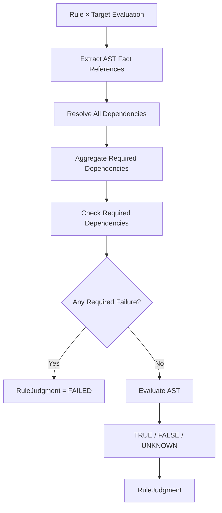
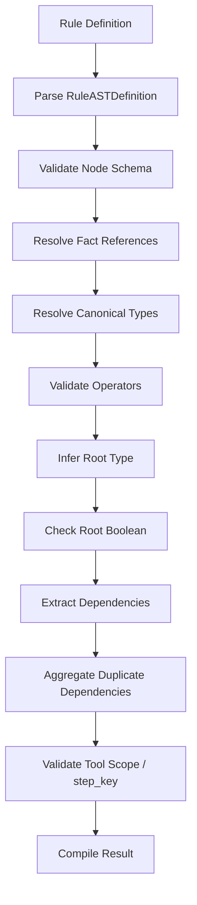

# D05 Batch 02-A — WP-A1 Rule AST Type System

> 文档类型：Technical Contract  
> 所属阶段：D05 Batch 02-A  
> Work Package：WP-A1  
> 对应 OPEN：R2-O12  
> 版本：V1.1  
> 状态：Proposed — Pending Independent Review  
> 适用领域基线：D03 V1.2  
> 适用技术基线：D05 R2.2.2  
> 技术实现：Python 3.11+ / Pydantic v2

---

# 0. 目标与范围

## 0.1 目标

建立 Rule AST 的完整静态类型系统，使 Compiler 能够：

1. 解析 Rule AST 中所有 Observation / Tool Fact References。
2. 验证 Fact Reference 是否存在且版本匹配。
3. 验证 Fact Field 的 Canonical Type。
4. 验证 AST Operator 的输入、输出类型兼容性。
5. 从 AST 自动提取 Field / Tool Dependencies。
6. 确定 Required / Optional 事实依赖。
7. 在 Bundle 编译期阻断非法表达式。
8. 为 Runtime 提供确定性的 AST 求值结构。
9. 支持 TARGET / GLOBAL 两种 Tool Fact 寻址。
10. 保证 Authoring / Compile 不包含 Runtime Target Instance 身份。

本工作包必须同时解决：

- Kleene 三值逻辑。
- NULL / UNKNOWN / NOT_APPLICABLE 语义。
- Required Fact Fail-Fast 的优先级。
- TARGET / GLOBAL 两种 Tool Fact 寻址。
- AST 静态依赖提取与类型检查。
- Fact Reference 的声明态与解析态分离。
- 同一 Fact 多次引用时的 Required 聚合。

## 0.2 非目标

本工作包不定义：

- N06 Top-K 和候选分数阈值。
- Non-violation Score 映射。
- Comparator 同分排序策略。
- N05 GLOBAL → TARGET ToolPlan DAG 的完整执行机制。
- SoM Renderer。
- HITL 阈值。
- Retry Policy 参数。

这些内容仍由 D05 R2.2.2 §13 对应 OPEN 项管理。

## 0.3 核心设计原则

| 原则 | 约束 |
|---|---|
| Strong Typing | 所有 AST 节点和 Fact Reference 使用显式类型 |
| No Untyped Dict | 禁止使用裸 `dict` 作为 AST、FactRef、Operator 等核心结构 |
| Compile-time Validation | 类型错误必须在 Bundle 编译阶段阻断 |
| Single Dependency Source | Required / Optional 只由 AST Fact Reference 声明 |
| Deterministic Evaluation | 相同 Fact Snapshot 和 Rule AST 必须得到相同求值结果 |
| Fail-Fast Priority | Required Fact Failure 优先于 Boolean Short-Circuit |
| Scope-aware Reference | ToolFactRef 原生支持 TARGET / GLOBAL |
| Authoring Isolation | Authoring / Compile 不包含 target_instance_id |
| Runtime Binding | Target 身份只在 Runtime 解析阶段绑定 |
| Dependency Deduplication | 同一 Rule 内相同 Fact 引用合并为一条依赖 |
| Provenance | 每个依赖和求值结果可以追溯到全部 AST Path |

---

# 1. Canonical Fact Type System

## 1.1 Canonical Type

Canonical Type 是 Observation Field 和 Tool Fact 共用的基础类型体系。

支持：

| Type | 语义 |
|---|---|
| boolean | 布尔值 |
| integer | 整数 |
| number | 数值 |
| string | 字符串 |
| enum | 有限枚举 |
| geometry | 几何结构 |
| array | 有类型的数组 |
| object | 有字段定义的结构化对象 |

不允许将所有字段统一降级为 `object` 或任意 JSON。

## 1.2 Pydantic v2 类型定义

以下模型使用 JSON 友好的 `list[...]` 表达序列字段。

由于 Pydantic v2 的 `strict=True` 在 Python 对象验证与 JSON 验证之间存在输入类型差异，本契约统一采用：

- Authoring JSON：通过 `model_validate_json()` 或 `model_validate()` 验证。
- YAML：先解析为标准 Python dict/list，再通过 `model_validate()` 验证。
- 序列化内部结构：使用 `model_dump(mode="json")`。
- 不要求调用方预先将 JSON/YAML 数组转换为 Python tuple。

```python
from __future__ import annotations

from typing import (
    Annotated,
    Literal,
    Union,
)

from pydantic import (
    BaseModel,
    ConfigDict,
    Field,
    StrictBool,
    StrictFloat,
    StrictInt,
    StrictStr,
    model_validator,
)


class StrictModel(BaseModel):
    model_config = ConfigDict(
        extra="forbid",
        frozen=True,
        strict=True,
    )


class BooleanType(StrictModel):
    kind: Literal["boolean"]


class IntegerType(StrictModel):
    kind: Literal["integer"]
    minimum: StrictInt | None = None
    maximum: StrictInt | None = None


class NumberType(StrictModel):
    kind: Literal["number"]
    minimum: StrictFloat | None = None
    maximum: StrictFloat | None = None


class StringType(StrictModel):
    kind: Literal["string"]
    min_length: StrictInt | None = None
    max_length: StrictInt | None = None


class EnumType(StrictModel):
    kind: Literal["enum"]

    values: list[StrictStr] = Field(min_length=1)

    @model_validator(mode="after")
    def validate_unique_values(self):
        if len(self.values) != len(set(self.values)):
            raise ValueError("enum values must be unique")
        return self


class GeometryType(StrictModel):
    kind: Literal["geometry"]

    geometry_kind: Literal[
        "point",
        "bbox",
        "polygon",
        "line",
    ]

    coordinate_system: Literal[
        "image_pixel",
        "normalized_0_1",
        "normalized_0_1000",
        "world",
    ]


class CanonicalTypeDefinition(StrictModel):
    field_key: StrictStr
    value_type: CanonicalType
    required: StrictBool


class ArrayType(StrictModel):
    kind: Literal["array"]

    items: CanonicalType

    min_items: StrictInt | None = None
    max_items: StrictInt | None = None


class ObjectType(StrictModel):
    kind: Literal["object"]

    fields: list[CanonicalTypeDefinition]


CanonicalType = Annotated[
    Union[
        BooleanType,
        IntegerType,
        NumberType,
        StringType,
        EnumType,
        GeometryType,
        ArrayType,
        ObjectType,
    ],
    Field(discriminator="kind"),
]


ArrayType.model_rebuild()
ObjectType.model_rebuild()
CanonicalTypeDefinition.model_rebuild()
```

约束：

1. `integer` 不自动等同于 `number`。
2. `number` 不自动等同于 `integer`。
3. 数值运算及数值比较允许 Integer 向 Number 安全提升，规则见 §7.2。
4. `enum` 必须声明完整合法值集合。
5. `geometry` 必须声明坐标系。
6. `array` 必须声明元素类型。
7. `object` 必须声明完整字段结构。
8. 未声明字段不得进入 Canonical Schema。
9. 不允许依赖 Python 隐式类型转换完成 AST 类型兼容。
10. 数组中的所有元素必须符合声明的元素类型。

## 1.3 类型兼容规则

| 左侧 | 右侧 | 是否兼容 |
|---|---|---|
| boolean | boolean | 是 |
| integer | integer | 是 |
| number | number | 是 |
| integer | number | 数值运算中允许安全提升 |
| number | integer | 禁止隐式降级 |
| string | string | 是 |
| enum | 相同 Enum Definition | 是 |
| enum | 不同 Enum Definition | 默认禁止 |
| geometry | 相同 Geometry Definition | 是 |
| array | 相同元素类型 | 是 |
| object | 相同字段契约 | 是 |

根节点额外约束：

**RuleASTDefinition.root 的静态推导类型必须为 BooleanType。**

如果根节点推导结果不是 BooleanType，Compiler 必须阻断 Bundle 编译。

UNKNOWN、NULL 和 NOT_APPLICABLE 是运行期事实状态，不改变 AST 节点的静态类型。

例如：

```text
Fact: parking_state
Canonical Type: EnumType

parking_state == "parked"
    |
    v
BooleanType
```

合法。

而：

```text
Fact: parking_state
Canonical Type: EnumType
```

直接作为 Rule AST 根节点，不合法。

---

# 2. Fact Reference Contract

## 2.1 AssetVersionRef

所有 Fact Producer 必须绑定精确版本。

```python
class AssetVersionRef(StrictModel):
    asset_id: StrictStr
    version: StrictStr
    content_hash: StrictStr
```

不允许运行时解析 Latest。

## 2.2 Authoring Fact References

Authoring Fact Reference 只描述事实来源，不绑定具体运行实例。

### ObservationFactRef

```python
class ObservationFactRef(StrictModel):
    source: Literal["observation"]

    question_ref: AssetVersionRef

    field_key: StrictStr
```

ObservationFactRef 不包含：

- `image_execution_id`
- `target_instance_id`
- `invocation_id`
- `attempt_id`

其 Target 身份由当前 Rule × Target 求值上下文隐式绑定。

同一个 Rule AST 可以被多个 Target 执行，不需要为每个 Target 创建新的 AST Definition。

语义寻址：

```text
Current Rule
    × Current Target
    × Question
    × Field
```

## 2.3 Authoring ToolFactRef

ToolFactRef 同样不包含 Runtime Target Identity。

### TARGET Binding

```python
class TargetToolBinding(StrictModel):
    scope: Literal["TARGET"]
```

TARGET 表示当前 Rule × Target 求值上下文中的目标实例。

不允许在 Authoring / Compile 中直接指定：

```text
target_instance_id
```

### GLOBAL Binding

```python
class GlobalToolBinding(StrictModel):
    scope: Literal["GLOBAL"]
```

GLOBAL 表示当前 Image Execution 范围内的共享事实。

不绑定任何 Target。

### ToolBinding

```python
ToolBinding = Annotated[
    Union[
        TargetToolBinding,
        GlobalToolBinding,
    ],
    Field(discriminator="scope"),
]
```

### ToolFactRef

```python
class ToolFactRef(StrictModel):
    source: Literal["tool"]

    binding: ToolBinding

    tool_ref: AssetVersionRef

    fact_key: StrictStr

    # 精确映射到当前 Rule 的 ToolPlanStepDefinition
    step_key: StrictStr
```

`step_key` 是必填字段。

映射约束：

1. `step_key` 必须存在于同一 Rule 的 `tool_plan_steps`。
2. 对应 ToolPlanStep 的 `tool_ref` 必须与 ToolFactRef 的 `tool_ref` 完全一致。
3. ToolPlanStep 的 `tool_scope` 必须与 ToolFactRef 的 `binding.scope` 一致。
4. `fact_key` 必须存在于对应 Tool Capability Output Schema。
5. 不允许跨 Rule 引用其他 Rule 的 `step_key`。
6. 不允许仅根据 Tool ID 推测 ToolPlanStep。
7. 同一个 Rule 允许多个步骤使用同一 Tool，但必须通过 `step_key` 明确区分。

该设计避免未来出现同一 Rule 中同一个 Tool 被不同参数、不同前置条件或不同执行步骤重复声明时，Fact Reference 无法确定来源的问题。

### 统一 FactRef

```python
FactRef = Annotated[
    Union[
        ObservationFactRef,
        ToolFactRef,
    ],
    Field(discriminator="source"),
]
```

FactRef 的作用域由其具体类型确定，不使用自由字符串或裸 JSON 表达。

## 2.4 Runtime ResolvedFactRef

Runtime 必须单独定义已经绑定运行实例的 Fact Reference。

```python
class ResolvedFactRef(StrictModel):
    source: Literal[
        "observation",
        "tool",
    ]

    image_execution_id: StrictStr

    target_instance_id: StrictStr | None

    question_ref: AssetVersionRef | None = None

    tool_ref: AssetVersionRef | None = None

    field_key: StrictStr | None = None

    fact_key: StrictStr | None = None

    step_key: StrictStr | None = None

    scope: Literal[
        "TARGET",
        "GLOBAL",
    ]

    @model_validator(mode="after")
    def validate_resolved_identity(self):

        if self.scope == "GLOBAL":
            if self.target_instance_id is not None:
                raise ValueError(
                    "GLOBAL Fact must not bind target_instance_id"
                )

        if self.scope == "TARGET":
            if self.target_instance_id is None:
                raise ValueError(
                    "TARGET Fact requires target_instance_id"
                )

        if self.source == "observation":
            if self.question_ref is None:
                raise ValueError(
                    "Observation requires question_ref"
                )

            if self.field_key is None:
                raise ValueError(
                    "Observation requires field_key"
                )

            if self.scope != "TARGET":
                raise ValueError(
                    "Observation Fact must use TARGET scope"
                )

            if self.tool_ref is not None:
                raise ValueError(
                    "Observation cannot contain tool_ref"
                )

        if self.source == "tool":
            if self.tool_ref is None:
                raise ValueError(
                    "Tool Fact requires tool_ref"
                )

            if self.fact_key is None:
                raise ValueError(
                    "Tool Fact requires fact_key"
                )

            if self.step_key is None:
                raise ValueError(
                    "Tool Fact requires step_key"
                )

            if self.question_ref is not None:
                raise ValueError(
                    "Tool Fact cannot contain question_ref"
                )

        return self
```

Runtime 身份约束：

| Fact Source | Scope | target_instance_id |
|---|---|---|
| Observation | TARGET | 必须存在 |
| Tool | TARGET | 必须存在 |
| Tool | GLOBAL | 必须为 None |

Authoring / Compile 与 Runtime 的转换：

```text
Authoring FactRef
        |
        v
Compiler Static Resolution
        |
        v
Compiled Dependency
        |
        v
Runtime Planner
        |
        v
ResolvedFactRef
        |
        v
Fact Resolver
```

禁止将 Runtime `ResolvedFactRef` 写回 Rule Definition 或 Bundle Authoring 数据。

## 2.5 Fact Dependency Declaration

Required / Optional 由 AST Fact Reference 明确声明。

```python
class FactReferenceDeclaration(StrictModel):
    fact_ref: FactRef

    required: StrictBool = True

    source_ast_path: StrictStr
```

语义：

- `required=True`：该事实是 Rule 的必需依赖。
- `required=False`：该事实为可选依赖。
- QuestionDependency 不声明字段级 Required。
- ToolPlanSteps 不声明 Rule 级 Required。
- Compiler 从 AST 提取该结构。
- 不允许在其他 Registry 中人工维护第二份依赖清单。

## 2.6 同一 Fact 多次引用的 Required 聚合

同一 Rule AST 中允许多处引用同一个 Fact。

如果多个引用的 `required` 不一致，Compiler 必须按照 Rule 级依赖进行合并。

### 依赖去重键

Observation：

```text
(
    rule_ref,
    source,
    question_ref,
    field_key,
    target_scope
)
```

Tool：

```text
(
    rule_ref,
    source,
    tool_ref,
    step_key,
    fact_key,
    scope
)
```

其中 TARGET 的 Target Identity 在 Runtime 绑定，不进入 Authoring / Compile 去重键。

### Required 聚合规则

```python
compiled_required = any(
    declaration.required
    for declaration in duplicate_declarations
)
```

即：

| 引用 A | 引用 B | 合并 Required |
|---|---|---|
| Required | Required | Required |
| Required | Optional | Required |
| Optional | Required | Required |
| Optional | Optional | Optional |

### 编译产物

```python
class CompiledRuleFieldDependency(StrictModel):
    rule_ref: AssetVersionRef

    question_ref: AssetVersionRef

    field_key: StrictStr

    target_scope: Literal[
        "OBJECT",
        "OBJECT_GROUP",
        "BOTH",
    ]

    required: StrictBool

    source_ast_paths: list[StrictStr]


class CompiledRuleToolDependency(StrictModel):
    rule_ref: AssetVersionRef

    tool_ref: AssetVersionRef

    step_key: StrictStr

    fact_key: StrictStr

    target_scope: Literal[
        "TARGET",
        "GLOBAL",
    ]

    required: StrictBool

    source_ast_paths: list[StrictStr]
```

`source_ast_paths` 必须保留所有引用该 Fact 的 AST Path。

Compiler 必须保证：

1. 同一 Rule 内同一 Fact 只产生一条 Compiled Dependency。
2. Required 按 `any(...)` 聚合。
3. 所有来源路径完整保留。
4. 不同 Rule 之间不合并 Required 语义。
5. 不同 ToolPlan Step 不得错误合并为同一个 Fact Producer。
6. 该聚合只改变 Rule 级依赖索引，不修改原始 AST 节点。

---

# 3. Fact Value and Availability Semantics

## 3.1 事实状态

遵循 D05 R2.2.2 §8 的三层状态体系，不重新定义其 Runtime Envelope。

WP-A1 的 AST 求值层使用以下逻辑输入状态：

| 状态 | 来源 | 逻辑含义 |
|---|---|---|
| KNOWN | 成功观察或工具执行 | 存在可解析的事实值 |
| UNKNOWN | 合法观察结果无法确定 | 三值逻辑 UNKNOWN |
| NULL | KNOWN 且字段值为 null，Schema 允许 nullable | 显式空值 |
| NOT_APPLICABLE | 已确定不适用于当前对象或条件 | 显式不适用 |
| MISSING | 预期字段未返回 | 事实缺失 |
| ERROR | 类型或结构非法 | 事实错误 |
| UNAVAILABLE | 请求或生产者不可用 | 事实不可用 |

注意：

- NULL 不等于 UNKNOWN。
- UNKNOWN 不等于 MISSING。
- NOT_APPLICABLE 不等于 FALSE。
- Optional MISSING 不等于业务否定。
- Required MISSING 不允许通过 Boolean Short-Circuit 隐藏。

## 3.2 NULL 语义

NULL 是一个合法但为空的显式值。

成立条件：

```text
FactStatus = KNOWN
Value = null
Schema.nullable = true
```

如果 Schema 不允许 nullable：

```text
KNOWN + null
    |
    v
ERROR
```

NULL 不自动转换为：

- False
- 0
- 空字符串
- UNKNOWN

普通比较遇到 NULL，结果为 UNKNOWN。

只有显式 NULL 检查操作符可以确定 NULL 是否存在。

## 3.3 UNKNOWN 语义

UNKNOWN 表示成功获得了一个合法观察结果，但无法确定事实值。

例如：

```text
parking_state = UNKNOWN
```

它不是执行失败。

UNKNOWN 进入 Kleene 三值逻辑参与求值。

## 3.4 NOT_APPLICABLE 语义

必须区分两种表达：

### A. 业务枚举值

例如：

```json
{
  "field_key": "parking_line_relation",
  "status": "known",
  "value": "not_applicable"
}
```

如果 Question Schema 允许该 Enum Value，它就是一个正常的 KNOWN 值。

### B. Fact Availability

例如：

```text
FactAvailability.NOT_APPLICABLE
```

它表示确定性地证明该事实对当前计算不适用。

不能仅因：

- Tool 没有执行；
- Fact 没有返回；
- 输入为空；
- 模型无法判断；

就产生 NOT_APPLICABLE。

只有确定性前置条件已证明不适用时，才允许产生该状态。

## 3.5 NULL / UNKNOWN / NOT_APPLICABLE 统一映射

| 输入状态 | AST 内部语义 | 普通比较 |
|---|---|---|
| KNOWN Boolean | TRUE / FALSE | 正常 |
| KNOWN 非 Boolean | 对应 Canonical Value | 按类型规则 |
| NULL | NULL | UNKNOWN |
| UNKNOWN | UNKNOWN | UNKNOWN |
| NOT_APPLICABLE | NOT_APPLICABLE | UNKNOWN |
| Optional MISSING | UNKNOWN | UNKNOWN |
| Optional ERROR | UNKNOWN | UNKNOWN |
| Optional UNAVAILABLE | UNKNOWN | UNKNOWN |
| Required MISSING | FAILED | 不进入逻辑求值 |
| Required ERROR | FAILED | 不进入逻辑求值 |
| Required UNAVAILABLE | FAILED | 不进入逻辑求值 |

NOT_APPLICABLE 与 UNKNOWN 在普通 Boolean Predicate 中均不能被解释为 FALSE，但内部状态必须保留区别，以便 Rule Trace 审计。

---

# 4. Kleene Three-Valued Logic

## 4.1 三值域

```python
class TruthValueModel(StrictModel):
    value: Literal[
        "true",
        "false",
        "unknown",
    ]
```

运行时逻辑值仅允许：

```text
TRUE
FALSE
UNKNOWN
```

NULL 与 NOT_APPLICABLE 是事实状态，不是第四、第五个 Boolean 真值。

当它们进入普通 Boolean Predicate 时，映射为 UNKNOWN。

## 4.2 NOT 真值表

| A | NOT A |
|---|---|
| TRUE | FALSE |
| FALSE | TRUE |
| UNKNOWN | UNKNOWN |

## 4.3 AND 真值表

| A | B | A AND B |
|---|---|---|
| TRUE | TRUE | TRUE |
| TRUE | FALSE | FALSE |
| TRUE | UNKNOWN | UNKNOWN |
| FALSE | TRUE | FALSE |
| FALSE | FALSE | FALSE |
| FALSE | UNKNOWN | FALSE |
| UNKNOWN | TRUE | UNKNOWN |
| UNKNOWN | FALSE | FALSE |
| UNKNOWN | UNKNOWN | UNKNOWN |

## 4.4 OR 真值表

| A | B | A OR B |
|---|---|---|
| TRUE | TRUE | TRUE |
| TRUE | FALSE | TRUE |
| TRUE | UNKNOWN | TRUE |
| FALSE | TRUE | TRUE |
| FALSE | FALSE | FALSE |
| FALSE | UNKNOWN | UNKNOWN |
| UNKNOWN | TRUE | TRUE |
| UNKNOWN | FALSE | UNKNOWN |
| UNKNOWN | UNKNOWN | UNKNOWN |

## 4.5 实现契约

```python
def kleene_not(
    value: TruthValueModel,
) -> TruthValueModel:

    if value.value == "true":
        return TruthValueModel(value="false")

    if value.value == "false":
        return TruthValueModel(value="true")

    return TruthValueModel(value="unknown")


def kleene_and(
    left: TruthValueModel,
    right: TruthValueModel,
) -> TruthValueModel:

    if (
        left.value == "false"
        or right.value == "false"
    ):
        return TruthValueModel(value="false")

    if (
        left.value == "true"
        and right.value == "true"
    ):
        return TruthValueModel(value="true")

    return TruthValueModel(value="unknown")


def kleene_or(
    left: TruthValueModel,
    right: TruthValueModel,
) -> TruthValueModel:

    if (
        left.value == "true"
        or right.value == "true"
    ):
        return TruthValueModel(value="true")

    if (
        left.value == "false"
        and right.value == "false"
    ):
        return TruthValueModel(value="false")

    return TruthValueModel(value="unknown")
```

以上函数表达逻辑结果，不负责 Required Fact 检查。

Required Fact 检查必须在逻辑求值之前完成。

---

# 5. Required Fact Fail-Fast Contract

## 5.1 核心原则

D05 R2.2.2 §8.10 已冻结：

> Required Fact Failure 优先于 Boolean Short-Circuit。

WP-A1 将其明确为 Rule AST 的求值顺序约束。

## 5.2 严格执行顺序



必须按照以下顺序执行：

1. 提取当前 Rule 的完整 Fact Dependencies。
2. 按 §2.6 合并重复引用。
3. 解析全部 Required Fact References。
4. 对 Required 依赖进行状态、类型和可用性检查。
5. 只要存在 Required MISSING / ERROR / UNAVAILABLE / INVALID，立即产生 FAILED。
6. 只有全部 Required Facts 通过检查，才允许进入 Boolean Evaluation。
7. 合法 UNKNOWN 参与 Kleene 三值逻辑。
8. 最终产生 TRIGGERED / NON_TRIGGERED / UNCERTAIN。

## 5.3 Fail-Fast 与 Short-Circuit 的优先关系

例如：

```text
A = FALSE
B = MISSING

Rule = A AND B
```

假设 B 是 Required：

```text
Required Fact Check
       |
       v
B = MISSING
       |
       v
RuleJudgment = FAILED
```

不能因为：

```text
FALSE AND UNKNOWN = FALSE
```

就把该 Rule 判定为 NON_TRIGGERED。

因为 B 根本没有获得合法的事实结果。

Required Fact Failure 优先于所有逻辑短路。

## 5.4 Required / Optional 映射

| Dependency | Fact Status | AST 行为 |
|---|---|---|
| Required | KNOWN | 正常求值 |
| Required | UNKNOWN | 进入三值逻辑 |
| Required | NULL，nullable=true | 进入 NULL 语义 |
| Required | NOT_APPLICABLE | 进入显式不适用语义 |
| Required | MISSING | FAILED |
| Required | ERROR | FAILED |
| Required | UNAVAILABLE | FAILED |
| Optional | KNOWN | 正常求值 |
| Optional | UNKNOWN | UNKNOWN |
| Optional | NULL | NULL |
| Optional | NOT_APPLICABLE | NOT_APPLICABLE |
| Optional | MISSING | UNKNOWN |
| Optional | ERROR | UNKNOWN |
| Optional | UNAVAILABLE | UNKNOWN |

Required 的 UNKNOWN 与 Required 的 MISSING 必须严格区分。

合法 UNKNOWN 不构成 Required Fact Failure。

---

# 6. AST Node Schema

## 6.1 Node 基础结构

```python
class ASTNodeBase(StrictModel):
    node_id: StrictStr

    source_path: StrictStr
```

所有 AST Node：

- 具有稳定 node_id。
- 具有可追溯 source_path。
- 不允许未知字段。
- 不允许自由格式 JSON。
- 不允许动态执行 Python 表达式。

## 6.2 FactReferenceNode

```python
class FactReferenceNode(ASTNodeBase):
    node_type: Literal["fact_ref"]

    declaration: FactReferenceDeclaration
```

FactReferenceNode 是 AST 中事实依赖的唯一声明入口。

## 6.3 LiteralNode

标量字面量：

```python
LiteralScalar = Union[
    StrictBool,
    StrictInt,
    StrictFloat,
    StrictStr,
    None,
]


class LiteralNode(ASTNodeBase):
    node_type: Literal["literal"]

    value: LiteralScalar

    value_type: CanonicalType
```

Literal 必须通过 Compiler 验证实际值与声明类型兼容。

### ArrayLiteralNode

数组字面量独立定义，不使用裸 List[Any]。

```python
class ArrayLiteralNode(ASTNodeBase):
    node_type: Literal["array_literal"]

    items: list[LiteralNode]

    element_type: CanonicalType
```

约束：

1. 数组必须声明 `element_type`。
2. 每个元素必须与 `element_type` 兼容。
3. 所有元素必须属于同一 Canonical Type。
4. 不允许混合类型数组。
5. 空数组必须显式声明元素类型。
6. 数组字面量的静态类型为 `ArrayType(items=element_type)`。

例如：

```json
{
  "node_type": "array_literal",
  "node_id": "n3",
  "source_path": "$.root.right",
  "element_type": {
    "kind": "string"
  },
  "items": [
    {
      "node_type": "literal",
      "node_id": "n4",
      "source_path": "$.root.right.items[0]",
      "value": "parked",
      "value_type": {
        "kind": "string"
      }
    },
    {
      "node_type": "literal",
      "node_id": "n5",
      "source_path": "$.root.right.items[1]",
      "value": "stopped",
      "value_type": {
        "kind": "string"
      }
    }
  ]
}
```

其静态类型为：

```text
ArrayType[String]
```

因此可以合法表达：

```text
parking_state IN ["parked", "stopped"]
```

## 6.4 UnaryExpressionNode

```python
class UnaryExpressionNode(ASTNodeBase):
    node_type: Literal["unary"]

    operator: Literal[
        "not",
        "is_null",
        "is_not_null",
        "is_not_applicable",
    ]

    operand: ASTNode
```

## 6.5 BinaryExpressionNode

```python
class BinaryExpressionNode(ASTNodeBase):
    node_type: Literal["binary"]

    operator: Literal[
        "and",
        "or",
        "eq",
        "ne",
        "gt",
        "gte",
        "lt",
        "lte",
        "add",
        "subtract",
        "multiply",
        "divide",
        "contains",
        "in",
    ]

    left: ASTNode

    right: ASTNode
```

## 6.6 ASTNode Discriminated Union

```python
ASTNode = Annotated[
    Union[
        FactReferenceNode,
        LiteralNode,
        ArrayLiteralNode,
        UnaryExpressionNode,
        BinaryExpressionNode,
    ],
    Field(discriminator="node_type"),
]
```

递归模型：

```python
UnaryExpressionNode.model_rebuild()
BinaryExpressionNode.model_rebuild()
```

## 6.7 RuleASTDefinition

```python
class RuleASTDefinition(StrictModel):
    schema_version: Literal["1.0"]

    root: ASTNode
```

静态根节点约束：

```text
StaticType(root) == BooleanType
```

Compiler 必须执行完整递归类型推导。

如果根节点不是 BooleanType：

```text
ROOT_TYPE_NOT_BOOLEAN
```

必须阻断 Bundle 编译。

例如：

```text
parking_state
    |
    v
EnumType
    |
    v
直接作为 root
    |
    v
ROOT_TYPE_NOT_BOOLEAN
```

正确表达：

```text
parking_state == "parked"
    |
    v
BooleanType
    |
    v
合法 Rule AST Root
```

本阶段 AST 使用受限表达式树，不允许：

- 任意 Python Code。
- 任意 SQL。
- 任意脚本执行。
- 任意字符串求值。
- 未注册 Operator。
- 未声明 Fact Reference。

---

# 7. Operator Specification

## 7.1 OperatorSpec

Operator 是 Compiler 与 Runtime 共同遵循的确定性运算定义。

必须明确区分左右操作数的类型约束，不能使用一个不区分左右的 `input_kinds` 表达非对称算子。

```python
class OperandConstraint(StrictModel):
    allowed_kinds: list[
        Literal[
            "boolean",
            "integer",
            "number",
            "string",
            "enum",
            "geometry",
            "array",
            "object",
        ]
    ]

    relation: Literal[
        "independent",
        "same_as_left",
        "array_of_left",
    ]


class OperatorSignature(StrictModel):
    signature_id: StrictStr

    left: OperandConstraint

    right: OperandConstraint | None = None

    output_kind: Literal[
        "boolean",
        "integer",
        "number",
        "string",
        "enum",
        "geometry",
        "array",
        "object",
    ]


class OperatorSpec(StrictModel):
    operator_id: StrictStr

    arity: Literal[1, 2]

    signatures: list[OperatorSignature] = Field(
        min_length=1
    )

    accepts_unknown: StrictBool

    accepts_null: StrictBool

    accepts_not_applicable: StrictBool

    deterministic: Literal[True]
```

Operator Registry 必须是版本化、受控的能力注册表。

不能允许 Rule 在运行时自行定义新的运算符。

`relation` 语义：

| Relation | 约束 |
|---|---|
| independent | 左右类型按各自允许类型检查 |
| same_as_left | 右侧类型必须与左侧相同 |
| array_of_left | 右侧必须为 Array，元素类型与左侧相同 |

对于数值安全提升的情况，由对应 Operator Signature 显式允许 Integer / Number 兼容。

## 7.2 Operator 类型与左右操作数约束

| Operator | Left | Right | Output |
|---|---|---|---|
| NOT | Boolean | — | Boolean |
| AND | Boolean | Boolean | Boolean |
| OR | Boolean | Boolean | Boolean |
| EQ | T | T | Boolean |
| NE | T | T | Boolean |
| GT / GTE | Integer / Number | Integer / Number | Boolean |
| LT / LTE | Integer / Number | Integer / Number | Boolean |
| ADD | Integer / Number | Integer / Number | Number / Integer |
| SUBTRACT | Integer / Number | Integer / Number | Number / Integer |
| MULTIPLY | Integer / Number | Integer / Number | Number / Integer |
| DIVIDE | Integer / Number | Integer / Number | Number |
| CONTAINS | String | String | Boolean |
| CONTAINS | Array[T] | T | Boolean |
| IN | T | Array[T] | Boolean |
| IS_NULL | Nullable Value | — | Boolean |
| IS_NOT_NULL | Nullable Value | — | Boolean |
| IS_NOT_APPLICABLE | Fact State | — | Boolean |

具体约束：

### EQ / NE

左右操作数必须为相同 Canonical Type。

禁止：

```text
Integer == String
EnumA == EnumB
Geometry(pixel) == Geometry(world)
```

### IN

类型签名：

```text
(T, Array[T]) -> Boolean
```

例如：

```text
parking_state IN ["parked", "stopped"]
```

其中：

```text
parking_state : EnumType
Array Element : Same EnumType
```

如果数组是 StringType，而左侧是 EnumType，必须由显式兼容定义允许，否则编译阻断。

### CONTAINS

支持两种签名：

```text
(String, String) -> Boolean
```

以及：

```text
(Array[T], T) -> Boolean
```

不允许：

```text
String CONTAINS Integer
Array[String] CONTAINS Integer
```

### Integer → Number 安全提升

明确允许 Integer 向 Number 的安全提升。

仅适用于：

- 数值比较。
- 数值加减乘除。

规则：

```text
Integer -> Number
```

是单向安全提升。

```text
Number -> Integer
```

禁止隐式转换。

`DIVIDE` 的左右操作数均允许 Integer 或 Number，输出始终为 Number。

例如：

```text
10 / 2
    |
    v
5.0 : Number
```

## 7.3 Unknown / Null Operator 行为

普通比较：

```text
UNKNOWN == TRUE
    -> UNKNOWN

NULL == 1
    -> UNKNOWN

NOT_APPLICABLE == 1
    -> UNKNOWN
```

显式状态检查必须按以下状态表确定性执行。

### 状态检查真值表

输入状态：

- KNOWN：合法非空事实值。
- NULL：KNOWN 且 nullable=true，value=null。
- UNKNOWN：合法但无法确定。
- NOT_APPLICABLE：确定性不适用。
- Optional MISSING：可选事实未返回，映射为 UNKNOWN。

| Operator | KNOWN | NULL | UNKNOWN | NOT_APPLICABLE | Optional MISSING |
|---|---|---|---|---|---|
| IS_NULL | FALSE | TRUE | UNKNOWN | UNKNOWN | UNKNOWN |
| IS_NOT_NULL | TRUE | FALSE | UNKNOWN | UNKNOWN | UNKNOWN |
| IS_NOT_APPLICABLE | FALSE | FALSE | UNKNOWN | TRUE | UNKNOWN |

Required MISSING / ERROR / UNAVAILABLE 不进入上述状态检查，必须先触发 Required Fact Fail-Fast。

显式状态检查结果本身必须是合法 Boolean 或 UNKNOWN。

例如：

```text
IS_NULL(NULL)
    -> TRUE

IS_NULL(KNOWN_VALUE)
    -> FALSE

IS_NOT_APPLICABLE(NOT_APPLICABLE)
    -> TRUE
```

---

# 8. Compiler Static Analysis Contract

## 8.1 编译步骤



## 8.2 静态检查内容

| 检查 | 失败处理 |
|---|---|
| AST Schema 非法 | 阻断 |
| 未知 Node Type | 阻断 |
| 未知 Operator | 阻断 |
| Fact Reference 不存在 | 阻断 |
| Question Version 不匹配 | 阻断 |
| Tool Version 不匹配 | 阻断 |
| Field Key 不存在 | 阻断 |
| Canonical Type 不兼容 | 阻断 |
| Enum Value 非法 | 阻断 |
| Geometry 坐标系不兼容 | 阻断 |
| TARGET / GLOBAL Scope 不匹配 | 阻断 |
| ToolFactRef.step_key 不存在 | 阻断 |
| ToolFactRef 与 ToolPlanStep 不匹配 | 阻断 |
| Required 声明无法解析 | 阻断 |
| AST 存在无法解析的引用 | 阻断 |
| Rule AST Root 不是 BooleanType | 阻断 |
| 同一 Fact 重复引用无法确定性聚合 | 阻断 |
| 数组字面量元素类型不一致 | 阻断 |
| 数组字面量未声明元素类型 | 阻断 |
| 非法 Integer / Number 隐式转换 | 阻断 |

## 8.3 Dependency Extraction

Compiler 从 AST 自动提取：

```python
class CompiledRuleFieldDependency(StrictModel):
    rule_ref: AssetVersionRef

    question_ref: AssetVersionRef

    field_key: StrictStr

    target_scope: Literal[
        "OBJECT",
        "OBJECT_GROUP",
        "BOTH",
    ]

    required: StrictBool

    source_ast_paths: list[StrictStr]


class CompiledRuleToolDependency(StrictModel):
    rule_ref: AssetVersionRef

    tool_ref: AssetVersionRef

    step_key: StrictStr

    fact_key: StrictStr

    target_scope: Literal[
        "TARGET",
        "GLOBAL",
    ]

    required: StrictBool

    source_ast_paths: list[StrictStr]
```

Compiler 必须执行：

1. AST Fact Reference 静态解析。
2. 精确版本解析。
3. Canonical Type 解析。
4. Operator 输入输出类型验证。
5. 根节点 BooleanType 验证。
6. Required / Optional 依赖提取。
7. 重复 Fact 依赖聚合。
8. `source_ast_paths` 完整收集。
9. ToolFactRef 与 ToolPlanStep 映射。
10. TARGET / GLOBAL Scope 一致性检查。

Required 聚合：

```python
required = any(
    declaration.required
    for declaration in same_fact_declarations
)
```

不得：

- 通过 Fact 是否实际返回反向推导 Required。
- 将不同 Rule 的 Required 语义合并。
- 将不同 ToolPlanStep 的 Fact Producer 合并。
- 将 GLOBAL 依赖转换为 TARGET 依赖。
- 通过 Scope Union 修改 Rule 原始 Target Scope。

## 8.4 CompileError

```python
class CompileError(StrictModel):
    code: Literal[
        "invalid_ast_schema",
        "unknown_node_type",
        "unknown_operator",
        "fact_reference_not_found",
        "fact_version_mismatch",
        "field_not_found",
        "type_mismatch",
        "invalid_enum_value",
        "geometry_type_mismatch",
        "tool_scope_mismatch",
        "tool_step_not_found",
        "tool_step_binding_mismatch",
        "required_declaration_invalid",
        "unresolved_dependency",
        "root_type_not_boolean",
        "duplicate_dependency_resolution_failed",
        "array_element_type_mismatch",
        "array_element_type_missing",
    ]

    severity: Literal["error"]

    rule_ref: AssetVersionRef

    source_ast_path: StrictStr

    message: StrictStr
```

CompileError 不允许通过任意 JSON 承载未定义错误字段。

如需新增错误类型，必须扩展错误码契约和验收用例。

## 8.5 Root Boolean Type Gate

Compiler 必须对完整 AST 执行静态类型推导。

最终检查：

```python
inferred_root_type = infer_type(
    rule_ast.root,
    canonical_fact_schemas,
    operator_registry,
)

if not isinstance(inferred_root_type, BooleanType):
    raise CompileError(
        code="root_type_not_boolean",
        severity="error",
        rule_ref=rule_ref,
        source_ast_path="$.root",
        message=(
            "Rule AST root must infer to BooleanType"
        ),
    )
```

该逻辑为语义伪代码，实际实现必须使用项目中统一的 CompileError 构造接口。

不得通过 Runtime 强制转换根节点类型。

## 8.6 Integer / Number 类型推导

Compiler 对数值算子采用明确的类型提升规则：

```text
Integer + Integer -> Integer
Integer + Number  -> Number
Number + Integer  -> Number
Number + Number   -> Number

Integer - Integer -> Integer
Integer * Integer -> Integer

Integer / Integer -> Number
Integer / Number  -> Number
Number / Integer  -> Number
Number / Number   -> Number
```

比较：

```text
Integer > Number -> Boolean
Number > Integer -> Boolean
```

上述提升只在数值运算和数值比较的 Operator Signature 中允许。

其他类型不允许隐式转换。

## 8.7 Duplicate Dependency Aggregation

Compiler 在 Rule 级别进行 Fact Reference 聚合。

例如：

```text
AST Node A:
    Fact Q1.parking_state
    required = false

AST Node B:
    Fact Q1.parking_state
    required = true
```

合并结果：

```text
CompiledRuleFieldDependency:
    question = Q1
    field = parking_state
    required = true
    source_ast_paths:
        - $.root.left
        - $.root.right
```

聚合结果：

- 一条依赖。
- `required = true`。
- 保留两个 AST Path。

同一 Rule 下不同 Target Scope 的 Observation Dependency 仍然遵守 D05 的原始 Scope 契约，不能因为 Fact Reference 去重而扩大 Rule 的消费范围。

---

# 9. Runtime Evaluation Contract

## 9.1 输入

Rule AST Runtime Evaluator 只消费：

- Bundle 中锁定的 RuleASTDefinition。
- Compiler 生成的 Field Dependencies。
- Compiler 生成的 Tool Dependencies。
- D05 正式 Runtime Fact Envelopes。
- 当前 Image Execution Context。
- 当前 Target / Global Fact Snapshot。

不允许 Runtime：

- 回源读取 Question Definition。
- 动态修改 Canonical Type。
- 动态修改 Operator Registry。
- 自动选择最新 Tool Version。
- 修改 Required / Optional。
- 根据 N06 排名决定是否执行 Rule。
- 在 Authoring AST 中写入运行期 Target Identity。

## 9.2 Runtime Fact Reference Resolution

Authoring FactRef 不包含实例身份。

Runtime 根据当前执行上下文解析：

```text
Rule × Target Evaluation
          |
          v
Authoring FactRef
          |
          v
Runtime Fact Resolver
          |
          v
ResolvedFactRef
```

Observation：

```text
ObservationFactRef
    +
Current Target
    +
Image Execution
    |
    v
Resolved Observation Fact
```

TARGET Tool：

```text
TargetToolBinding
    +
Current Target
    +
Image Execution
    |
    v
Resolved TARGET Tool Fact
```

GLOBAL Tool：

```text
GlobalToolBinding
    +
Image Execution
    |
    v
Resolved GLOBAL Tool Fact
```

GLOBAL 不需要 Target Identity。

## 9.3 求值顺序

严格顺序：

```text
Resolve Dependencies
       |
       v
Resolve Runtime Fact References
       |
       v
Validate Fact Identity
       |
       v
Required Fact Fail-Fast
       |
       v
Resolve Optional Facts
       |
       v
Kleene Three-Valued Evaluation
       |
       v
RuleJudgment
       |
       v
Rule Trace
```

## 9.4 RuleJudgment 映射

| AST Evaluation | RuleJudgment |
|---|---|
| TRUE | TRIGGERED |
| FALSE | NON_TRIGGERED |
| UNKNOWN | UNCERTAIN |
| Required Fact Failure | FAILED |
| AST Runtime Execution Error | FAILED |

不得把 FAILED 映射为 UNCERTAIN。

不得把 UNKNOWN 自动映射为 NON_TRIGGERED。

## 9.5 GLOBAL Tool Fact

GLOBAL Tool Fact：

```text
image_execution_id = current execution
target_instance_id = None
tool_ref = exact version
step_key = exact Rule ToolPlanStep
fact_key = exact key
```

GLOBAL Fact 可以被同一 Image Execution 中符合声明作用域的 Rule 消费。

它不属于任何具体 Target。

不得：

- 为 GLOBAL Fact 创建虚拟 Target。
- 将 GLOBAL Fact 与 Target Fact 混为同一身份。
- 在没有明确 GLOBAL Dependency 的情况下自动共享。
- 在 Authoring AST 中填写 Runtime Target ID。

GLOBAL → TARGET 的工具生产依赖 DAG 不在 WP-A1 中展开，继续由 R2-O09 管理。

## 9.6 Arithmetic Runtime Error

所有算术 Operator 必须具有确定性运行时错误处理。

DIVIDE：

```text
A / B
```

当 B 为 KNOWN 且数值等于 0：

```text
RuleJudgment.status = FAILED

error_code = ARITHMETIC_DIVISION_BY_ZERO
```

禁止：

- 返回 NaN。
- 返回 +Inf / -Inf。
- 将除零结果转换为 UNKNOWN。
- 将除零结果转换为 FALSE。
- 静默使用 epsilon 修改分母。
- 静默返回 0。

如果分母为 UNKNOWN：

```text
A / UNKNOWN
    -> UNKNOWN
```

如果分母是 Required MISSING / ERROR / UNAVAILABLE，则在 Required Fact Fail-Fast 阶段直接 FAILED，不进入除法运算。

运行时算术错误必须保留 AST Path 和参与计算的 Fact Provenance。

## 9.7 Provenance

每次 AST 求值必须能够追溯：

- Rule ID / Version / Hash。
- AST Schema Version。
- Node ID。
- Source AST Path。
- Fact Reference。
- Fact Producer Version。
- Fact Status。
- Required / Optional。
- Operator ID。
- 中间逻辑值。
- 最终 RuleJudgment。

WP-A1 不重新定义 D05 的完整 Evidence Bundle，只规定 AST 求值必须保留可追溯信息。

---

# 10. Minimal Positive / Negative JSON Examples

以下五组是最小契约验收用例。

示例中的 Runtime Fact 数据是测试输入投影，不替代 D05 正式 Envelope。

所有 JSON Schema 输入均采用 JSON 数组形式，不要求转换为 Python tuple。

## Case 01 — 合法 Observation Fact 引用与 Boolean Root

**类型：Positive**

输入：

```json
{
  "schema_version": "1.0",
  "root": {
    "node_type": "binary",
    "node_id": "n1",
    "source_path": "$.root",
    "operator": "eq",
    "left": {
      "node_type": "fact_ref",
      "node_id": "n2",
      "source_path": "$.root.left",
      "declaration": {
        "required": true,
        "source_ast_path": "$.root.left",
        "fact_ref": {
          "source": "observation",
          "question_ref": {
            "asset_id": "nonmotor_parking_state",
            "version": "1.0.0",
            "content_hash": "sha256:question001"
          },
          "field_key": "parking_state"
        }
      }
    },
    "right": {
      "node_type": "literal",
      "node_id": "n3",
      "source_path": "$.root.right",
      "value": "parked",
      "value_type": {
        "kind": "enum",
        "values": [
          "parked",
          "not_parked",
          "unknown"
        ]
      }
    }
  }
}
```

假设 Question Schema 中 `parking_state` 的 Enum Definition 与 Literal 完全一致。

预期：

```json
{
  "compile_status": "succeeded",
  "root_type": {
    "kind": "boolean"
  },
  "dependency_count": 1,
  "required": true,
  "target_scope": "OBJECT"
}
```

注意：

AST 中没有 `target_instance_id`。

Runtime 在执行具体 Rule × Target 时绑定实际目标。

## Case 02 — 非法类型阻断

**类型：Negative**

输入：

```json
{
  "schema_version": "1.0",
  "root": {
    "node_type": "binary",
    "node_id": "n1",
    "source_path": "$.root",
    "operator": "and",
    "left": {
      "node_type": "literal",
      "node_id": "n2",
      "source_path": "$.root.left",
      "value": 10,
      "value_type": {
        "kind": "integer"
      }
    },
    "right": {
      "node_type": "literal",
      "node_id": "n3",
      "source_path": "$.root.right",
      "value": true,
      "value_type": {
        "kind": "boolean"
      }
    }
  }
}
```

预期：

```json
{
  "compile_status": "blocked",
  "error": {
    "code": "type_mismatch",
    "severity": "error",
    "source_ast_path": "$.root",
    "message": "AND requires Boolean operands"
  }
}
```

不得在 Runtime 将 Integer 自动转换成 Boolean。

## Case 03 — Required Fail-Fast 压过 Boolean Short-Circuit

**类型：Negative / Runtime Semantic Test**

表达式：

```text
FALSE AND RequiredFact
```

事实输入：

```json
{
  "facts": [
    {
      "fact_key": "condition_a",
      "status": "known",
      "value": false,
      "required": true
    },
    {
      "fact_key": "condition_b",
      "status": "missing",
      "value": null,
      "required": true
    }
  ],
  "operator": "and"
}
```

预期：

```json
{
  "rule_judgment": "FAILED",
  "error_code": "REQUIRED_FACT_UNAVAILABLE",
  "logical_evaluation": "NOT_EXECUTED"
}
```

禁止产生：

```json
{
  "rule_judgment": "NON_TRIGGERED"
}
```

## Case 04 — Optional UNKNOWN 传播

**类型：Positive / Runtime Semantic Test**

表达式：

```text
TRUE AND OptionalFact
```

输入：

```json
{
  "facts": [
    {
      "fact_key": "condition_a",
      "status": "known",
      "value": true,
      "required": true
    },
    {
      "fact_key": "condition_b",
      "status": "unknown",
      "value": null,
      "required": false
    }
  ],
  "operator": "and"
}
```

预期：

```json
{
  "rule_judgment": "UNCERTAIN",
  "logical_result": "UNKNOWN",
  "required_fact_failure": false
}
```

不能将 Optional UNKNOWN 当作 FALSE。

## Case 05 — GLOBAL Tool Fact 引用与 Boolean Root

**类型：Positive**

输入：

```json
{
  "schema_version": "1.0",
  "root": {
    "node_type": "fact_ref",
    "node_id": "global_001",
    "source_path": "$.root",
    "declaration": {
      "required": true,
      "source_ast_path": "$.root",
      "fact_ref": {
        "source": "tool",
        "binding": {
          "scope": "GLOBAL"
        },
        "tool_ref": {
          "asset_id": "scene_geometry",
          "version": "1.0.0",
          "content_hash": "sha256:tool001"
        },
        "step_key": "scene_geometry_step",
        "fact_key": "ground_plane_quality"
      }
    }
  }
}
```

假设 Tool Capability 中：

```text
ground_plane_quality : BooleanType
```

并且 Rule 的 ToolPlanSteps 中存在：

```text
step_key = scene_geometry_step
tool_ref = scene_geometry@1.0.0
tool_scope = GLOBAL
```

预期：

```json
{
  "compile_status": "succeeded",
  "root_type": {
    "kind": "boolean"
  },
  "fact_source": "tool",
  "target_scope": "GLOBAL",
  "runtime_target_instance_id": null,
  "required": true
}
```

以下 GLOBAL 引用非法：

```json
{
  "source": "tool",
  "binding": {
    "scope": "GLOBAL",
    "target_instance_id": "O0001"
  },
  "tool_ref": {
    "asset_id": "scene_geometry",
    "version": "1.0.0",
    "content_hash": "sha256:tool001"
  },
  "step_key": "scene_geometry_step",
  "fact_key": "ground_plane_quality"
}
```

预期：

```json
{
  "compile_status": "blocked",
  "error": "extra_forbidden"
}
```

GLOBAL 不允许携带 Target Identity。

---

# 11. Engineering Acceptance Criteria

## 11.1 Schema

- [ ] 所有核心结构使用 Pydantic v2。
- [ ] FactRef 使用 Discriminated Union。
- [ ] CanonicalType 使用 Discriminated Union。
- [ ] ASTNode 使用 Discriminated Union。
- [ ] 所有模型 `extra="forbid"`。
- [ ] 不存在裸 dict 作为核心结构。
- [ ] 不存在任意 Python 表达式执行入口。
- [ ] ToolFactRef 原生支持 TARGET / GLOBAL。
- [ ] Authoring FactRef 不包含 target_instance_id。
- [ ] Compile State 不包含 target_instance_id。
- [ ] Runtime ResolvedFactRef 包含 image_execution_id。
- [ ] Runtime ResolvedFactRef 支持 target_instance_id=None。
- [ ] GLOBAL ResolvedFactRef 必须 target_instance_id=None。
- [ ] TARGET ResolvedFactRef 必须具有 target_instance_id。
- [ ] JSON/YAML list 输入可以通过正式加载路径完成验证。

## 11.2 Type Checking

- [ ] Boolean 运算符拒绝 Integer。
- [ ] Number 不允许隐式转换为 Integer。
- [ ] Integer → Number 安全提升规则明确。
- [ ] DIVIDE 支持 Integer / Number 组合。
- [ ] Enum Value 必须存在于声明集合。
- [ ] Geometry 必须验证坐标系。
- [ ] Array 必须验证元素类型。
- [ ] ArrayLiteralNode 支持合法数组字面量。
- [ ] ArrayLiteralNode 禁止混合元素类型。
- [ ] Object 必须验证字段结构。
- [ ] 不存在的 Field Reference 必须阻断。
- [ ] 不存在的 Tool Fact 必须阻断。
- [ ] Root 必须推导为 BooleanType。
- [ ] 非 Boolean Root 必须产生 ROOT_TYPE_NOT_BOOLEAN。

## 11.3 Logic

- [ ] Kleene NOT 真值表完整。
- [ ] Kleene AND 真值表完整。
- [ ] Kleene OR 真值表完整。
- [ ] NULL 不等同 UNKNOWN。
- [ ] NOT_APPLICABLE 不等同 FALSE。
- [ ] Optional MISSING 映射为 UNKNOWN。
- [ ] Required MISSING 产生 FAILED。
- [ ] Required ERROR 产生 FAILED。
- [ ] Required UNAVAILABLE 产生 FAILED。
- [ ] Required Fail-Fast 优先于 Boolean Short-Circuit。
- [ ] 合法 UNKNOWN 不产生 FAILED。
- [ ] IS_NULL 状态真值表完整。
- [ ] IS_NOT_NULL 状态真值表完整。
- [ ] IS_NOT_APPLICABLE 状态真值表完整。

## 11.4 Dependency

- [ ] Required / Optional 只从 AST 提取。
- [ ] QuestionDependency 不维护字段级 Required。
- [ ] ToolPlanSteps 不维护 Rule 级 Required。
- [ ] CompiledRuleFieldDependency 可确定性生成。
- [ ] CompiledRuleToolDependency 可确定性生成。
- [ ] 相同 Fact 的多次引用可以合并。
- [ ] Required 聚合规则为 any(...)。
- [ ] 所有来源 AST Path 完整保留。
- [ ] 不同 Rule 的 Required 语义独立。
- [ ] GLOBAL Tool Fact 不产生虚拟 Target。
- [ ] Dependency 保留 AST Path。
- [ ] ToolFactRef 必须映射到明确 step_key。

## 11.5 Arithmetic

- [ ] Integer / Number 提升规则确定。
- [ ] DIVIDE 输出 Number。
- [ ] 除数为零时 RuleJudgment FAILED。
- [ ] 除零错误具有 ARITHMETIC_DIVISION_BY_ZERO 错误码。
- [ ] 不允许 NaN / Inf。
- [ ] 不允许静默修改分母。

## 11.6 Determinism

- [ ] 相同 AST 与 Fact Schema 生成相同依赖索引。
- [ ] 相同 Fact Snapshot 得到相同 AST 求值结果。
- [ ] 相同错误输入产生相同 CompileError。
- [ ] Operator Registry 必须绑定版本。
- [ ] 所有 Fact Reference 锁定精确 Producer Version。
- [ ] 同一 Fact 多次引用的聚合结果确定。
- [ ] 不同 ToolPlan Step 不被错误合并。

---

# 12. WP-A1 Exit Gate

WP-A1 只有满足以下条件才允许关闭 R2-O12：

1. Canonical Type Schema 完整。
2. FactRef / ToolFactRef Schema 完整。
3. Authoring / Compile / Runtime 身份边界明确。
4. Runtime ResolvedFactRef Schema 完整。
5. AST Node Schema 完整。
6. Array Literal Schema 完整。
7. Operator Specification 完整。
8. 非对称 Operator 类型约束明确。
9. Integer → Number 安全提升规则明确。
10. Kleene 三值逻辑真值表完整。
11. NULL / UNKNOWN / NOT_APPLICABLE 语义明确。
12. 状态检查 Operator 真值表完整。
13. Required Fact Fail-Fast 优先级明确。
14. Compiler Static Type Checking 规则明确。
15. Root Boolean Type Gate 明确。
16. Required / Optional Dependency Extraction 明确。
17. Duplicate Dependency Required 聚合规则明确。
18. TARGET / GLOBAL 寻址兼容性通过验证。
19. ToolFactRef 与 ToolPlanStep 映射明确。
20. 除零错误语义明确。
21. 五组最小正反例全部通过。
22. 独立 Reviewer 审查通过。

## 12.1 冻结边界

WP-A1 关闭后：

- Rule AST 类型系统作为独立技术契约冻结。
- D03 V1.2 不修改。
- D05 R2.2.2 不修改。
- R2-O08 / R2-O09 后续可以扩展 GLOBAL Tool 执行依赖，但不得破坏现有 ToolFactRef Schema。
- R2-O01～O06 继续按照各自 WP 处理。
- 不提前将未关闭的 Batch 02 OPEN 项写入 Runtime 默认策略。

---

# 13. Final Decision

WP-A1 的最终架构原则：

1. Rule AST 是结构化、强类型、可静态检查的确定性表达。
2. Observation Fact 与 Tool Fact 使用统一 Canonical Type System。
3. Authoring FactRef 不绑定 Runtime Target Identity。
4. Runtime ResolvedFactRef 负责绑定 Image Execution 与 Target。
5. ToolFactRef 同时支持 TARGET 与 GLOBAL。
6. ToolFactRef 必须通过 step_key 精确映射 ToolPlanStep。
7. Required / Optional 只由 AST Fact References 声明。
8. Compiler 静态扫描 AST，生成完整依赖索引。
9. 同一 Rule 内相同 Fact 的重复引用按 Required = any(...) 聚合。
10. 所有引用路径通过 source_ast_paths 保留。
11. Kleene 三值逻辑是唯一 Boolean UNKNOWN 传播机制。
12. NULL 与 NOT_APPLICABLE 保持独立事实语义。
13. Required Fact Fail-Fast 优先于 Boolean Short-Circuit。
14. FAILED 与 UNCERTAIN 必须严格区分。
15. 类型错误在 Compile 阶段阻断，不留给 Runtime 猜测。
16. Rule AST Root 必须为 BooleanType。
17. 数值运算允许 Integer → Number 安全提升。
18. 除零属于 Runtime 算术错误，必须产生 FAILED。
19. 所有 AST 求值必须保留 Fact Provenance。
20. Pydantic v2 Schema 必须兼容正式 JSON / YAML 加载路径。

**WP-A1 的目标不是建设一个通用脚本引擎，而是建设一个面向巡检事实的、受限且确定性的 Rule Execution Language。**