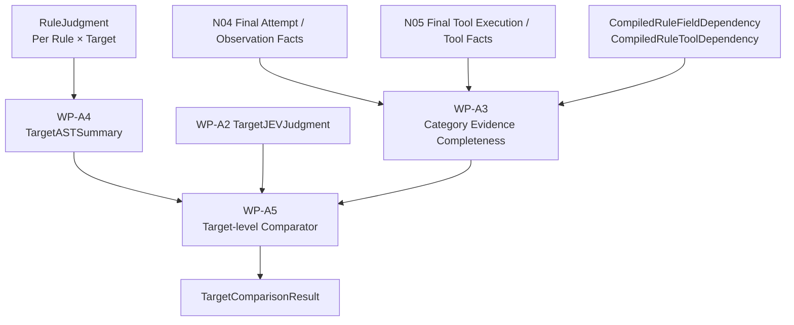

# D05 Batch 02-A — WP-A3 / WP-A4 / WP-A5 Evidence & Comparison Closure

> 文档类型：Technical Contract  
> 所属阶段：D05 Batch 02-A Final Closure  
> Work Packages：WP-A3 / WP-A4 / WP-A5  
> 对应 OPEN：R2-O04 / R2-O06 / R2-O05  
> 版本：V1.1  
> 状态：Frozen — V1.1 Final Freeze（含 F-1～F-4）  
> 适用领域基线：D03 V1.2  
> 适用技术基线：D05 R2.2.2  
> 前置契约：
> - WP-A1 Rule AST Type System V1.1 — Frozen
> - WP-A2 N06 Ranking & Wire Schema V1.1 — Frozen
> 技术实现：Python 3.11+ / Pydantic v2

---

# 0. 目标与范围

## 0.1 本批关闭目标

本文件合并关闭三个相互依赖的技术契约：

| WP | OPEN ID | 技术契约 | 核心职责 |
|---|---|---|---|
| WP-A3 | R2-O04 | Category Evidence Completeness | 判断每个 Category 的事实证据完整性 |
| WP-A4 | R2-O06 | Target-level AST Category Aggregation | 聚合每个 Target 下的独立 Rule Judgment |
| WP-A5 | R2-O05 | Target-level Decision Comparator | 比较 N06 JEV 与 Rule AST 的判断结果 |

三个模块共享同一个 Image Execution Context、Target Identity 和 Bundle Version。

本文件不改变 D05 R2.2.2 已冻结的执行 DAG 和 Comparator Priority 0～7。

## 0.2 全局工程约束

统一 Pydantic v2 基类：

```python
from __future__ import annotations

from typing import Literal, Union

from pydantic import (
    BaseModel,
    ConfigDict,
    Field,
    StrictBool,
    StrictFloat,
    StrictInt,
    StrictStr,
    model_validator,
)


class StrictModel(BaseModel):
    model_config = ConfigDict(
        extra="forbid",
        frozen=True,
        strict=True,
        allow_inf_nan=False,
    )


FiniteScore = Union[
    StrictFloat,
    StrictInt,
]
```

基线类型引用：

- `AssetVersionRef` 继承自 WP-A1 AST Type System V1.1。
- `TargetJEVJudgment` 继承自 WP-A2 N06 Ranking & Wire Schema V1.1。
- `TargetASTSummary`、`CategoryEvidenceCompleteness`、`TargetComparisonResult` 由本文件定义。

所有核心结构必须满足：

1. 使用 Pydantic v2。
2. 所有 JSON 数组使用 `list[...]`。
3. 禁止裸 `dict` 作为核心数据结构。
4. 分数和比例使用 FiniteScore。
5. 分数与比例必须显式约束在 `[0.0, 1.0]`。
6. 不允许 NaN / Infinity。
7. 不允许隐式类型转换。
8. Runtime 身份必须由当前 Image Execution 和 Catalog 解析。
9. 所有依赖、判断、差异和统计必须可追溯。
10. 所有排序必须确定性。

## 0.3 三模块关系



执行关系：

- WP-A3 和 WP-A4 可以基于 N04 / N05 的最终结果独立计算。
- WP-A5 等待 N06 Judgment、AST Summary 和 Evidence Completeness 就绪。
- WP-A3 的 Category 级结果不得改变 WP-A4 的 Rule Judgment。
- WP-A4 的聚合状态不得覆盖底层 Rule Judgment。
- WP-A5 的主状态严格遵循 D05 Priority 0～7。

## 0.4 不属于本文件的范围

本文件不定义：

- R2-O07：N04 Retry Policy。
- R2-O08：Global Tool Fact Schema 扩展。
- R2-O09：GLOBAL → TARGET Tool DAG。
- R2-O10：SoM Renderer。
- R2-O11：Capacity Benchmark。
- R2-O13：HITL Policy。
- 最终自动放行 / 业务发布策略。

---

# 1. WP-A3 — Category Evidence Completeness

对应：R2-O04。

## 1.1 设计目标

Evidence Completeness 用于确定：

> 当前 Image Execution 中，某个 Target 对应的某个 Violation Category，其 Rule 所依赖的事实是否完整、可用且能够追溯。

计算粒度：

```text
Image Execution
    × Target Instance
    × Category
    × Rule
```

Category 与 Rule 严格 1:1。

因此，每个 `(target_instance_id, category_id)` 只允许存在一个 Evidence Completeness 结果。

Evidence Completeness 不是：

- 模型自报的置信度。
- N06 自行生成的字段。
- 整张图像的全局完整性。
- 整个 Target 的统一完整性。
- Rule Judgment 的替代品。

## 1.2 唯一输入来源

WP-A3 只允许消费：

1. Compiler 派生的 `CompiledRuleFieldDependency`。
2. Compiler 派生的 `CompiledRuleToolDependency`。
3. N04 最终 Attempt 的 Observation Fact 状态。
4. N05 最终 Tool Execution 的 Tool Fact 状态。
5. 当前 Image Execution 和 Target Identity。
6. Bundle 中锁定的 Rule / Question / Tool Version。

禁止：

- 从 N06 Raw Model Output 推断事实完整性。
- 从 N06 Top Verdict 推断事实完整性。
- 从 Rule AST 的最终 Boolean 结果反推事实是否完整。
- 回源读取 Authoring 资产重新解析依赖。
- 根据某个 Category 的结果修改其他 Category 的完整性。

## 1.3 依赖结构

WP-A3 直接消费 WP-A1 的编译态依赖。

### Observation Dependency

```python
class CompiledRuleFieldDependency(StrictModel):
    rule_ref: AssetVersionRef

    question_ref: AssetVersionRef

    field_key: StrictStr

    target_scope: Literal[
        "OBJECT",
        "OBJECT_GROUP",
        "BOTH",
    ]

    required: StrictBool

    source_ast_paths: list[StrictStr]
```

### Tool Dependency

```python
class CompiledRuleToolDependency(StrictModel):
    rule_ref: AssetVersionRef

    tool_ref: AssetVersionRef

    step_key: StrictStr

    fact_key: StrictStr

    target_scope: Literal[
        "TARGET",
        "GLOBAL",
    ]

    required: StrictBool

    source_ast_paths: list[StrictStr]
```

依赖身份：

Observation：

```text
Rule
 × Target
 × Question
 × Field
```

Tool TARGET：

```text
Rule
 × Target
 × Tool
 × Step
 × Fact Key
```

Tool GLOBAL：

```text
Rule
 × Image Execution
 × Tool
 × Step
 × Fact Key
```

GLOBAL Tool Fact 不绑定 Target，但可以作为当前 Image Execution 中符合声明作用域的多个 Rule-Target Evaluation 的共享事实。

## 1.4 Fact Availability

WP-A3 统一将 N04 / N05 最终结果解析为以下状态：

```python
FactAvailability = Literal[
    "KNOWN",
    "UNKNOWN",
    "NULL",
    "NOT_APPLICABLE",
    "MISSING",
    "ERROR",
    "UNAVAILABLE",
]
```

各状态语义：

| 状态 | 语义 | 是否为合法产出 |
|---|---|---|
| KNOWN | 存在合法事实值 | 是 |
| UNKNOWN | 成功生产，但无法确定事实值 | 是 |
| NULL | Schema 允许的显式空值 | 是 |
| NOT_APPLICABLE | 确定性证明当前事实不适用 | 是 |
| MISSING | 预期事实未产生 | 否 |
| ERROR | 事实结构、类型或内容非法 | 否 |
| UNAVAILABLE | 请求或生产者不可用 | 否 |

关键区分：

- UNKNOWN 是合法观察结果，不是执行失败。
- NULL 是合法空值，不是缺失。
- NOT_APPLICABLE 必须具有确定性依据。
- MISSING / ERROR / UNAVAILABLE 属于执行缺失或失败。

遵循 WP-A1 的语义：

```text
Required UNKNOWN        != Required Failure
Required NULL           != Required Failure
Required NOT_APPLICABLE != Required Failure

Required MISSING        = Failure
Required ERROR          = Failure
Required UNAVAILABLE    = Failure
```

## 1.5 N04 Final Attempt 映射

N04 正式状态以 D05 R2.2.2 §8 为准。

WP-A3 使用以下映射：

| N04 最终 Field 状态 | WP-A3 Fact Availability |
|---|---|
| KNOWN | KNOWN |
| UNKNOWN | UNKNOWN |
| 合法 nullable NULL | NULL |
| 合法 NOT_APPLICABLE | NOT_APPLICABLE |
| MISSING | MISSING |
| ERROR | ERROR |
| Invocation UNAVAILABLE | UNAVAILABLE |

N04 的最终 Attempt 必须是 Retry Coordinator 确认的最终 Attempt。

不允许混合多个 Attempt 中的 Field 结果拼接为一个虚假的完整 Observation。

## 1.6 N05 Final Tool Execution 映射

N05 的正式执行状态以 D05 R2.2.2 §3、§8 为准。

WP-A3 使用以下映射：

| N05 Tool 状态 | Fact Availability |
|---|---|
| SUCCEEDED + 合法 Fact | KNOWN |
| SUCCEEDED + 合法 nullable NULL | NULL |
| SUCCEEDED_NO_FACT | UNKNOWN |
| SKIPPED_PRECONDITION_UNMET，且确定性证明不适用 | NOT_APPLICABLE |
| SKIPPED_PRECONDITION_UNMET，缺少确定性不适用证明 | UNAVAILABLE |
| FAILED | UNAVAILABLE |
| PLAN_ERROR | ERROR |
| Tool Fact 缺失 | MISSING |
| Tool Fact 类型错误 | ERROR |
| N05 整体 UNAVAILABLE | UNAVAILABLE |

特殊约束：

`SUCCEEDED_NO_FACT` 是有效空结果，不等同于工具执行失败。

如果 Required Tool Fact 对应 `SUCCEEDED_NO_FACT`，它是合法 UNKNOWN，不产生 Evidence Completeness UNAVAILABLE。

`SKIPPED_PRECONDITION_UNMET` 只有在确定性前置条件证明不适用时，才允许映射为 NOT_APPLICABLE。

缺少确定性不适用证明时，必须映射为 UNAVAILABLE，不得将任意工具跳过状态自动解释为 NOT_APPLICABLE。

## 1.7 EvidenceCompletenessStatus

```python
EvidenceCompletenessStatus = Literal[
    "COMPLETE",
    "PARTIAL",
    "UNAVAILABLE",
]
```

三个状态的定义：

### COMPLETE

所有 Required / Optional Dependencies 均已成功产生合法事实状态。

合法状态包括：

- KNOWN
- UNKNOWN
- NULL
- NOT_APPLICABLE

没有 MISSING / ERROR / UNAVAILABLE。

### PARTIAL

所有 Required Dependencies 均已成功产生合法事实状态，但至少一个 Optional Dependency 出现：

- MISSING
- ERROR
- UNAVAILABLE

Optional 事实缺失不能导致整个 Category 变为 UNAVAILABLE。

### UNAVAILABLE

至少一个 Required Dependency 出现：

- MISSING
- ERROR
- UNAVAILABLE

该状态优先于 Optional Dependency 的状态。

## 1.8 Evidence Completeness 判定真值表

| Required Dependencies | Optional Dependencies | 结果 |
|---|---|---|
| 全部合法 | 全部合法 | COMPLETE |
| 全部合法 | 存在 MISSING | PARTIAL |
| 全部合法 | 存在 ERROR | PARTIAL |
| 全部合法 | 存在 UNAVAILABLE | PARTIAL |
| 存在 MISSING | 任意 | UNAVAILABLE |
| 存在 ERROR | 任意 | UNAVAILABLE |
| 存在 UNAVAILABLE | 任意 | UNAVAILABLE |

合法事实状态：

| Fact Status | Required | Optional |
|---|---|---|
| KNOWN | 合法 | 合法 |
| UNKNOWN | 合法 | 合法 |
| NULL | 合法 | 合法 |
| NOT_APPLICABLE | 合法 | 合法 |
| MISSING | UNAVAILABLE | PARTIAL |
| ERROR | UNAVAILABLE | PARTIAL |
| UNAVAILABLE | UNAVAILABLE | PARTIAL |

判定伪代码：

```python
def calculate_evidence_status(
    required_states: list[str],
    optional_states: list[str],
) -> str:

    failed_states = {
        "MISSING",
        "ERROR",
        "UNAVAILABLE",
    }

    required_failed = any(
        state in failed_states
        for state in required_states
    )

    if required_failed:
        return "UNAVAILABLE"

    optional_failed = any(
        state in failed_states
        for state in optional_states
    )

    if optional_failed:
        return "PARTIAL"

    return "COMPLETE"
```

当依赖集合为空时：

- Required = 0。
- Optional = 0。
- 结果为 COMPLETE。

该规则是空依赖集合的确定性空集语义，不代表没有执行有效 Rule。

## 1.9 Category 级隔离

Evidence Completeness 必须严格按 Rule 级依赖计算。

示例：

```text
Target O1
    |
    +-- Category A / Rule A
    |      |
    |      +-- Required Q1 = KNOWN
    |      +-- Required Tool T1 = UNAVAILABLE
    |      |
    |      +-- Evidence = UNAVAILABLE
    |
    +-- Category B / Rule B
           |
           +-- Required Q2 = KNOWN
           +-- Required Tool T2 = KNOWN
           |
           +-- Evidence = COMPLETE
```

Category A 的工具失败不得降级 Category B。

即使：

- 两个 Category 属于同一 Target。
- 两个 Rule 使用同一个 Question。
- 两个 Rule 使用同一个 Tool Capability。
- 两个 Rule 使用同一个 GLOBAL Tool Fact。

Required / Optional 仍由各自 Rule 的 Compiled Dependency 独立决定。

共享 Fact 可以共享生产结果，但不能共享失败传播语义。

## 1.10 Evidence Dependency Reference

```python
class EvidenceDependencyRef(StrictModel):
    source: Literal[
        "observation",
        "tool",
    ]

    dependency_id: StrictStr

    source_ast_paths: list[StrictStr]

    fact_status: FactAvailability

    required: StrictBool

    target_scope: Literal[
        "OBJECT",
        "OBJECT_GROUP",
        "BOTH",
        "TARGET",
        "GLOBAL",
    ]

    producer_ref: AssetVersionRef
```

该结构用于输出缺失和失败依赖明细。

`dependency_id` 规范格式（用于跨实现确定性排序与唯一性校验）：

- `source == "observation"`：`{question_ref.asset_id}:{field_key}`
- `source == "tool"`：`{tool_ref.asset_id}:{step_key}:{fact_key}`

上述格式由 Evidence Resolver 在生成依赖引用时执行；本模型通过 `source` 与 `dependency_id` 的组合进行唯一性校验。

不重复定义 WP-A1 的 FactRef，也不改变其 Authoring / Compile / Runtime 边界。

## 1.11 CategoryEvidenceCompleteness

```python
class CategoryEvidenceCompleteness(StrictModel):
    image_execution_id: StrictStr

    target_instance_id: StrictStr

    category_id: StrictStr

    rule_ref: AssetVersionRef

    status: EvidenceCompletenessStatus

    required_dependency_count: StrictInt = Field(
        ge=0
    )

    required_valid_count: StrictInt = Field(
        ge=0
    )

    required_failed_count: StrictInt = Field(
        ge=0
    )

    optional_dependency_count: StrictInt = Field(
        ge=0
    )

    optional_valid_count: StrictInt = Field(
        ge=0
    )

    optional_failed_count: StrictInt = Field(
        ge=0
    )

    missing_dependency_refs: list[
        EvidenceDependencyRef
    ]

    error_dependency_refs: list[
        EvidenceDependencyRef
    ]

    unavailable_dependency_refs: list[
        EvidenceDependencyRef
    ]

    n04_final_attempt_id: StrictStr | None

    n05_execution_id: StrictStr | None

    @model_validator(mode="after")
    def validate_counts(self):

        if (
            self.required_valid_count
            + self.required_failed_count
            != self.required_dependency_count
        ):
            raise ValueError(
                "Required dependency counts inconsistent"
            )

        if (
            self.optional_valid_count
            + self.optional_failed_count
            != self.optional_dependency_count
        ):
            raise ValueError(
                "Optional dependency counts inconsistent"
            )

        if self.required_failed_count > 0:
            expected_status = "UNAVAILABLE"

        elif self.optional_failed_count > 0:
            expected_status = "PARTIAL"

        else:
            expected_status = "COMPLETE"

        if self.status != expected_status:
            raise ValueError(
                "Evidence completeness status inconsistent"
            )

        failure_refs = (
            self.missing_dependency_refs
            + self.error_dependency_refs
            + self.unavailable_dependency_refs
        )

        expected_failed_count = (
            self.required_failed_count
            + self.optional_failed_count
        )

        if len(failure_refs) != expected_failed_count:
            raise ValueError(
                "Failure dependency references inconsistent"
            )

        failure_keys = [
            (ref.source, ref.dependency_id)
            for ref in failure_refs
        ]

        if len(failure_keys) != len(set(failure_keys)):
            raise ValueError(
                "Duplicate dependency across or within failure lists"
            )

        for ref in self.missing_dependency_refs:
            if ref.fact_status != "MISSING":
                raise ValueError(
                    "Missing dependency list contains invalid status"
                )

        for ref in self.error_dependency_refs:
            if ref.fact_status != "ERROR":
                raise ValueError(
                    "Error dependency list contains invalid status"
                )

        for ref in self.unavailable_dependency_refs:
            if ref.fact_status != "UNAVAILABLE":
                raise ValueError(
                    "Unavailable dependency list contains invalid status"
                )

        sort_key = lambda ref: (
            ref.source,
            ref.dependency_id,
        )

        if self.missing_dependency_refs != sorted(
            self.missing_dependency_refs,
            key=sort_key,
        ):
            raise ValueError(
                "Missing dependencies must be sorted"
            )

        if self.error_dependency_refs != sorted(
            self.error_dependency_refs,
            key=sort_key,
        ):
            raise ValueError(
                "Error dependencies must be sorted"
            )

        if self.unavailable_dependency_refs != sorted(
            self.unavailable_dependency_refs,
            key=sort_key,
        ):
            raise ValueError(
                "Unavailable dependencies must be sorted"
            )

        return self
```

计数约束：

```text
required_dependency_count
    =
required_valid_count
    +
required_failed_count

optional_dependency_count
    =
optional_valid_count
    +
optional_failed_count
```

字段可空性：

- `n04_final_attempt_id`：在纯 Tool 依赖（零 Observation 依赖）或 N04 未执行时允许为 `None`；存在 Observation 依赖且 N04 已执行时必须非空。
- `n05_execution_id`：无 Tool 依赖或 N05 未执行时允许为 `None`。

三个失败列表两两互斥：

| 字段 | 仅允许的 fact_status |
|---|---|
| missing_dependency_refs | MISSING |
| error_dependency_refs | ERROR |
| unavailable_dependency_refs | UNAVAILABLE |

必须满足：

```text
len(missing_dependency_refs)
+
len(error_dependency_refs)
+
len(unavailable_dependency_refs)
=
required_failed_count
+
optional_failed_count
```

列表排序：

```text
(source ASC, dependency_id ASC)
```

禁止：

- 同一个失败依赖重复进入多个列表。
- 只保留失败计数而丢弃依赖身份。
- 将 UNKNOWN 加入失败列表。
- 将 NULL 加入失败列表。
- 将 NOT_APPLICABLE 加入失败列表。

每个有效 `(target_instance_id, category_id)` 只能产生一个 CategoryEvidenceCompleteness。

WP-A3 输出必须按：

```text
category_id ASC
```

确定性排序。

## 1.12 WP-A3 输出约束

每个有效 Rule-Target Evaluation 必须产生且只产生一个 CategoryEvidenceCompleteness。

不允许：

- 一个 Rule 的结果覆盖另一个 Rule。
- 通过 N06 Ranking 过滤依赖。
- 因 AST Short-Circuit 删除未检查的 Required Dependency。
- 将 UNKNOWN 映射为 UNAVAILABLE。
- 将 Optional Failure 映射为 UNAVAILABLE。
- 将 Required Failure 映射为 PARTIAL。

Evidence Completeness 不决定最终业务 Verdict。

---

# 2. WP-A4 — Target-level AST Category Aggregation

对应：R2-O06。

## 2.1 设计目标

Rule AST 在 `(rule_id, target_instance_id)` 粒度独立执行。

WP-A4 将同一个 Target 下所有激活 Rule Judgment 聚合为 TargetASTSummary。

核心原则：

> 聚合状态描述整体执行完整性，Category 分区保留每条 Rule 的实际判断结果，两者不能互相替代。

尤其是：

```text
Rule A = TRIGGERED
Rule B = FAILED
```

不能只输出：

```text
aggregation_status = PARTIAL_FAILED
```

而丢失 Rule A 已经确定的 TRIGGERED 结论。

## 2.2 输入契约

```python
RuleJudgmentStatus = Literal[
    "TRIGGERED",
    "NON_TRIGGERED",
    "UNCERTAIN",
    "FAILED",
]
```

```python
class RuleJudgment(StrictModel):
    rule_ref: AssetVersionRef

    category_id: StrictStr

    target_instance_id: StrictStr

    status: RuleJudgmentStatus

    consumed_fact_refs: list[StrictStr]

    unavailable_fact_refs: list[StrictStr]

    rule_trace_ref: StrictStr

    error_code: StrictStr | None

    image_execution_id: StrictStr
```

输入必须来自：

- 当前 Image Execution。
- 当前 Target。
- 当前 Active Rule-Target Evaluation Set。
- 当前 Bundle。
- 已完成的 Rule AST 执行。

不允许把未激活 Rule 加入聚合集合。

## 2.3 Category 与 Rule 1:1

必须遵循 D05 R2.2.2：

```text
category_id <-> rule_id
```

严格 1:1。

Compiler 已保证：

- 一个 Category 只对应一个 Rule。
- 一个 Rule 只对应一个 Category。

因此：

```text
Target × Category
    |
    v
Exactly One RuleJudgment
```

禁止引入：

- 多 Rule 覆盖优先级。
- Category 内部投票。
- Rule Judgment 分数竞争。
- 多 Rule 决策融合。

## 2.4 输入完整性检查

对当前 Target 的 Active Rule-Target Evaluation Set：

```text
Expected Evaluations
        |
        v
Actual RuleJudgments
        |
        v
Identity Reconciliation
```

必须满足：

1. 每个预期 `(rule_ref, target_instance_id)` 有且只有一个 RuleJudgment。
2. Category ID 与 Rule Ref 一致。
3. Image Execution ID 一致。
4. Bundle Version 一致。
5. 不存在重复 Rule Judgment。
6. 不存在未激活 Rule 的 Judgment。

如果存在：

- 重复 Judgment。
- Rule / Category 映射错误。
- Target Identity 不一致。
- Image Execution Identity 不一致。

属于聚合输入协议错误，不得静默去重或覆盖。

## 2.5 AST Aggregation Status

```python
ASTAggregationStatus = Literal[
    "ALL_SUCCEEDED",
    "PARTIAL_FAILED",
    "ALL_FAILED",
]
```

定义：

| 状态 | 条件 |
|---|---|
| ALL_SUCCEEDED | 全部激活 Rule Judgment 均非 FAILED |
| PARTIAL_FAILED | 至少一个 FAILED，且至少一个非 FAILED |
| ALL_FAILED | 全部激活 Rule Judgment 均 FAILED |

前置条件：

```text
len(active_rule_judgments) > 0
```

零有效评估属于 D05 Clean Frame，不产生 TargetASTSummary。

## 2.6 聚合状态确定性算法

设：

\[
N = |RuleJudgments|
\]

\[
F = |\{r \mid r.status=FAILED\}|
\]

则：

\[
AggregationStatus =
\begin{cases}
ALL\_SUCCEEDED & F=0\\
ALL\_FAILED & F=N\\
PARTIAL\_FAILED & 0<F<N
\end{cases}
\]

伪代码：

```python
def aggregate_status(
    judgments: list[RuleJudgment],
) -> str:

    if not judgments:
        raise ValueError(
            "Empty evaluations must use Clean Frame"
        )

    failed_count = sum(
        item.status == "FAILED"
        for item in judgments
    )

    if failed_count == 0:
        return "ALL_SUCCEEDED"

    if failed_count == len(judgments):
        return "ALL_FAILED"

    return "PARTIAL_FAILED"
```

该规则没有优先级覆盖和不确定性推断。

## 2.7 Category 确定性分区

必须将所有激活 Category 完整划分为四个集合：

```text
triggered_categories
non_triggered_categories
uncertain_categories
failed_categories
```

映射：

| RuleJudgment.status | Category 分区 |
|---|---|
| TRIGGERED | triggered_categories |
| NON_TRIGGERED | non_triggered_categories |
| UNCERTAIN | uncertain_categories |
| FAILED | failed_categories |

所有集合统一：

```text
category_id ASC
```

即使用稳定 `category_id` 字符串字典序升序。

不得依赖：

- Rule 执行完成顺序。
- 并发返回顺序。
- 数据库查询顺序。
- 模型候选排序。
- 原始 JSON 数组顺序。

## 2.8 PARTIAL_FAILED 保真规则

假设：

```text
Target O1

Rule A / Category A = TRIGGERED
Rule B / Category B = FAILED
Rule C / Category C = NON_TRIGGERED
Rule D / Category D = UNCERTAIN
```

必须输出：

```text
aggregation_status = PARTIAL_FAILED

triggered_categories:
    [Category A]

non_triggered_categories:
    [Category C]

uncertain_categories:
    [Category D]

failed_categories:
    [Category B]
```

禁止：

```text
triggered_categories = []
```

禁止：

```text
partial_failed = true
```

却丢弃成功 Rule 的 Category 判断。

禁止把 FAILED 自动改写为 UNCERTAIN。

## 2.9 Category Coverage

```python
class CategoryCoverage(StrictModel):
    active_count: StrictInt = Field(ge=0)

    triggered_count: StrictInt = Field(ge=0)

    non_triggered_count: StrictInt = Field(ge=0)

    uncertain_count: StrictInt = Field(ge=0)

    failed_count: StrictInt = Field(ge=0)

    @model_validator(mode="after")
    def validate_coverage(self):

        if self.active_count <= 0:
            raise ValueError(
                "TargetASTSummary requires active evaluations"
            )

        total = (
            self.triggered_count
            + self.non_triggered_count
            + self.uncertain_count
            + self.failed_count
        )

        if total != self.active_count:
            raise ValueError(
                "Category coverage counts inconsistent"
            )

        return self
```

必须满足：

\[
ActiveCount =
TriggeredCount +
NonTriggeredCount +
UncertainCount +
FailedCount
\]

## 2.10 TargetASTSummary

```python
class TargetASTSummary(StrictModel):
    image_execution_id: StrictStr

    target_instance_id: StrictStr

    aggregation_status: ASTAggregationStatus

    triggered_categories: list[StrictStr]

    non_triggered_categories: list[StrictStr]

    uncertain_categories: list[StrictStr]

    failed_categories: list[StrictStr]

    rule_judgment_refs: list[StrictStr]

    category_coverage: CategoryCoverage

    @model_validator(mode="after")
    def validate_summary(self):

        partitions = [
            self.triggered_categories,
            self.non_triggered_categories,
            self.uncertain_categories,
            self.failed_categories,
        ]

        # 每个分区必须按 category_id ASC 排序。
        for categories in partitions:
            if categories != sorted(categories):
                raise ValueError(
                    "Category partition must be sorted"
                )

            if len(categories) != len(set(categories)):
                raise ValueError(
                    "Duplicate category in partition"
                )

        # 四个分区必须两两不相交。
        all_categories = [
            category
            for partition in partitions
            for category in partition
        ]

        if len(all_categories) != len(set(all_categories)):
            raise ValueError(
                "Category partitions must be disjoint"
            )

        # Category 分区长度必须与 Coverage 完全一致。
        expected_counts = [
            len(self.triggered_categories),
            len(self.non_triggered_categories),
            len(self.uncertain_categories),
            len(self.failed_categories),
        ]

        actual_counts = [
            self.category_coverage.triggered_count,
            self.category_coverage.non_triggered_count,
            self.category_coverage.uncertain_count,
            self.category_coverage.failed_count,
        ]

        if expected_counts != actual_counts:
            raise ValueError(
                "Category partition counts inconsistent"
            )

        # 所有分区并集必须覆盖全部 Active Categories。
        if len(all_categories) != self.category_coverage.active_count:
            raise ValueError(
                "Active category coverage incomplete"
            )

        # Aggregation Status 与 failed_categories 数量一致。
        failed_count = len(self.failed_categories)
        active_count = self.category_coverage.active_count

        if failed_count == 0:
            expected_status = "ALL_SUCCEEDED"

        elif failed_count == active_count:
            expected_status = "ALL_FAILED"

        else:
            expected_status = "PARTIAL_FAILED"

        if self.aggregation_status != expected_status:
            raise ValueError(
                "Aggregation status inconsistent"
            )

        # Rule Trace References 与 Category 顺序一一对应。
        if len(self.rule_judgment_refs) != active_count:
            raise ValueError(
                "Rule judgment references incomplete"
            )

        return self
```

附加约束：

- `rule_judgment_refs` 必须引用全部激活 RuleJudgment 的 `rule_trace_ref`。
- `rule_judgment_refs` 与按 `category_id ASC` 排序后的激活 Category 顺序一一对应。
- 每个 Category 只能进入一个分区。
- 四个分区的并集必须等于 Active Evaluation Set。
- 四个分区两两不相交。
- 每个分区按 `category_id ASC` 排序。
- `ALL_FAILED` 时，所有激活 Category 必须位于 failed_categories。
- `PARTIAL_FAILED` 时，成功类别必须完整保留。
- `ALL_SUCCEEDED` 时，failed_categories 必须为空。

## 2.11 AST Summary 与 Evidence Completeness 的隔离

Evidence Completeness 和 RuleJudgment 是不同维度。

例如：

```text
Category A:
    Evidence = PARTIAL
    RuleJudgment = TRIGGERED

Category B:
    Evidence = COMPLETE
    RuleJudgment = NON_TRIGGERED
```

合法。

不得因为 Evidence PARTIAL 就自动把 TRIGGERED 改为 UNCERTAIN。

如果 Required Fact 不可用，Rule AST 应按照 WP-A1 Fail-Fast 规则产生 FAILED；WP-A3 和 WP-A4 必须分别保留自己的结果。

---

# 3. WP-A5 — Target-level Decision Comparator

对应：R2-O05。

## 3.1 设计目标

Comparator 比较：

- WP-A2 的 TargetJEVJudgment。
- WP-A4 的 TargetASTSummary。
- WP-A3 的 CategoryEvidenceCompleteness。

对每个 Target 输出唯一主比较状态，同时保留类别级差异和完整 Provenance。

Comparator：

- 不执行模型推理。
- 不执行 Rule AST。
- 不重新排序 Active Ranking。
- 不修改 Evidence Completeness。
- 不决定最终业务自动放行。
- 不输出 `final_decision`。
- 不输出 `needs_hitl`。

## 3.2 Comparator 输入

```python
class ComparatorInput(StrictModel):
    image_execution_id: StrictStr

    target_instance_id: StrictStr

    bundle_digest: StrictStr

    jev_judgment_ref: StrictStr | None

    ast_summary_ref: StrictStr | None

    evidence_completeness_refs: list[StrictStr]
```

Comparator 必须能够解析：

- N06 TargetJEVJudgment。
- TargetASTSummary。
- CategoryEvidenceCompleteness。

不得重新读取 Authoring Definition。

## 3.3 对齐主键

```python
comparison_key = (
    image_execution_id,
    target_instance_id,
)
```

N06、AST Summary、Evidence Completeness 必须使用同一主键。

Bundle Digest 和 Category Catalog Digest 必须一致。

身份不一致时：

- 产生 Protocol Failure。
- 不进入业务比较。
- 不得强行合并结果。

## 3.4 Comparator 输入状态

N06：

```python
JEVResultAvailability = Literal[
    "AVAILABLE",
    "MISSING",
    "FAILED",
]
```

AST：

```python
ASTResultAvailability = Literal[
    "AVAILABLE",
    "MISSING",
]
```

注意：

- JEV `FAILED` 表示 Target 级 JEV_FAILED。
- JEV `MISSING` 表示预期 Target 未返回。
- AST `MISSING` 表示预期 AST Summary 不存在。
- AST PARTIAL_FAILED 是有效的 AST Summary，不等于 AST Missing。

## 3.5 Comparator Priority 0～7

严格继承 D05 R2.2.2 §6。

本文件只补充计算细节，不重新定义优先级。

| Priority | 判断 | 主状态 |
|---|---|---|
| P0 | Identity Validation Failure | Protocol Failure，不进入业务比较 |
| P1 | 双方缺失 | BOTH_MISSING |
| P2 | 单侧缺失 | JEV_MISSING_TARGET / AST_MISSING |
| P3 | 执行或局部结构失败 | JEV_FAILED / AST_FAILED / AST_PARTIAL_FAILED |
| P4 | 不确定性 | BOTH_UNCERTAIN / JEV_UNCERTAIN / AST_UNCERTAIN |
| P5 | 违规存在性 | AGREE_NON_VIOLATION / EXISTENCE_CONFLICT |
| P6 | 类别集合覆盖 | CATEGORY_CONFLICT / CATEGORY_SET_PARTIAL_MATCH |
| P7 | Top-1 / Top-K 排序 | AGREE_TOP1 / AGREE_TOPK_RANK_DIFF |

Comparator 必须按照顺序执行，首次命中后确定唯一主状态。

所有 Category Diff 仍需完整生成，不因为主状态确定而丢弃。

## 3.6 Priority 0：Identity Validation

检查：

- Image Execution ID。
- Target Instance ID。
- Bundle Digest。
- Category Catalog Digest。
- Rule Version。
- Target Identity。
- N06 Policy Version。
- N06 Mapping Policy Version。

不一致：

```text
ComparisonProtocolFailure
```

不得进入 P1～P7。

其中：

- `N06 Policy Version` 不一致；
- `N06 Mapping Policy Version` 不一致；

统一映射为：

```text
PROVENANCE_MISMATCH
```

不允许将策略版本不一致降级为普通业务分歧。

## 3.7 Priority 1：双方缺失

| JEV | AST | Status |
|---|---|---|
| MISSING | MISSING | BOTH_MISSING |

不产生有效类别比较。

## 3.8 Priority 2：单侧缺失

| JEV | AST | Status |
|---|---|---|
| MISSING | AVAILABLE | JEV_MISSING_TARGET |
| AVAILABLE | MISSING | AST_MISSING |

其中：

`JEV_MISSING_TARGET` 表示 N06 成功返回，但没有返回 Planner 预期的 Target。

不等同于 N06 请求失败。

如果 AST 有结果，即使其为 PARTIAL_FAILED，也不能覆盖 Priority 2。

## 3.9 Priority 3：执行失败与 JEV 内部语义一致性

保留 D05 已冻结状态：

- JEV_FAILED
- AST_FAILED
- AST_PARTIAL_FAILED

### A. JEV 内部语义一致性检查

所有 JEV 内部契约一致性检查必须在 Priority 3 执行。

包括：

1. `NON_VIOLATION` 必须对应空 `active_ranking`。
2. `VIOLATION` 必须对应非空 `active_ranking`。
3. `UNCERTAIN` 必须满足 WP-A2 V1.1 冻结的 NonViolationMappingPolicy 约束。
4. Active Ranking、Non-violation Score 与 Top Verdict 必须符合其绑定的 Policy Version。
5. Active Ranking 不得包含违反 Ranking Policy 的类别。

WP-A2 的反序列化和 Runtime Policy Mapping 层应首先拦截上述违约。

Comparator P3 必须再次执行一致性检查，作为下游防御性兜底。

发现任何 JEV 内部语义违约：

```text
ComparisonStatus = JEV_FAILED
```

禁止将内部语义违约留到 P4 或 P5 处理。

### B. AST 状态映射

| AST Summary | Comparator |
|---|---|
| ALL_FAILED | AST_FAILED |
| PARTIAL_FAILED | AST_PARTIAL_FAILED |
| ALL_SUCCEEDED | 继续 P4 |

### C. JEV Target 失败

例如：

- 非法 Category Index。
- 非法 Score。
- 非法 Evidence Reference。
- 重复 Category。
- 重复 Target Reference。
- JEV 内部语义映射不一致。

对应 Target：

```text
JEV_FAILED
```

其他合法 Target 继续比较。

### D. 同一 Target 多种 P3 失败同时发生

为保证唯一主状态，规定 P3 内部确定性选择顺序：

```text
JEV_FAILED
    >
AST_FAILED
    >
AST_PARTIAL_FAILED
```

该顺序只解决同一 Target 同时存在多个 P3 失败原因时的主状态选择，不改变 D05 Priority 0～7。

所有失败原因必须保留在结果明细中。

### E. PARTIAL_FAILED 保真

例如：

```text
AST:
    Category A = TRIGGERED
    Category B = FAILED

JEV:
    Category A = Rank 1
    Category B = Rank 2
```

主状态：

```text
AST_PARTIAL_FAILED
```

但：

- Category A 的对齐结果仍必须保留。
- Category B 的 AST 失败必须保留。
- 不允许只返回 AST_PARTIAL_FAILED 而丢弃成功类别的比较信息。

如果 JEV 同时 FAILED，则主状态为 JEV_FAILED，但 AST 成功类别和失败类别仍必须完整保留。

## 3.10 Priority 4：不确定性

严格沿用 D05 的 AST 不确定性谓词：

```python
ast_is_uncertain = (
    len(ast_triggered_categories) == 0
    and len(ast_uncertain_categories) > 0
)
```

判定：

| JEV | AST | Status |
|---|---|---|
| UNCERTAIN | ast_is_uncertain=True | BOTH_UNCERTAIN |
| UNCERTAIN | ast_is_uncertain=False | JEV_UNCERTAIN |
| 确定结果 | ast_is_uncertain=True | AST_UNCERTAIN |

如果 AST 同时存在 TRIGGERED 和 UNCERTAIN：

```text
ast_is_uncertain = False
```

不命中 AST_UNCERTAIN。

其他不确定类别仍保留在 Category Diff。

P3 优先于 P4。

因此 AST PARTIAL_FAILED 即使同时存在 UNCERTAIN，也优先输出 AST_PARTIAL_FAILED。

JEV 内部语义违约已经在 P3 检查，不允许被 P4 不确定性状态遮蔽。

## 3.11 Priority 5：违规存在性检查

定义：

\[
J = ActiveRanking
\]

\[
A = ASTTriggeredCategories
\]

其中：

- J 为 WP-A2 的 `active_ranking`。
- A 为 WP-A4 的 `triggered_categories`。

进入 P5 前，必须满足：

- JEV 状态为 AVAILABLE。
- AST 状态为 AVAILABLE。
- AST Aggregation Status 为 ALL_SUCCEEDED。
- JEV 内部语义一致性检查通过。

严格遵循：

| JEV Top Verdict | J | A | Status |
|---|---|---|---|
| NON_VIOLATION | 空 | 空 | AGREE_NON_VIOLATION |
| NON_VIOLATION | 空 | 非空 | EXISTENCE_CONFLICT |
| VIOLATION | 非空 | 空 | EXISTENCE_CONFLICT |

P5 仅处理合法 VIOLATION / NON_VIOLATION 与 AST Triggered 集合之间的违规存在性比较。

以下情况已经在更高优先级处理：

- JEV FAILED：P3。
- JEV MISSING：P2。
- AST FAILED：P3。
- AST PARTIAL_FAILED：P3。
- JEV UNCERTAIN：P4。

因此 P5 不再输出 `JEV_FAILED`。

其中：

- NON_VIOLATION 与非空 AST Triggered 集合构成 JEV 漏检。
- VIOLATION 与空 AST Triggered 集合构成违规存在性冲突。
- NON_VIOLATION 且双方均无违规候选时，输出 AGREE_NON_VIOLATION。

不得将上述情况直接映射为业务最终裁决。

## 3.12 Priority 6：类别集合覆盖关系

设：

\[
J = \{category\_id \mid category \in ActiveRanking\}
\]

\[
A = ASTTriggeredCategories
\]

### 情况 A：无交集

\[
J \cap A = \varnothing
\]

输出：

```text
CATEGORY_CONFLICT
```

### 情况 B：存在交集，但 AST 触发类别没有被 JEV 完整覆盖

\[
J \cap A \neq \varnothing
\]

且：

\[
A \nsubseteq J
\]

输出：

```text
CATEGORY_SET_PARTIAL_MATCH
```

### 情况 C：AST 触发类别完全包含于 JEV 有效候选集

\[
A \subseteq J
\]

且：

\[
A \neq J
\]

进入 Priority 7。

### 情况 D：两个集合完全一致

\[
A = J
\]

进入 Priority 7。

## 3.13 Priority 7：Top-1 / Top-K 比较

WP-A2 已冻结排序：

```text
score DESC
category_id ASC
```

Comparator 直接消费已经确定性排序的 `active_ranking`。

禁止：

- 再次排序。
- 再次应用阈值。
- 再次执行 Top-K。
- 使用 Raw Ranking 代替 Active Ranking。
- 根据 AST 顺序重排 JEV。

定义：

```python
J = [
    item.category_id
    for item in jev.active_ranking
]

A = set(
    ast_summary.triggered_categories
)

J_set = set(J)
```

### Top-1 Hit

```python
top1_hit = (
    len(J) > 0
    and len(A) > 0
    and J[0] in A
)
```

当 A 为空：

```text
top1_hit = None
```

表示无 AST 触发类别可用于比较。

当 A 非空但 J 为空：

```text
top1_hit = False
```

### Top-K Hit

定义为所有 AST 触发类别是否都被 JEV Active Ranking 覆盖：

\[
TopKHit =
\begin{cases}
None & |A|=0\\
True & A \subseteq J\_set\\
False & Otherwise
\end{cases}
\]

### Top-K Coverage Ratio

定义为 AST 触发类别被 JEV Active Ranking 覆盖的比例：

\[
TopKCoverageRatio =
\frac{|J\_set \cap A|}{|A|}
\]

边界：

| A | J | Ratio |
|---|---|---|
| 空 | 任意 | None |
| 非空 | 空 | 0.0 |
| 非空 | 有交集 | 按公式计算 |
| 非空 | 完全覆盖 | 1.0 |

不得出现除零。

### Top-K Precision Ratio

同时保留 D05 的 Alignment Precision：

\[
TopKPrecisionRatio =
\frac{|J\_set \cap A|}{|J\_set|}
\]

当 J 为空时：

```text
topk_precision_ratio = None
```

### 最终 Priority 7 状态

```python
if J_set == A:
    comparison_status = "AGREE_TOP1"

elif A < J_set:
    comparison_status = "AGREE_TOPK_RANK_DIFF"
```

其中：

- `set(J) == A` 输出 `AGREE_TOP1`。
- `A < set(J)` 输出 `AGREE_TOPK_RANK_DIFF`。

`AGREE_TOP1` 的冻结语义是类别集合精确一致，不要求 Active Ranking 只能包含一个类别。

即使：

```text
top1_hit = True
```

只要 JEV Active Ranking 中还存在 AST 未触发的额外候选类别：

```text
A < set(J)
```

主状态仍必须为：

```text
AGREE_TOPK_RANK_DIFF
```

不得因为 Top-1 命中就覆盖集合覆盖关系。

## 3.14 Top-K 例子

```text
JEV Active Ranking:
    Rank 1: C1
    Rank 2: C2
    Rank 3: C3

AST Triggered:
    C2
```

则：

```text
top1_hit = False

topk_hit = True

topk_coverage_ratio = 1.0

topk_precision_ratio = 1/3

comparison_status = AGREE_TOPK_RANK_DIFF
```

AST 触发类别被完整覆盖，但 JEV 存在额外候选。

如果：

```text
JEV Active Ranking:
    C1

AST Triggered:
    C2
```

则：

```text
top1_hit = False
topk_hit = False
topk_coverage_ratio = 0.0

comparison_status = CATEGORY_CONFLICT
```

## 3.15 JEV 漏检与误报

### JEV 漏检

```text
JEV:
    top_verdict = NON_VIOLATION
    active_ranking = []

AST:
    triggered_categories = [C1]
```

主状态：

```text
EXISTENCE_CONFLICT
```

Category Diff：

```text
C1:
    diff_type = AST_TRIGGERED_JEV_MISSED
```

### JEV 误报

```text
JEV:
    top_verdict = VIOLATION
    active_ranking = [C1]

AST:
    triggered_categories = []
    non_triggered_categories = [C1]
```

主状态：

```text
EXISTENCE_CONFLICT
```

Category Diff：

```text
C1:
    diff_type = JEV_CANDIDATE_AST_NON_TRIGGERED
```

不得将 JEV 误报直接判定为 AST FAILED。

## 3.16 PerCategoryDiff

```python
CategoryDiffType = Literal[
    "AGREED_TRIGGERED",
    "JEV_CANDIDATE_AST_NON_TRIGGERED",
    "JEV_CANDIDATE_AST_UNCERTAIN",
    "AST_TRIGGERED_JEV_MISSED",
    "AST_NON_TRIGGERED_NOT_RANKED",
    "AST_UNCERTAIN_NOT_RANKED",
    "AST_FAILED",
    "JEV_ONLY",
    "AST_ONLY_JEV_UNAVAILABLE",
    "NO_ACTIVE_JUDGMENT",
]
```

```python
class PerCategoryDiff(StrictModel):
    category_id: StrictStr

    jev_rank: StrictInt | None = Field(
        default=None,
        ge=1,
    )

    jev_score: FiniteScore | None = Field(
        default=None,
        ge=0.0,
        le=1.0,
    )

    ast_status: Literal[
        "TRIGGERED",
        "NON_TRIGGERED",
        "UNCERTAIN",
        "FAILED",
    ] | None

    evidence_completeness_status: EvidenceCompletenessStatus | None

    rule_judgment_ref: StrictStr | None

    diff_type: CategoryDiffType
```

生成规则：

| JEV 状态 | AST 状态 | Diff |
|---|---|---|
| Active Ranking 存在 | TRIGGERED | AGREED_TRIGGERED |
| Active Ranking 存在 | NON_TRIGGERED | JEV_CANDIDATE_AST_NON_TRIGGERED |
| Active Ranking 存在 | UNCERTAIN | JEV_CANDIDATE_AST_UNCERTAIN |
| Active Ranking 不存在，JEV AVAILABLE | TRIGGERED | AST_TRIGGERED_JEV_MISSED |
| Active Ranking 不存在，JEV AVAILABLE | NON_TRIGGERED | AST_NON_TRIGGERED_NOT_RANKED |
| Active Ranking 不存在，JEV AVAILABLE | UNCERTAIN | AST_UNCERTAIN_NOT_RANKED |
| 任意 JEV 状态 | FAILED | AST_FAILED |
| JEV AVAILABLE 且存在类别 | 无 AST 结果 | JEV_ONLY |
| JEV FAILED / MISSING | TRIGGERED | AST_ONLY_JEV_UNAVAILABLE |
| JEV FAILED / MISSING | NON_TRIGGERED | AST_ONLY_JEV_UNAVAILABLE |
| JEV FAILED / MISSING | UNCERTAIN | AST_ONLY_JEV_UNAVAILABLE |
| JEV FAILED / MISSING | FAILED | AST_FAILED |
| 不存在 JEV 有效类别 | 无 AST 结果 | NO_ACTIVE_JUDGMENT |

`AST_ONLY_JEV_UNAVAILABLE` 的语义：

JEV 处于 FAILED 或 MISSING，无法提供有效 Active Ranking，但 AST 已经产生非 FAILED 的 Rule Judgment。

该状态只表示 AST 裁决可用、JEV 不可用，不代表 JEV 漏检。

尤其需要区分：

```text
AST_TRIGGERED_JEV_MISSED
```

表示 JEV 正常完成，但没有提名 AST 已触发的类别。

```text
AST_ONLY_JEV_UNAVAILABLE
```

表示 JEV 执行失败或 Target 缺失，不能形成有效的类别漏检判断。

`NO_ACTIVE_JUDGMENT` 适用边界：

- 在标准 Target 比较输出的活跃并集（`JEV Active Categories ∪ AST 四分区`）中，每个类别至少有一侧有效结果，不会产出 `NO_ACTIVE_JUDGMENT`。
- 该枚举作为协议预留值保留，仅用于下游全量 Category Catalog 投影或审计报表补齐场景。

所有 Category Diff 按 `category_id ASC` 排序。

类别级差异必须完整覆盖：

```text
JEV Active Categories
    UNION
AST Triggered
    UNION
AST Non-triggered
    UNION
AST Uncertain
    UNION
AST Failed
```

不允许只生成发生分歧的类别而丢弃一致类别。

## 3.17 Evidence Completeness 与 Comparator

Comparator 接收每个 Category 的 Evidence Completeness。

但 Evidence Completeness：

- 不改变 JEV Ranking。
- 不改变 AST Summary。
- 不改变 Comparator Priority 顺序。
- 不将 COMPLETE 自动解释为违规。
- 不将 PARTIAL 自动解释为 UNCERTAIN。
- 不将 UNAVAILABLE 自动解释为 NON_TRIGGERED。

它用于：

1. 解释类别证据质量。
2. 识别 JEV / AST 分歧的事实背景。
3. 提供后续评测和审计信息。

WP-A5 不重新执行 WP-A3 的完整性计算。

## 3.18 AST PARTIAL_FAILED 与 JEV 局部失败交互

必须按照 D05 Priority 处理：

| JEV | AST | Main Status |
|---|---|---|
| MISSING | PARTIAL_FAILED | JEV_MISSING_TARGET |
| FAILED | PARTIAL_FAILED | JEV_FAILED |
| AVAILABLE | PARTIAL_FAILED | AST_PARTIAL_FAILED |
| AVAILABLE | ALL_FAILED | AST_FAILED |
| AVAILABLE | ALL_SUCCEEDED | 继续 P4～P7 |

无论主状态是什么：

- 保留完整 AST Summary。
- 保留全部成功 Rule Judgment。
- 保留全部失败 Rule Judgment。
- 保留可用 JEV Raw / Runtime 结果。
- 保留所有可生成的 Category Diff。
- 不允许将失败状态覆盖为成功类别。
- 不允许将成功类别覆盖为失败状态。

当 JEV Target 失败或缺失时，不能伪造有效 JEV Ranking。

如果 JEV 原始输出可用且局部存在合法部分信息，可以作为独立审计材料保存，但不能作为正常 Active Ranking 参与比较。

---

# 4. Runtime Output Schemas

## 4.1 TopKMetrics

```python
class TopKMetrics(StrictModel):
    top1_hit: StrictBool | None

    topk_hit: StrictBool | None

    topk_coverage_ratio: FiniteScore | None = Field(
        default=None,
        ge=0.0,
        le=1.0,
    )

    topk_precision_ratio: FiniteScore | None = Field(
        default=None,
        ge=0.0,
        le=1.0,
    )

    ast_triggered_count: StrictInt = Field(
        ge=0
    )

    jev_active_count: StrictInt = Field(
        ge=0
    )

    intersection_count: StrictInt = Field(
        ge=0
    )

    @model_validator(mode="after")
    def validate_metrics(self):

        if self.intersection_count > min(
            self.ast_triggered_count,
            self.jev_active_count,
        ):
            raise ValueError(
                "Intersection count exceeds input set size"
            )

        if self.ast_triggered_count == 0:

            if self.top1_hit is not None:
                raise ValueError(
                    "top1_hit must be None when AST Triggered is empty"
                )

            if self.topk_hit is not None:
                raise ValueError(
                    "topk_hit must be None when AST Triggered is empty"
                )

            if self.topk_coverage_ratio is not None:
                raise ValueError(
                    "coverage ratio must be None when AST Triggered is empty"
                )

        else:

            if self.top1_hit is None:
                raise ValueError(
                    "top1_hit must not be None when AST Triggered is non-empty"
                )

            if self.topk_hit is None:
                raise ValueError(
                    "topk_hit must not be None when AST Triggered is non-empty"
                )

            if self.topk_coverage_ratio is None:
                raise ValueError(
                    "coverage ratio must not be None when AST Triggered is non-empty"
                )

        if self.jev_active_count == 0:

            if self.topk_precision_ratio is not None:
                raise ValueError(
                    "precision ratio must be None when JEV Active Ranking is empty"
                )

        else:

            if self.topk_precision_ratio is None:
                raise ValueError(
                    "topk_precision_ratio must not be None when JEV Active Ranking is non-empty"
                )

        return self
```

### TopKMetrics 生成条件矩阵

| Comparator Priority / 状态 | AST 状态 | topk_metrics |
|---|---|---|
| P1 BOTH_MISSING | 不存在 | None |
| P2 JEV_MISSING_TARGET | 有效或部分失败 | None |
| P2 AST_MISSING | 不存在 | None |
| P3 JEV_FAILED | 任意有效 AST Summary | None |
| P3 AST_FAILED | ALL_FAILED | None |
| P3 AST_PARTIAL_FAILED | PARTIAL_FAILED | None |
| P4 BOTH_UNCERTAIN | ALL_SUCCEEDED | 完整对象 |
| P4 JEV_UNCERTAIN | ALL_SUCCEEDED | 完整对象 |
| P4 AST_UNCERTAIN | ALL_SUCCEEDED | 完整对象 |
| P5 AGREE_NON_VIOLATION | ALL_SUCCEEDED | 完整对象 |
| P5 EXISTENCE_CONFLICT | ALL_SUCCEEDED | 完整对象 |
| P6 CATEGORY_CONFLICT | ALL_SUCCEEDED | 完整对象 |
| P6 CATEGORY_SET_PARTIAL_MATCH | ALL_SUCCEEDED | 完整对象 |
| P7 AGREE_TOP1 | ALL_SUCCEEDED | 完整对象 |
| P7 AGREE_TOPK_RANK_DIFF | ALL_SUCCEEDED | 完整对象 |

P1 / P2 / P3 不输出 TopKMetrics，避免不完整 AST 或失败侧污染全局召回率、精确率统计。

P4～P7 必须输出完整 TopKMetrics。

边界：

- AST Triggered 为空：`top1_hit`、`topk_hit`、`topk_coverage_ratio` 为 None。
- JEV Active Ranking 为空：`topk_precision_ratio` 为 None。
- AST Triggered 非空且 JEV Active Ranking 为空：Coverage 为 `0.0`。
- 双方均为空：四个比率 / 命中字段均为 None。
- 不允许除零。

## 4.2 ComparatorStatus

```python
ComparisonStatus = Literal[
    "AGREE_TOP1",
    "AGREE_NON_VIOLATION",
    "AGREE_TOPK_RANK_DIFF",

    "CATEGORY_CONFLICT",
    "EXISTENCE_CONFLICT",

    "AST_PARTIAL_FAILED",
    "AST_FAILED",

    "JEV_MISSING_TARGET",
    "JEV_FAILED",
    "AST_MISSING",
    "BOTH_MISSING",

    "JEV_UNCERTAIN",
    "AST_UNCERTAIN",
    "BOTH_UNCERTAIN",

    "CATEGORY_SET_PARTIAL_MATCH",
]
```

以上状态名称严格沿用 D05 R2.2.2 §6。

## 4.3 ComparisonProvenance

```python
class ComparisonProvenance(StrictModel):
    image_execution_id: StrictStr

    target_instance_id: StrictStr

    bundle_digest: StrictStr

    category_catalog_digest: StrictStr

    planner_version: StrictStr

    target_planning_snapshot_hash: StrictStr

    jev_judgment_ref: StrictStr | None

    ast_summary_ref: StrictStr | None

    evidence_completeness_refs: list[StrictStr]

    n04_final_attempt_id: StrictStr | None

    n05_execution_id: StrictStr | None

    compiled_tool_plan_digest: StrictStr | None

    runtime_tool_plan_hash: StrictStr | None
```

字段可空性：

- `n04_final_attempt_id`：在 N04 未执行、Clean Frame 或对应结果缺失时允许 None。
- `n05_execution_id`：无 ToolPlan 或 N05 未执行时允许 None。
- `compiled_tool_plan_digest`：无工具计划时允许 None。
- `runtime_tool_plan_hash`：无运行期工具计划实例时允许 None。

排序规则：

`evidence_completeness_refs` 必须按照对应 Category 的 `category_id ASC` 排序。

该字段中的引用顺序必须与 `evidence_completeness_by_category` 一致。

所有引用必须指向当前 Image Execution 和当前 Bundle。

## 4.4 TargetComparisonResult

```python
class TargetComparisonResult(StrictModel):
    image_execution_id: StrictStr

    target_instance_id: StrictStr

    comparison_status: ComparisonStatus

    ast_summary: TargetASTSummary | None

    jev_judgment: TargetJEVJudgment | None

    evidence_completeness_by_category: list[
        CategoryEvidenceCompleteness
    ]

    topk_metrics: TopKMetrics | None

    per_category_diffs: list[PerCategoryDiff]

    provenance: ComparisonProvenance

    @model_validator(mode="after")
    def validate_result(self):

        # 1. Identity 与 Provenance 一致
        if self.provenance.image_execution_id != self.image_execution_id:
            raise ValueError(
                "Provenance image_execution_id mismatch"
            )

        if self.provenance.target_instance_id != self.target_instance_id:
            raise ValueError(
                "Provenance target_instance_id mismatch"
            )

        # 2. Evidence Completeness 按 category_id ASC 排序且无重复
        evidence_categories = [
            item.category_id
            for item in self.evidence_completeness_by_category
        ]

        if evidence_categories != sorted(evidence_categories):
            raise ValueError(
                "evidence_completeness_by_category must be sorted by category_id ASC"
            )

        if len(evidence_categories) != len(set(evidence_categories)):
            raise ValueError(
                "Duplicate category_id in evidence_completeness_by_category"
            )

        if len(self.provenance.evidence_completeness_refs) != len(
            self.evidence_completeness_by_category
        ):
            raise ValueError(
                "provenance.evidence_completeness_refs count mismatch"
            )

        # 3. PerCategoryDiff 按 category_id ASC 排序且无重复
        diff_categories = [
            item.category_id
            for item in self.per_category_diffs
        ]

        if diff_categories != sorted(diff_categories):
            raise ValueError(
                "per_category_diffs must be sorted by category_id ASC"
            )

        if len(diff_categories) != len(set(diff_categories)):
            raise ValueError(
                "Duplicate category_id in per_category_diffs"
            )

        # 4. TopKMetrics 可空性与 P1-P3 / P4-P7 严格一致
        no_metrics_statuses = {
            "BOTH_MISSING",
            "JEV_MISSING_TARGET",
            "AST_MISSING",
            "JEV_FAILED",
            "AST_FAILED",
            "AST_PARTIAL_FAILED",
        }

        if self.comparison_status in no_metrics_statuses:
            if self.topk_metrics is not None:
                raise ValueError(
                    "topk_metrics must be None for P1/P2/P3 statuses"
                )
        else:
            if self.topk_metrics is None:
                raise ValueError(
                    "topk_metrics must be present for P4-P7 statuses"
                )

        # 5. AST / JEV 对象可空性与主状态一致
        if self.comparison_status in {"BOTH_MISSING", "AST_MISSING"}:
            if self.ast_summary is not None:
                raise ValueError(
                    "ast_summary must be None when AST is missing"
                )
        else:
            if self.ast_summary is None:
                raise ValueError(
                    "ast_summary must be present for this comparison_status"
                )

        if self.comparison_status in {
            "BOTH_MISSING",
            "JEV_MISSING_TARGET",
            "JEV_FAILED",
        }:
            if self.jev_judgment is not None:
                raise ValueError(
                    "jev_judgment must be None when JEV is missing or failed"
                )
        elif self.comparison_status != "AST_MISSING":
            # AST_MISSING 命中 P2 时，若 JEV 同时 FAILED 则应由更高优先级 P3 输出 JEV_FAILED
            if self.jev_judgment is None:
                raise ValueError(
                    "jev_judgment must be present for this comparison_status"
                )

        return self
```

列表排序规则：

| 字段 | 排序规则 |
|---|---|
| evidence_completeness_by_category | category_id ASC |
| per_category_diffs | category_id ASC |
| provenance.evidence_completeness_refs | 对应 category_id ASC |

`evidence_completeness_by_category` 中每个 Category 只能出现一次。

`evidence_completeness_refs` 必须与 `evidence_completeness_by_category` 的 Category 顺序一一对应。

`per_category_diffs` 必须完整保留类别差异，不得按分歧程度或 Score 再排序。

禁止增加：

```text
final_decision
needs_hitl
```

Comparator 只输出技术比较结果。

## 4.5 ComparisonProtocolFailure

P0 Identity Validation 失败时，不产生正常 TargetComparisonResult。

```python
class ComparisonProtocolFailure(StrictModel):
    image_execution_id: StrictStr

    target_instance_id: StrictStr

    error_code: Literal[
        "IMAGE_EXECUTION_MISMATCH",
        "TARGET_IDENTITY_MISMATCH",
        "BUNDLE_DIGEST_MISMATCH",
        "CATEGORY_CATALOG_MISMATCH",
        "RULE_VERSION_MISMATCH",
        "PROVENANCE_MISMATCH",
    ]

    error_message: StrictStr

    source_refs: list[StrictStr]
```

P0 协议错误不参与 Priority 1～7。

策略版本一致性：

- N06 Ranking Policy Version 不一致。
- N06 Mapping Policy Version 不一致。

均统一映射为：

```text
PROVENANCE_MISMATCH
```

不得将策略版本不一致降级为普通业务分歧。

## 4.6 输出约束

每个有效 Target 只产生一个主 ComparisonStatus。

同时保留：

- AST Summary。
- JEV Judgment。
- Evidence Completeness。
- Top-K Metrics。
- PerCategoryDiff。
- Provenance。

Comparator 不拥有最终业务自动放行和人工审核策略。

---

# 5. Minimal Positive / Negative JSON Examples

以下六组为本文件最低验收用例。

示例使用经过解析的 Runtime 事实投影，不替代 D05 正式 Envelope。

## Case 01 — Category 级隔离

类型：Positive

输入：

```json
{
  "image_execution_id": "IMG001",
  "target_instance_id": "O001",
  "categories": [
    {
      "category_id": "category_a",
      "rule_ref": {
        "asset_id": "rule_a",
        "version": "1.0.0",
        "content_hash": "sha256:rulea"
      },
      "required_dependencies": [
        {
          "dependency_id": "tool_a",
          "source": "tool",
          "required": true,
          "scope": "TARGET",
          "fact_status": "UNAVAILABLE"
        }
      ],
      "optional_dependencies": []
    },
    {
      "category_id": "category_b",
      "rule_ref": {
        "asset_id": "rule_b",
        "version": "1.0.0",
        "content_hash": "sha256:ruleb"
      },
      "required_dependencies": [
        {
          "dependency_id": "tool_b",
          "source": "tool",
          "required": true,
          "scope": "GLOBAL",
          "fact_status": "KNOWN"
        }
      ],
      "optional_dependencies": []
    }
  ]
}
```

输出：

```json
{
  "results": [
    {
      "category_id": "category_a",
      "status": "UNAVAILABLE",
      "required_dependency_count": 1,
      "required_valid_count": 0,
      "required_failed_count": 1,
      "optional_dependency_count": 0,
      "optional_valid_count": 0,
      "optional_failed_count": 0,
      "missing_dependency_refs": [],
      "error_dependency_refs": [],
      "unavailable_dependency_refs": [
        {
          "source": "tool",
          "dependency_id": "tool_a",
          "source_ast_paths": [
            "$.root"
          ],
          "fact_status": "UNAVAILABLE",
          "required": true,
          "target_scope": "TARGET",
          "producer_ref": {
            "asset_id": "tool_a",
            "version": "1.0.0",
            "content_hash": "sha256:toola"
          }
        }
      ]
    },
    {
      "category_id": "category_b",
      "status": "COMPLETE",
      "required_dependency_count": 1,
      "required_valid_count": 1,
      "required_failed_count": 0,
      "optional_dependency_count": 0,
      "optional_valid_count": 0,
      "optional_failed_count": 0,
      "missing_dependency_refs": [],
      "error_dependency_refs": [],
      "unavailable_dependency_refs": []
    }
  ]
}
```

验收：

- Category A = UNAVAILABLE。
- Category B = COMPLETE。
- 不允许互相连坐。
- GLOBAL Tool Fact 不需要虚拟 Target。
- 三个失败列表必须两两互斥。

## Case 02 — Required UNKNOWN 与 Required MISSING

类型：Positive + Negative

输入：

```json
{
  "categories": [
    {
      "category_id": "category_unknown",
      "required_dependencies": [
        {
          "dependency_id": "q1",
          "fact_status": "UNKNOWN"
        }
      ],
      "optional_dependencies": []
    },
    {
      "category_id": "category_missing",
      "required_dependencies": [
        {
          "dependency_id": "q2",
          "fact_status": "MISSING"
        }
      ],
      "optional_dependencies": []
    }
  ]
}
```

输出：

```json
{
  "results": [
    {
      "category_id": "category_unknown",
      "status": "COMPLETE",
      "required_dependency_count": 1,
      "required_valid_count": 1,
      "required_failed_count": 0,
      "optional_dependency_count": 0,
      "optional_valid_count": 0,
      "optional_failed_count": 0,
      "missing_dependency_refs": [],
      "error_dependency_refs": [],
      "unavailable_dependency_refs": []
    },
    {
      "category_id": "category_missing",
      "status": "UNAVAILABLE",
      "required_dependency_count": 1,
      "required_valid_count": 0,
      "required_failed_count": 1,
      "optional_dependency_count": 0,
      "optional_valid_count": 0,
      "optional_failed_count": 0,
      "missing_dependency_refs": [
        {
          "source": "observation",
          "dependency_id": "q2",
          "source_ast_paths": [
            "$.root"
          ],
          "fact_status": "MISSING",
          "required": true,
          "target_scope": "OBJECT",
          "producer_ref": {
            "asset_id": "question_q2",
            "version": "1.0.0",
            "content_hash": "sha256:q2"
          }
        }
      ],
      "error_dependency_refs": [],
      "unavailable_dependency_refs": []
    }
  ]
}
```

验收：

- Required UNKNOWN 合法。
- Required MISSING 必须 UNAVAILABLE。
- 两者不能混淆。

## Case 03 — AST PARTIAL_FAILED 保真

类型：Positive

输入：

```json
{
  "image_execution_id": "IMG003",
  "target_instance_id": "O003",
  "rule_judgments": [
    {
      "category_id": "category_a",
      "rule_ref": "rule_a@1.0.0",
      "status": "TRIGGERED",
      "rule_trace_ref": "trace_a"
    },
    {
      "category_id": "category_b",
      "rule_ref": "rule_b@1.0.0",
      "status": "FAILED",
      "rule_trace_ref": "trace_b",
      "error_code": "REQUIRED_FACT_UNAVAILABLE"
    }
  ]
}
```

输出：

```json
{
  "image_execution_id": "IMG003",
  "target_instance_id": "O003",
  "aggregation_status": "PARTIAL_FAILED",
  "triggered_categories": [
    "category_a"
  ],
  "non_triggered_categories": [],
  "uncertain_categories": [],
  "failed_categories": [
    "category_b"
  ],
  "category_coverage": {
    "active_count": 2,
    "triggered_count": 1,
    "non_triggered_count": 0,
    "uncertain_count": 0,
    "failed_count": 1
  },
  "rule_judgment_refs": [
    "trace_a",
    "trace_b"
  ]
}
```

验收：

- Category A 必须保留 TRIGGERED。
- Category B 必须保留 FAILED。
- 聚合状态为 PARTIAL_FAILED。
- 不允许用聚合状态覆盖 Category A 的成功裁决。
- `rule_judgment_refs` 顺序与 Category ASC 顺序一致。

## Case 04 — Top-K 覆盖但 Top-1 未命中

类型：Positive

输入：

```json
{
  "image_execution_id": "IMG004",
  "target_instance_id": "O004",
  "jev": {
    "top_verdict": "VIOLATION",
    "active_ranking": [
      {
        "rank": 1,
        "category_id": "category_a",
        "score": 0.95
      },
      {
        "rank": 2,
        "category_id": "category_b",
        "score": 0.90
      },
      {
        "rank": 3,
        "category_id": "category_c",
        "score": 0.80
      }
    ]
  },
  "ast": {
    "aggregation_status": "ALL_SUCCEEDED",
    "triggered_categories": [
      "category_b"
    ],
    "non_triggered_categories": [
      "category_a",
      "category_c"
    ],
    "uncertain_categories": [],
    "failed_categories": []
  }
}
```

输出：

```json
{
  "comparison_status": "AGREE_TOPK_RANK_DIFF",
  "topk_metrics": {
    "top1_hit": false,
    "topk_hit": true,
    "topk_coverage_ratio": 1.0,
    "topk_precision_ratio": 0.3333333333,
    "ast_triggered_count": 1,
    "jev_active_count": 3,
    "intersection_count": 1
  },
  "per_category_diffs": [
    {
      "category_id": "category_a",
      "jev_rank": 1,
      "ast_status": "NON_TRIGGERED",
      "diff_type": "JEV_CANDIDATE_AST_NON_TRIGGERED"
    },
    {
      "category_id": "category_b",
      "jev_rank": 2,
      "ast_status": "TRIGGERED",
      "diff_type": "AGREED_TRIGGERED"
    },
    {
      "category_id": "category_c",
      "jev_rank": 3,
      "ast_status": "NON_TRIGGERED",
      "diff_type": "JEV_CANDIDATE_AST_NON_TRIGGERED"
    }
  ]
}
```

验收：

- Top-1 未命中。
- Top-K 完整覆盖 AST Triggered。
- Coverage = 1.0。
- 主状态为 AGREE_TOPK_RANK_DIFF。

## Case 05 — JEV 漏检

类型：Negative / Semantic Conflict

输入：

```json
{
  "image_execution_id": "IMG005",
  "target_instance_id": "O005",
  "jev": {
    "top_verdict": "NON_VIOLATION",
    "active_ranking": [],
    "non_violation_score": 0.95
  },
  "ast": {
    "aggregation_status": "ALL_SUCCEEDED",
    "triggered_categories": [
      "category_a"
    ],
    "non_triggered_categories": [],
    "uncertain_categories": [],
    "failed_categories": []
  }
}
```

输出：

```json
{
  "comparison_status": "EXISTENCE_CONFLICT",
  "topk_metrics": {
    "top1_hit": false,
    "topk_hit": false,
    "topk_coverage_ratio": 0.0,
    "topk_precision_ratio": null,
    "ast_triggered_count": 1,
    "jev_active_count": 0,
    "intersection_count": 0
  },
  "per_category_diffs": [
    {
      "category_id": "category_a",
      "jev_rank": null,
      "jev_score": null,
      "ast_status": "TRIGGERED",
      "diff_type": "AST_TRIGGERED_JEV_MISSED"
    }
  ]
}
```

验收：

- NON_VIOLATION 与非空 AST Triggered 集合冲突。
- 主状态为 EXISTENCE_CONFLICT。
- 不允许因为 JEV Non-violation Score 较高而覆盖 AST 结果。

## Case 06 — JEV Target 级失败隔离

类型：Negative / Failure Isolation

输入：

```json
{
  "image_execution_id": "IMG006",
  "targets": [
    {
      "target_instance_id": "O006",
      "jev_status": "FAILED",
      "jev_error_code": "N06_EVIDENCE_REFERENCE_INVALID",
      "ast": {
        "aggregation_status": "PARTIAL_FAILED",
        "triggered_categories": [
          "category_a"
        ],
        "non_triggered_categories": [],
        "uncertain_categories": [],
        "failed_categories": [
          "category_b"
        ],
        "rule_judgment_refs": [
          "trace_a",
          "trace_b"
        ]
      }
    },
    {
      "target_instance_id": "O007",
      "jev_status": "AVAILABLE",
      "jev": {
        "top_verdict": "NON_VIOLATION",
        "active_ranking": []
      },
      "ast": {
        "aggregation_status": "ALL_SUCCEEDED",
        "triggered_categories": [],
        "non_triggered_categories": [
          "category_c"
        ],
        "uncertain_categories": [],
        "failed_categories": []
      }
    }
  ]
}
```

输出：

```json
{
  "results": [
    {
      "target_instance_id": "O006",
      "comparison_status": "JEV_FAILED",
      "topk_metrics": null,
      "ast_summary": {
        "aggregation_status": "PARTIAL_FAILED",
        "triggered_categories": [
          "category_a"
        ],
        "non_triggered_categories": [],
        "uncertain_categories": [],
        "failed_categories": [
          "category_b"
        ]
      },
      "jev_judgment": null,
      "per_category_diffs": [
        {
          "category_id": "category_a",
          "jev_rank": null,
          "jev_score": null,
          "ast_status": "TRIGGERED",
          "diff_type": "AST_ONLY_JEV_UNAVAILABLE"
        },
        {
          "category_id": "category_b",
          "jev_rank": null,
          "jev_score": null,
          "ast_status": "FAILED",
          "diff_type": "AST_FAILED"
        }
      ]
    },
    {
      "target_instance_id": "O007",
      "comparison_status": "AGREE_NON_VIOLATION",
      "topk_metrics": {
        "top1_hit": null,
        "topk_hit": null,
        "topk_coverage_ratio": null,
        "topk_precision_ratio": null,
        "ast_triggered_count": 0,
        "jev_active_count": 0,
        "intersection_count": 0
      },
      "ast_summary": {
        "aggregation_status": "ALL_SUCCEEDED",
        "triggered_categories": [],
        "non_triggered_categories": [
          "category_c"
        ],
        "uncertain_categories": [],
        "failed_categories": []
      },
      "jev_judgment": {
        "top_verdict": "NON_VIOLATION",
        "active_ranking": []
      },
      "per_category_diffs": [
        {
          "category_id": "category_c",
          "jev_rank": null,
          "jev_score": null,
          "ast_status": "NON_TRIGGERED",
          "diff_type": "AST_NON_TRIGGERED_NOT_RANKED"
        }
      ]
    }
  ]
}
```

验收：

- O006 JEV_FAILED。
- O006 AST 成功类别和失败类别全部保留。
- O006 不产生 TopKMetrics。
- O006 的成功 AST Category 标记 AST_ONLY_JEV_UNAVAILABLE，不误判为 JEV 漏检。
- O007 正常完成比较。
- O007 的 TopKMetrics 四个命中 / 比率字段均为 null，三个计数字段均为 0。
- O006 的失败不得升级为整图失败。
- 不得丢弃已经完成的 AST Trace。

---

# 6. Engineering Acceptance Criteria

## 6.1 WP-A3 Evidence Completeness

- [ ] 只消费 Compiler 派生的 Field / Tool Dependencies。
- [ ] 支持 Observation TARGET Scope。
- [ ] 支持 Tool TARGET Scope。
- [ ] 支持 Tool GLOBAL Scope。
- [ ] 只消费 N04 Final Attempt。
- [ ] 只消费 N05 Final Execution。
- [ ] Required UNKNOWN 视为合法。
- [ ] Required NULL 视为合法。
- [ ] Required NOT_APPLICABLE 视为合法。
- [ ] Required MISSING 产生 UNAVAILABLE。
- [ ] Required ERROR 产生 UNAVAILABLE。
- [ ] Required UNAVAILABLE 产生 UNAVAILABLE。
- [ ] Optional MISSING 产生 PARTIAL。
- [ ] Optional ERROR 产生 PARTIAL。
- [ ] Optional UNAVAILABLE 产生 PARTIAL。
- [ ] Required Failure 优先于 Optional 状态。
- [ ] Category 级隔离。
- [ ] 缺失、错误、不可用列表两两互斥。
- [ ] 失败明细与失败计数一致。
- [ ] 失败列表按 `(source ASC, dependency_id ASC)` 排序。
- [ ] 输出完整缺失 / 失败依赖明细。
- [ ] 不允许模型自报 Evidence Completeness。

## 6.2 WP-A4 AST Aggregation

- [ ] 输入只包含 Active Rule-Target Evaluation。
- [ ] Category 与 Rule 严格 1:1。
- [ ] 每个 Category 只对应一个 RuleJudgment。
- [ ] ALL_SUCCEEDED 判定确定。
- [ ] PARTIAL_FAILED 判定确定。
- [ ] ALL_FAILED 判定确定。
- [ ] 空 Evaluation Set 走 Clean Frame。
- [ ] 四类 Category 分区完整。
- [ ] 四个分区两两不相交。
- [ ] Category 按 ASC 排序。
- [ ] PARTIAL_FAILED 保留已成功 TRIGGERED。
- [ ] PARTIAL_FAILED 保留已成功 NON_TRIGGERED。
- [ ] PARTIAL_FAILED 保留已成功 UNCERTAIN。
- [ ] FAILED Category 保留底层 Trace。
- [ ] Category Coverage 统计正确。
- [ ] Rule Trace References 按 Category ASC 一一对应。

## 6.3 WP-A5 Comparator

- [ ] 严格继承 D05 Priority 0～7。
- [ ] P0 Identity Failure 阻断业务比较。
- [ ] P1 BOTH_MISSING 正确。
- [ ] P2 JEV_MISSING_TARGET / AST_MISSING 正确。
- [ ] P3 JEV_FAILED / AST_FAILED / AST_PARTIAL_FAILED 正确。
- [ ] JEV 内部语义违约统一在 P3 处理。
- [ ] JEV 内部语义违约不得被 P4 遮蔽。
- [ ] P4 AST 不确定谓词严格一致。
- [ ] P5 违规存在性判定正确。
- [ ] P6 集合冲突和部分覆盖判定正确。
- [ ] P7 Top-1 / Top-K 判定正确。
- [ ] 直接使用 WP-A2 Active Ranking。
- [ ] 不重新排序。
- [ ] 不重新截断 Top-K。
- [ ] Top-1 Hit 定义正确。
- [ ] Top-K Hit 定义正确。
- [ ] Coverage Ratio 不发生除零。
- [ ] Precision Ratio 不发生除零。
- [ ] AST PARTIAL_FAILED 不吞掉成功类别。
- [ ] JEV_FAILED 不连坐其他 Target。
- [ ] JEV_MISSING_TARGET 不覆盖 AST 已有 Trace。
- [ ] AST_ONLY_JEV_UNAVAILABLE 与 AST_TRIGGERED_JEV_MISSED 区分正确。
- [ ] PerCategoryDiff 完整。
- [ ] 所有差异按 Category ID ASC。
- [ ] TargetComparisonResult 包含完整 Provenance。
- [ ] P1 / P2 / P3 不产生 TopKMetrics。
- [ ] P4～P7 且 AST ALL_SUCCEEDED 时产生完整 TopKMetrics。
- [ ] 不输出 final_decision。
- [ ] 不输出 needs_hitl。

## 6.4 Pydantic Schema

- [ ] 所有核心模型继承 StrictModel。
- [ ] `extra="forbid"`。
- [ ] `frozen=True`。
- [ ] `strict=True`。
- [ ] `allow_inf_nan=False`。
- [ ] JSON 数组统一使用 list。
- [ ] FiniteScore 拒绝 NaN / Infinity。
- [ ] 分数与比例范围为 `[0,1]`。
- [ ] 不存在裸 dict 兜底。
- [ ] 不存在隐式身份绑定。
- [ ] 所有核心 Schema 可导出 JSON Schema。
- [ ] CategoryEvidenceCompleteness 状态与计数一致。
- [ ] CategoryEvidenceCompleteness 三个失败列表状态一致且互斥。
- [ ] CategoryCoverage 计数与 active_count 一致。
- [ ] TargetASTSummary 四分区两两不相交。
- [ ] TargetASTSummary 四分区顺序确定。
- [ ] TargetASTSummary Aggregation Status 与 failed_categories 一致。
- [ ] TopKMetrics 集合计数约束通过。
- [ ] PerCategoryDiff.jev_rank 必须为正数或 None。

---

# 7. WP-A3 / WP-A4 / WP-A5 Exit Gate

三个工作包必须整体通过验收，才能关闭本批。

| WP | OPEN | Exit Condition |
|---|---|---|
| WP-A3 | R2-O04 | Evidence Completeness 状态、Required / Optional 传播及 Category 隔离通过 |
| WP-A4 | R2-O06 | AST 三态聚合、PARTIAL_FAILED 保真、Category 分区通过 |
| WP-A5 | R2-O05 | Priority 0～7、Top-K 指标、集合比较及失败交互通过 |

必须完成：

1. 全部核心 Pydantic Schema 验证。
2. 六组最小 JSON 验收。
3. Required / Optional 边界组合测试。
4. Category 级隔离测试。
5. AST PARTIAL_FAILED 保真测试。
6. Top-1 / Top-K 全覆盖边界测试。
7. 空集合除零边界测试。
8. JEV_FAILED / JEV_MISSING_TARGET 交互测试。
9. Comparator Priority 0～7 回归测试。
10. JEV 内部语义违约与 AST_UNCERTAIN 同时发生的优先级测试。
11. AST_ONLY_JEV_UNAVAILABLE 与 AST_TRIGGERED_JEV_MISSED 区分测试。
12. TopKMetrics 生成条件矩阵测试。
13. 全部 Schema Validator 正反例测试。
14. 独立 Reviewer 审查通过。

---

# 8. Frozen Decisions

WP-A3 / WP-A4 / WP-A5 关闭后，以下内容冻结：

| ID | 冻结决定 |
|---|---|
| A345-01 | Evidence Completeness 粒度为 Category × Target |
| A345-02 | Evidence Completeness 只消费 Compiler 派生依赖和 N04/N05 最终执行结果 |
| A345-03 | Required 合法 UNKNOWN / NULL / NOT_APPLICABLE 不产生 UNAVAILABLE |
| A345-04 | Required MISSING / ERROR / UNAVAILABLE 产生 UNAVAILABLE |
| A345-05 | Optional MISSING / ERROR / UNAVAILABLE 产生 PARTIAL |
| A345-06 | Category Evidence Failure 不跨 Category 传播 |
| A345-07 | AST Aggregation 使用 ALL_SUCCEEDED / PARTIAL_FAILED / ALL_FAILED |
| A345-08 | PARTIAL_FAILED 必须保留成功类别的确定性裁决 |
| A345-09 | Category 分区按 category_id ASC |
| A345-10 | Category 与 Rule 严格 1:1，不引入多 Rule 优先级 |
| A345-11 | Comparator 严格继承 D05 Priority 0～7 |
| A345-12 | Comparator 直接消费 WP-A2 Active Ranking，不重新排序 |
| A345-13 | Top-1 Hit / Top-K Hit / Coverage / Precision 采用本文件定义 |
| A345-14 | AST Triggered 集合为空时 Coverage Ratio 为 None |
| A345-15 | JEV / AST 双路径分歧保留 PerCategoryDiff |
| A345-16 | AST PARTIAL_FAILED 不覆盖已成功类别 |
| A345-17 | JEV_FAILED / JEV_MISSING_TARGET 按 D05 Priority 传播 |
| A345-18 | Comparator 不输出 final_decision / needs_hitl |
| A345-19 | Pydantic 核心结构禁止裸 dict |
| A345-20 | 所有结果绑定 Image Execution、Bundle 和 Target Provenance |
| A345-21 | JEV 内部语义违约在 Comparator Priority 3 处理 |
| A345-22 | JEV FAILED / MISSING 时，非 FAILED AST Category 使用 AST_ONLY_JEV_UNAVAILABLE |
| A345-23 | CategoryEvidenceCompleteness 三个失败明细列表两两互斥 |
| A345-24 | TargetASTSummary 使用 non_triggered_categories |
| A345-25 | TopKMetrics 在 P1 / P2 / P3 不生成 |
| A345-26 | CategoryEvidenceCompleteness 的失败明细按 source / dependency_id 排序 |
| A345-27 | TargetASTSummary 的 Rule Trace References 按 Category ASC 一一对应 |
| A345-28 | AGREE_TOP1 表示类别集合精确一致 |
| A345-29 | AGREE_TOPK_RANK_DIFF 表示 AST Triggered 为 JEV Active Ranking 的真子集 |

---

# 9. Final Architecture

本批关闭后的完整判断与比较链路：

```text
                 N04 Final Attempt
                        |
                        v
             Observation Fact Snapshot
                        |
                        |
                 N05 Final Execution
                        |
                        v
                 Tool Fact Snapshot
                        |
                        v
       CompiledRuleFieldDependencies
       CompiledRuleToolDependencies
                        |
                        v
          WP-A3 Evidence Completeness
                        |
                        |
                 Rule AST Judgments
                        |
                        v
             WP-A4 TargetASTSummary
                        |
                        |
                 N06 TargetJEVJudgment
                        |
                        v
          WP-A5 Target-level Comparator
                        |
                        v
            TargetComparisonResult
                        |
                        v
              Evidence / Trace Archive
```

最终原则：

1. Evidence Completeness 由 Runtime 根据编译态依赖确定性计算。
2. Required / Optional 语义只来源于 Rule AST 编译依赖。
3. Category Evidence Failure 不跨 Category 传播。
4. AST Aggregation 不能丢失底层 Rule Judgment。
5. PARTIAL_FAILED 必须保留成功类别的确定性结论。
6. Category 与 Rule 严格 1:1。
7. Comparator 继承 D05 Priority 0～7。
8. Comparator 不重新排序 N06 Active Ranking。
9. Top-1 / Top-K 指标采用明确集合公式。
10. 空集合必须有明确数学边界。
11. JEV / AST 的分歧必须保留 Category-level Diff。
12. JEV 局部失败不得连坐其他 Target。
13. AST 部分失败不得抹除已经成功的类别判断。
14. 所有结果必须具有完整 Provenance。
15. Comparator 不负责最终业务放行或 HITL 决策。
16. JEV 内部语义违约必须在 Priority 3 被识别，不得被不确定性状态遮蔽。
17. JEV 不可用时，AST 非 FAILED 结果标记 AST_ONLY_JEV_UNAVAILABLE，不得误标为 JEV 漏检。
18. Evidence Completeness 失败明细必须按照状态互斥分类。
19. TargetASTSummary 必须保证四类 Category 分区完整、互斥且排序确定。
20. TopKMetrics 仅在双方有效且 AST ALL_SUCCEEDED 时生成。

**D05 Batch 02-A 的最终目标是将 Observation / Tool Facts 转化为可审计的 Category Evidence Completeness，将独立 Rule Judgments 转化为无损的 TargetASTSummary，再通过确定性 Comparator 完成 JEV 与 Rule AST 的 Target-level 对照。**

**本文件 V1.1 与 WP-A1 V1.1、WP-A2 V1.1 共同构成 D05 Batch 02-A 的完整技术契约闭环。**

---

# Appendix A. V1.0 → V1.1 Revision Changelog

| ID | 优先级 | 修改内容 | 落点 | 状态 |
|---|---|---|---|---|
| P1-1 | P1 | 新增 AST_ONLY_JEV_UNAVAILABLE；修复 JEV 不可用时的 Category Diff；修正 Case 06 | §3.16、§5 Case 06 | DONE |
| P1-2 | P1 | JEV 内部语义一致性检查前移至 P3；P5 删除 JEV_FAILED 出口 | §3.5、§3.9、§3.10、§3.11 | DONE |
| P1-3 | P1 | 修正集合类型比较；明确 AGREE_TOP1 / AGREE_TOPK_RANK_DIFF 语义 | §3.13 | DONE |
| P2-1 | P2 | non_violation_categories 全文统一为 non_triggered_categories | §2.10、§3.15、§5 Case 03～06 | DONE |
| P2-2 | P2 | 失败依赖列表拆分为 MISSING / ERROR / UNAVAILABLE 三个互斥列表；更新 JSON 示例 | §1.11、§5 Case 01 / 02 | DONE |
| P2-3 | P2 | 明确 TopKMetrics 生成条件矩阵；更新 Case 06 两个 Target 的指标 | §4.1、§5 Case 06 | DONE |
| P2-4 | P2 | 补充 N05 合法 NULL 与无确定性不适用证明的映射 | §1.6 | DONE |
| P2-5 | P2 | Provenance 可空性放宽；补全 Category / Dependency 列表排序 | §1.11、§2.10、§4.3、§4.4 | DONE |
| P3-1 | P3 | 增加 Evidence Completeness 状态、计数、失败引用和状态类型一致性校验 | §1.11 | DONE |
| P3-2 | P3 | 增加 CategoryCoverage 与 TargetASTSummary 的分区、计数、排序和状态校验 | §2.9、§2.10 | DONE |
| P3-3 | P3 | jev_rank 增加约束；TopKMetrics 增加交集计数及空集边界校验 | §3.16、§4.1 | DONE |
| P3-4 | P3 | 清理 Annotated 导入；声明继承基线；统一策略版本错误码 | §0.2、§3.6、§4.5 | DONE |
| F-1 | P3 | `CategoryEvidenceCompleteness.n04_final_attempt_id` 放宽为可空；明确 `dependency_id` 格式并补齐失败列表去重校验 | §1.10、§1.11 | DONE |
| F-2 | P3 | 明确 `NO_ACTIVE_JUDGMENT` 仅用于外部全量目录投影场景 | §3.16 | DONE |
| F-3 | P3 | `TopKMetrics.validate_metrics` 补全非空集合的反向非 `None` 校验 | §4.1 | DONE |
| F-4 | P3 | `TargetComparisonResult` 补齐顶层 `@model_validator`（排序、去重、指标与双侧可空性校验） | §4.4 | DONE |

## Revision Completion Summary

| 优先级 | 总项数 | 已落位 |
|---|---:|---:|
| P1 | 3 | 3 |
| P2 | 5 | 5 |
| P3 | 4 | 4 |
| **合计** | **12** | **12** |

### Final Freeze Patch Closure Summary

| 阶段 | 补丁项 | 已整合 |
|---|---:|---:|
| Final Freeze | F-1～F-4 | 4 / 4 |

本次修订不修改：

- D03 V1.2。
- D05 R2.2.2。
- WP-A1 AST Type System V1.1。
- WP-A2 N06 Ranking & Wire Schema V1.1。

**V1.1 状态：Frozen（含 F-1～F-4 Final Freeze 加固补丁）。**

