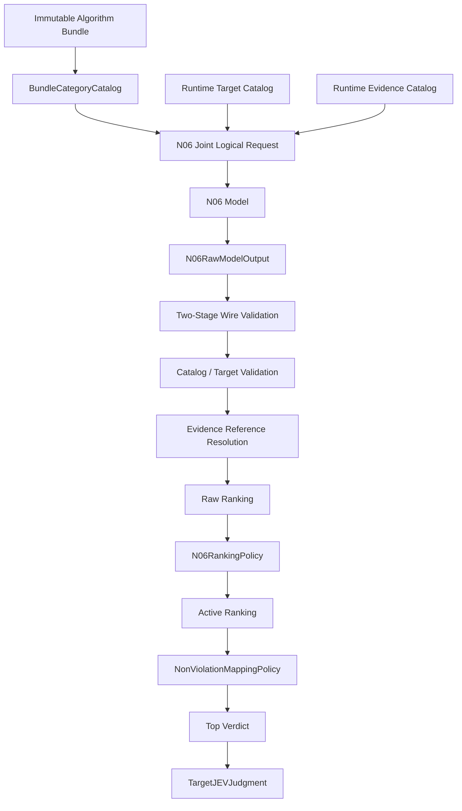
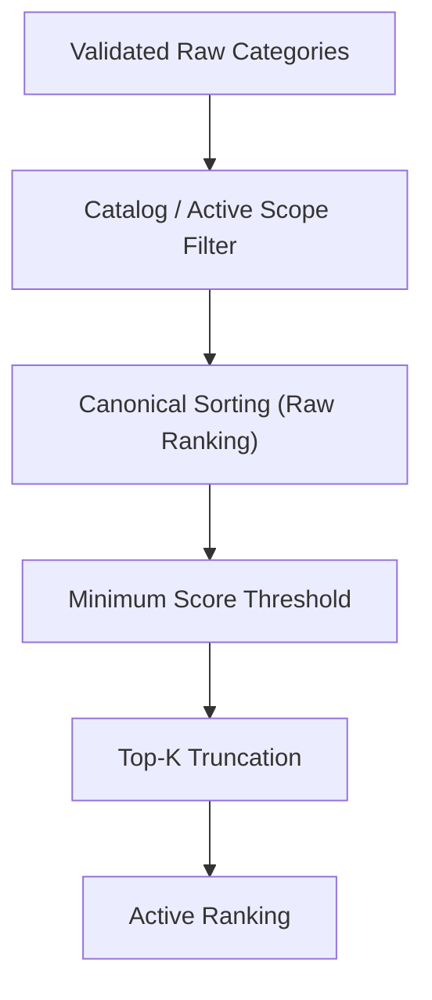
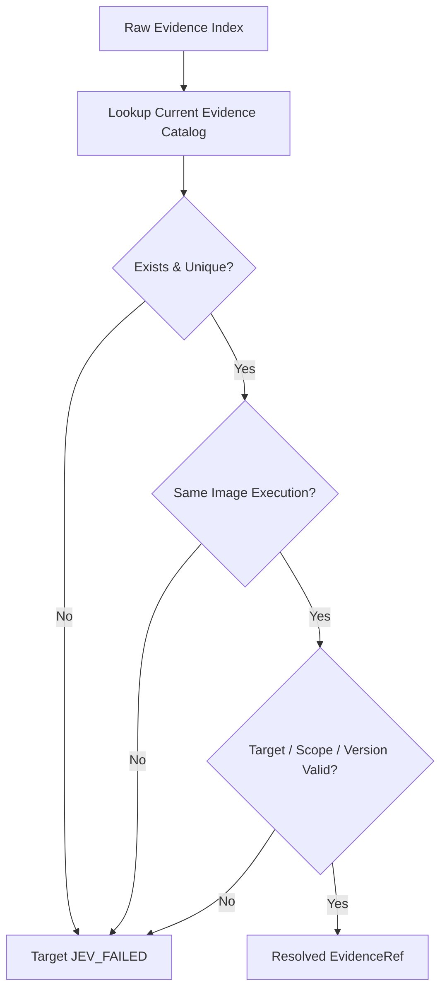

# D05 Batch 02-A — WP-A2 N06 Ranking & Wire Schema

- **文档类型**：Technical Contract
- **所属阶段**：D05 Batch 02-A
- **Work Package**：WP-A2
- **对应 OPEN**：R2-O01、R2-O02、R2-O03
- **版本**：V1.1
- **状态**：Frozen-Ready — Revised After Independent Review
- **适用领域基线**：D03 V1.2
- **适用技术基线**：D05 R2.2.2
- **前置契约**：D05 Batch 02-A WP-A1 AST Type System V1.1
- **技术实现**：Python 3.11+ / Pydantic v2

---

## 修订记录（V1.0 -> V1.1）

| 编号 | 所在章节 | V1.0 缺陷 | V1.1 修补方案 |
| :--- | :--- | :--- | :--- |
| **F-01** | §1.3 | “模型只返回”清单误包含 `top_verdict`（与下一句自相矛盾），且 `evidence_indices` 与 §2.2 实际字段名 `evidence` 不一致。 | 从“模型只返回”中移除 `top_verdict` 并移入禁止清单；字段名与 §2.2–§2.4 完全对齐。 |
| **F-02** | §2.1 / §2.3 / §2.4 | `StrictFloat` 在 Pydantic v2 `strict=True` 下会拒绝 JSON 整数 `0`/`1`（vLLM Guided Decoding 高频输出），且默认未关闭 `NaN`/`Inf`。 | 引入 `FiniteUnitFloat = Annotated[float, Field(ge=0.0, le=1.0, allow_inf_nan=False)]`；在 `strict=True` 下接受 JSON `int \| float`，严格拒绝 `bool`、`str`、`NaN`、$\pm\infty$。 |
| **F-03** | §2.2 / §2.6 / §2.7 | `RawCategoryEvidence` 索引缺少 `ge=0` 约束；`BundleCategoryCatalog` 与 `RuntimeTargetReferenceCatalog` 缺少唯一性 `@model_validator`；`AssetVersionRef` 未声明来源。 | 为索引列表元素补充 `NonNegativeInt`；补齐两类 Catalog 的索引/ID 唯一性校验；显式声明复用 WP-A1 `AssetVersionRef`。 |
| **F-04** | §3.2 | `VisualRegionRef.bbox_xyxy` 使用 `tuple`，违反 §2.1“JSON 数组统一使用 `list[...]`”规定，在 `strict=True` 下会导致 JSON 反序列化失败。 | 改为 `list[FiniteFloat]` + `Field(min_length=4, max_length=4)`，并补充 $x_1 < x_2$、$y_1 < y_2$ 校验。 |
| **F-05** | §3.4 / §4.1 / §5.1 | `class TopVerdict(StrictModel)` 与 `class TieBreakRule(StrictModel)` 为未使用的死定义；`TargetJEVJudgment` 缺少 §5.6 要求的映射审计字段和 §4.3 要求的被隔离类别记录。 | 统一为 `TopVerdictValue` / `TieBreakRuleValue` 类型别名；在 `TargetJEVJudgment` 中新增 `mapping_audit` 与 `isolated_categories`。 |
| **F-06** | §5.3 | `non_violation_score >= top1_score + margin` 直接用 IEEE 754 浮点比较，存在 `0.75 + 0.10 == 0.8500000000000001` 导致的边界误判。 | 规定使用 `Decimal(str(x))` 执行精确十进制比较，彻底消除浮点误差。 |
| **F-07** | §7.2 / §7.4 | `N06ErrorCode` 为普通类且值风格与 Case 04 不一致；§7.4 提出分层验证但未定义两阶段解析契约，直接用 `N06RawModelOutput` 解析会导致单 Target 错误升级为整图失败。 | `N06ErrorCode` 改为 `StrEnum` 并统一枚举值；新增 `N06RawEnvelope` 两阶段解析契约，将 Guided Decoding Schema 与 Runtime 隔离解析解耦。 |

---

## 0. 目标与范围

### 0.1 目标

建立 N06 全图联合 JEV 的结构化输出与确定性 Ranking Contract，关闭：

| OPEN | 内容 | 本文对应章节 |
| :--- | :--- | :--- |
| R2-O01 | N06 Category Ranking Top-K / 候选阈值 | §4 |
| R2-O02 | Non-violation Score 与 Top Verdict 映射 | §5 |
| R2-O03 | N06 多类别排序 JSON Wire Schema | §2–§3 |

核心目标：
1. 建立模型 Wire Output 与 Runtime Judgment 的严格边界。
2. 模型只能引用 Bundle 静态 Category Catalog 和 Runtime Target Reference Catalog。
3. 模型不得自行生成业务对象身份、Rule 身份或证据完整性结论。
4. Ranking Policy 必须独立版本化。
5. Raw Ranking 到 Active Ranking 必须确定性转换。
6. Non-violation 与 Violation Candidate 必须具有明确的映射语义。
7. N06 的证据引用必须绑定当前 Image Execution 的真实 Evidence Catalog。
8. 保持 D05 R2.2.2 冻结的 Target 级错误隔离和 Image 级错误传播规则。

### 0.2 非目标

本工作包不定义：
- Evidence Completeness 的完整依赖计算算法（R2-O04，WP-A3）。
- AST `PARTIAL_FAILED` 聚合（R2-O06，WP-A4）。
- Comparator Top-K 覆盖和同分处理（R2-O05，WP-A5）。
- Comparator 的最终状态优先级修改。
- HITL 门槛。
- 最终自动放行策略。
- N06 模型训练、分数校准和模型内部置信度计算方法。

### 0.3 核心架构约束

| 约束 | 规定 |
| :--- | :--- |
| N06 调用 | 每张图像一次全图联合 JEV 请求 |
| Target 输入 | 使用 Runtime 下发的 `target_ref_index` |
| Category 输入 | 使用 Bundle 固定的 `category_index` |
| Rule 身份 | Runtime 从 `BundleCategoryCatalog` 解析，不由模型生成 |
| Target 身份 | Runtime 从 `RuntimeTargetReferenceCatalog` 解析，不由模型生成 |
| Evidence | 模型只返回 Evidence Index，不直接生成 Runtime Fact Identity |
| Evidence Completeness | Runtime 负责计算，模型禁止自报 |
| Raw Ranking | 保留通过结构、Catalog、Scope、Score 与 Evidence 校验的模型类别排序 |
| Active Ranking | 由版本化 `N06RankingPolicy` 确定性生成 |
| Top Verdict | 由版本化 `NonViolationMappingPolicy` 确定性生成 |
| Comparator | 不在 N06 内执行 |

---

## 1. 三态边界与数据流

### 1.1 Authoring / Compile / Runtime 分离

N06 使用严格的三态数据结构：

| 状态 | 主要对象 | 职责 |
| :--- | :--- | :--- |
| Authoring | `Rule.violation_semantics`、N06 Policy Definition | 定义业务类别语义和策略参数 |
| Compile | `BundleCategoryCatalog`、Policy Version Lock、`ModelBinding` | 固定类别索引与策略版本 |
| Runtime | `RuntimeTargetReferenceCatalog`、Evidence Catalog、Raw Output、`TargetJEVJudgment` | 当前图像推理和确定性解析 |

N06 不允许将运行期 Target Identity 写入静态 Category Catalog。

### 1.2 N06 数据流



### 1.3 四类数据身份严格区分

| 身份 | 所属范围 | 产生方 |
| :--- | :--- | :--- |
| `category_index` | Bundle | Compiler |
| `target_ref_index` | 单图 Runtime Request | Runtime Request Builder |
| `category_id` | Bundle 资产身份 | Runtime 根据 Catalog 解析 |
| `target_instance_id` | 单图 Runtime | N03 / Runtime Planner |

**模型只允许返回以下 Wire 字段**：
- `results`
  - `target_ref_index`
  - `ranked_categories`
    - `category_index`
    - `score`
    - `reasoning`
    - `evidence`（`visual_evidence_indices`、`observation_evidence_indices`、`tool_evidence_indices`）
  - `non_violation_score`

**模型不得返回以下任何 Runtime / Policy 字段**：
- `target_instance_id`
- `category_id`
- `rule_id`
- `rule_version`
- `image_execution_id`
- `top_verdict`
- `evidence_completeness`
- `comparison_status`
- `needs_review`
- `final_decision`

---

## 2. N06RawModelOutput — Wire Schema

### 2.1 基础类型与 `StrictModel` 定义

所有核心模型统一基于以下基础类型定义。`AssetVersionRef` 复用自前置契约 **WP-A1 AST Type System V1.1**（包含 `asset_id`、`version`、`content_hash`）。

```python
from __future__ import annotations

from enum import StrEnum
from typing import Annotated, Any, Literal, Union

from pydantic import (
    BaseModel,
    ConfigDict,
    Field,
    StrictInt,
    StrictStr,
    model_validator,
)


class StrictModel(BaseModel):
    model_config = ConfigDict(
        extra="forbid",
        frozen=True,
        strict=True,
    )


# 在 ConfigDict(strict=True) 下：
# - float 接受 JSON number（int 或 float，如 0、1、0.91）
# - 严格拒绝 bool、str（如 "0.91"）
# - allow_inf_nan=False 严格拒绝 NaN、+Inf、-Inf
FiniteFloat = Annotated[
    float,
    Field(allow_inf_nan=False),
]

FiniteUnitFloat = Annotated[
    float,
    Field(ge=0.0, le=1.0, allow_inf_nan=False),
]

NonNegativeInt = Annotated[
    StrictInt,
    Field(ge=0),
]

TopVerdictValue = Literal[
    "VIOLATION",
    "NON_VIOLATION",
    "UNCERTAIN",
]

TieBreakRuleValue = Literal[
    "score_desc_category_id_asc",
]
```

通用序列化与校验约束：
- JSON 数组字段统一使用 `list[...]`，禁止在对外模型中使用 `tuple[...]`。
- 正式输入通过 `model_validate_json()` 或标准 JSON/YAML 解析后的 `model_validate()` 加载，不要求调用方将 JSON 数组转换为 `tuple`。
- 所有 Wire Model 必须：
  - 禁止未知字段。
  - 禁止字符串或布尔值到数值的自动类型转换。
  - 禁止隐式分数归一化或截断。
  - 禁止自动补充缺失必填字段。
  - 禁止模型生成运行期身份。

### 2.2 `RawCategoryEvidence`

N06 只引用 Runtime Request 提供的 Evidence Catalog 索引：

```python
class RawCategoryEvidence(StrictModel):
    visual_evidence_indices: list[NonNegativeInt]
    observation_evidence_indices: list[NonNegativeInt]
    tool_evidence_indices: list[NonNegativeInt]
```

约束：
1. 所有索引必须满足 $\text{index} \ge 0$。
2. 索引必须能够在当前 Image Execution 的对应 Evidence Catalog 中解析。
3. 同一索引列表内不允许重复索引（由 Runtime Evidence Resolver 校验；不在 JSON Schema 层依赖 `uniqueItems`，以保证 vLLM Guided Decoding 兼容性）。
4. 模型不直接返回 Fact ID。

### 2.3 `RawRankedCategory`

```python
class RawRankedCategory(StrictModel):
    category_index: NonNegativeInt
    score: FiniteUnitFloat
    reasoning: StrictStr
    evidence: RawCategoryEvidence
```

约束：
1. `category_index` 必须存在于 `BundleCategoryCatalog`。
2. `score` 必须处于 $[0.0, 1.0]$，接受合法 JSON 整数 `0` 或 `1`，拒绝字符串、布尔值、`NaN` 和 $\pm\infty$。
3. 同一 Target 内不接受重复 `category_index`。
4. `reasoning` 不承担事实完整性声明。
5. `evidence` 中的所有索引必须通过 Runtime Evidence Catalog 验证。

### 2.4 `RawTargetJEVResult`

```python
class RawTargetJEVResult(StrictModel):
    target_ref_index: NonNegativeInt
    ranked_categories: list[RawRankedCategory]
    non_violation_score: FiniteUnitFloat
```

语义：
- `target_ref_index`：当前 Runtime Request 中的 Target 引用索引。
- `ranked_categories`：该 Target 的模型类别排序，允许为空列表 `[]`。
- `non_violation_score`：模型对该 Target 不存在违规的评分，必填。

不允许模型输出 `target_instance_id`、`rule_id`、`category_id`、`evidence_completeness` 或 `top_verdict`。空 Ranking 的最终语义由 §5 `NonViolationMappingPolicy` 决定。

### 2.5 `N06RawModelOutput` 与分层解析信封 `N06RawEnvelope`

`N06RawModelOutput` 是唯一面向 **vLLM Guided Decoding / Structured Output** 生成 JSON Schema 的顶层 Wire Schema：

```python
class N06RawModelOutput(StrictModel):
    results: list[RawTargetJEVResult] = Field(min_length=1)
```

为了支持 §7.3 的 **Target 级错误隔离**（避免单个 Target 的字段错误导致整图 `N06RawModelOutput.model_validate_json()` 失败），Runtime 接收模型原始 JSON 字符串时，必须先通过 `N06RawEnvelope` 解析顶层信封，再逐个对元素执行 `RawTargetJEVResult.model_validate()`：

```python
class N06RawEnvelope(StrictModel):
    results: list[dict[str, Any]] = Field(min_length=1)
```

模型返回示例：

```json
{
  "results": [
    {
      "target_ref_index": 0,
      "ranked_categories": [
        {
          "category_index": 1,
          "score": 0.91,
          "reasoning": "目标存在明确的违规停放特征",
          "evidence": {
            "visual_evidence_indices": [0],
            "observation_evidence_indices": [0, 1],
            "tool_evidence_indices": [0]
          }
        }
      ],
      "non_violation_score": 0.08
    }
  ]
}
```

### 2.6 Catalog Binding

#### `BundleCategoryCatalog`

N06 的 Category Index 必须使用 Bundle 静态全集：

```python
class BundleCategoryEntry(StrictModel):
    category_index: NonNegativeInt
    category_id: StrictStr
    rule_ref: AssetVersionRef


class BundleCategoryCatalog(StrictModel):
    entries: list[BundleCategoryEntry] = Field(min_length=1)
    catalog_digest: StrictStr

    @model_validator(mode="after")
    def validate_uniqueness(self) -> BundleCategoryCatalog:
        indices = [e.category_index for e in self.entries]
        category_ids = [e.category_id for e in self.entries]
        rule_keys = [(e.rule_ref.asset_id, e.rule_ref.version) for e in self.entries]

        if len(indices) != len(set(indices)):
            raise ValueError("Duplicate category_index in BundleCategoryCatalog")
        if len(category_ids) != len(set(category_ids)):
            raise ValueError("Duplicate category_id in BundleCategoryCatalog")
        if len(rule_keys) != len(set(rule_keys)):
            raise ValueError("Duplicate rule_ref in BundleCategoryCatalog")
        return self
```

约束：
- `category_index` 在 Bundle 内固定，与 `Bundle Digest` 绑定。
- `category_id` 与 Rule 严格 1:1；不允许不同 Category 共享同一个 Rule，也不允许不同 Rule 共享同一个 Category。
- 不允许 Runtime 根据命中 Rule 动态重新编号。

#### `RuntimeTargetReferenceCatalog`

```python
class TargetReferenceEntry(StrictModel):
    target_ref_index: NonNegativeInt
    target_instance_id: StrictStr
    target_kind: Literal["OBJECT", "OBJECT_GROUP"]


class RuntimeTargetReferenceCatalog(StrictModel):
    entries: list[TargetReferenceEntry] = Field(min_length=1)
    image_execution_id: StrictStr
    catalog_digest: StrictStr

    @model_validator(mode="after")
    def validate_uniqueness(self) -> RuntimeTargetReferenceCatalog:
        indices = [e.target_ref_index for e in self.entries]
        instance_ids = [e.target_instance_id for e in self.entries]

        if len(indices) != len(set(indices)):
            raise ValueError("Duplicate target_ref_index in RuntimeTargetReferenceCatalog")
        if len(instance_ids) != len(set(instance_ids)):
            raise ValueError("Duplicate target_instance_id in RuntimeTargetReferenceCatalog")
        return self
```

该 Catalog 属于 Runtime，与当前 `image_execution_id` 绑定。模型只接触 `target_ref_index`，不接触实际 Target Identity。

### 2.7 静态索引约束

Compiler / Runtime 必须确保双射映射：
- `BundleCategoryCatalog`: `category_index` $\leftrightarrow$ 唯一 `category_id` $\leftrightarrow$ 唯一 `rule_ref`
- `RuntimeTargetReferenceCatalog`: `target_ref_index` $\leftrightarrow$ 唯一 `target_instance_id`

索引要求：
1. Index 唯一且非负。
2. 同一 Catalog 内不存在重复 Index、重复 Category 或重复 Target。
3. Category Index 与 Bundle Digest 绑定；Target Index 与 Image Execution ID 绑定。

---

## 3. Runtime Judgment Envelope

### 3.1 Raw Model Output 与 Runtime Judgment 分离

```text
N06RawModelOutput (Raw JSON)
        |
        v
Stage 1: N06RawEnvelope Validation
        |
        v
Stage 2: Per-Target RawTargetJEVResult Validation
        |
        v
Catalog Resolution & Evidence Resolution
        |
        v
Raw Ranking -> N06RankingPolicy -> Active Ranking
        |
        v
NonViolationMappingPolicy -> Top Verdict + Mapping Audit
        |
        v
TargetJEVJudgment
```

`N06RawModelOutput` 不得直接作为最终 Runtime Judgment 使用。Runtime 必须完成 Target Identity 绑定、Category Identity 绑定、Rule Version 绑定、Evidence Reference 解析、Ranking Policy 执行与 Top Verdict 映射。

### 3.2 Runtime Evidence Reference

```python
class VisualRegionRef(StrictModel):
    source: Literal["visual"]
    image_execution_id: StrictStr
    evidence_id: StrictStr
    bbox_xyxy: list[FiniteFloat] = Field(min_length=4, max_length=4)

    @model_validator(mode="after")
    def validate_bbox(self) -> VisualRegionRef:
        x1, y1, x2, y2 = self.bbox_xyxy
        if x1 >= x2 or y1 >= y2:
            raise ValueError("bbox_xyxy must satisfy x1 < x2 and y1 < y2")
        return self


class ObservationFactEvidenceRef(StrictModel):
    source: Literal["observation"]
    image_execution_id: StrictStr
    fact_id: StrictStr
    target_instance_id: StrictStr
    question_ref: AssetVersionRef
    field_key: StrictStr


class ToolFactEvidenceRef(StrictModel):
    source: Literal["tool"]
    image_execution_id: StrictStr
    fact_id: StrictStr
    target_instance_id: StrictStr | None
    scope: Literal["TARGET", "GLOBAL"]
    tool_ref: AssetVersionRef
    step_key: StrictStr
    fact_key: StrictStr

    @model_validator(mode="after")
    def validate_scope(self) -> ToolFactEvidenceRef:
        if self.scope == "GLOBAL" and self.target_instance_id is not None:
            raise ValueError("GLOBAL Tool Fact cannot bind a Target")
        if self.scope == "TARGET" and self.target_instance_id is None:
            raise ValueError("TARGET Tool Fact requires Target Identity")
        return self


EvidenceRef = Annotated[
    Union[
        VisualRegionRef,
        ObservationFactEvidenceRef,
        ToolFactEvidenceRef,
    ],
    Field(discriminator="source"),
]
```

禁止：
- 将 `GLOBAL` Fact 伪装为 `IMAGE` Target。
- 将 `GLOBAL` Fact 自动复制为 Target Fact。
- 将其他 Image Execution 的 Fact 作为当前图像证据。

### 3.3 Runtime Ranking Entry 与审计辅助结构

```python
class RuntimeRankedCategory(StrictModel):
    category_index: NonNegativeInt
    category_id: StrictStr
    rule_ref: AssetVersionRef
    score: FiniteUnitFloat
    rank: StrictInt = Field(ge=1)
    model_position: NonNegativeInt
    reasoning: StrictStr
    evidence_refs: list[EvidenceRef]


class IsolatedCategoryRecord(StrictModel):
    category_index: NonNegativeInt
    category_id: StrictStr
    score: FiniteUnitFloat
    model_position: NonNegativeInt
    reason_code: Literal["category_out_of_active_scope"]


class NonViolationMappingAudit(StrictModel):
    top1_score: FiniteUnitFloat | None
    non_violation_score: FiniteUnitFloat
    margin: FiniteUnitFloat
    empty_ranking_non_violation_threshold: FiniteUnitFloat
    active_ranking_empty: bool
    resolved_verdict: TopVerdictValue
```

字段语义：
- `model_position`：保留模型原始输出数组中的 0-based 位置，用于审计。
- `rank`：经过确定性排序后的 1-based 排名。
- `IsolatedCategoryRecord`：记录因不属于当前 Target Active Evaluation Set 而被隔离的合法 Catalog 类别。
- `NonViolationMappingAudit`：完整保留 §5.4 要求的 Policy 映射输入与结果。

### 3.4 `TargetJEVJudgment`

```python
class TargetJEVJudgment(StrictModel):
    image_execution_id: StrictStr
    target_instance_id: StrictStr
    target_kind: Literal["OBJECT", "OBJECT_GROUP"]
    bundle_digest: StrictStr
    category_catalog_digest: StrictStr
    ranking_policy_ref: AssetVersionRef
    non_violation_mapping_policy_ref: AssetVersionRef
    raw_ranking: list[RuntimeRankedCategory]
    active_ranking: list[RuntimeRankedCategory]
    isolated_categories: list[IsolatedCategoryRecord]
    non_violation_score: FiniteUnitFloat
    top_verdict: TopVerdictValue
    mapping_audit: NonViolationMappingAudit
    evidence_refs: list[EvidenceRef]
```

约束：
1. `image_execution_id` 由 Runtime 注入；`target_instance_id`、`target_kind` 由 `RuntimeTargetReferenceCatalog` 解析；`category_id`、`rule_ref` 由 `BundleCategoryCatalog` 解析。
2. `raw_ranking` 是完整的有效原始候选排序；`active_ranking` 是 `N06RankingPolicy` 转换结果。
3. `evidence_refs` 为该 Target 下所有 `raw_ranking` 涉及证据的去重聚合列表，且全部属于当前 Image Execution。
4. 不允许模型自行填充上述任何 Runtime Identity。
5. 本工作包不定义 `evidence_completeness` 的计算逻辑（属于 WP-A3）。

### 3.5 与 D05 R2.2.2 的兼容关系

| 本文结构 | D05 R2.2.2 对应概念 |
| :--- | :--- |
| `N06RawModelOutput` | `N06RawModelOutput` |
| `RawRankedCategory` | `RawRankedCategory` |
| `TopVerdictValue` | `TopVerdict` |
| `RuntimeRankedCategory` | `CategoryScore` |
| `TargetJEVJudgment` | `TargetJEVJudgment` |
| `EvidenceRef` | Category Evidence 引用 |
| `active_ranking` | 有效 Category Ranking |

---

## 4. N06RankingPolicy — R2-O01

### 4.1 Policy 定义

Ranking Policy 是独立版本化的运行策略资产，不属于 Rule，也不属于 Question：

```python
class N06RankingPolicy(StrictModel):
    policy_id: StrictStr
    version: StrictStr
    content_hash: StrictStr
    top_k: StrictInt = Field(gt=0)
    min_candidate_score: FiniteUnitFloat
    tie_break_rule: TieBreakRuleValue
    policy_description: StrictStr
```

本 Schema 不设置生产默认值。`top_k`、`min_candidate_score` 必须由明确版本的 Policy 提供；未配置时，Bundle 编译或策略解析必须阻断，不允许 Runtime 自行补默认值。

### 4.2 分数合法范围

所有 Category Score 与 Non-violation Score 必须满足：
$$0 \le \text{score} \le 1$$

- **合法**：`0`、`0.0`、`0.25`、`0.91`、`1`、`1.0`
- **非法**：`-0.1`、`1.01`、`NaN`、`+Inf`、`-Inf`、`"0.91"`、`true`
- **禁止**：自动截断到 $[0, 1]$、自动归一化、将 `NaN` 替换为 `0` 或将非法分数映射为 `UNKNOWN`。

### 4.3 Raw Ranking 标准化与 Scope 隔离

Runtime 依次验证：
1. `target_ref_index` 存在于 `RuntimeTargetReferenceCatalog` 且无重复。
2. `category_index` 存在于 `BundleCategoryCatalog` 且同一 Target 内无重复。
3. `score` 与 `non_violation_score` 合法。
4. 所有 Evidence Index 可在当前 Image Execution 的 Evidence Catalog 中解析且作用域合法。

**Active Scope 隔离**：
- 存在于 `BundleCategoryCatalog` 但不属于当前 Target Active Evaluation Set 的 Category：从当前 Target 有效 Ranking 中隔离，记录至 `isolated_categories`（错误码 `category_out_of_active_scope`），保留原始响应，不影响同一 Target 的其他合法 Category。
- 不存在于 `BundleCategoryCatalog` 的非法 `category_index`：该 Target 标记 `JEV_FAILED`，不进入正常 Comparator，其他合法 Target 继续执行。

### 4.4 确定性排序规则

本契约唯一采用：
- 首先按 `score` 降序（`score DESC`）。
- `score` 相同时按 `category_id` 字典序升序（`category_id ASC`）。
- 不保留模型自报并列排名，不依赖模型原始数组顺序、本地化名称或数据库查询顺序。

### 4.5 Raw Ranking -> Active Ranking 转换流水线



数学表达：
设通过校验且处于 Active Scope 的原始候选集合为 $R = \{c_1, c_2, \ldots, c_n\}$，阈值 $\tau = \text{min\_candidate\_score}$，截断数 $K = \text{top\_k}$：
$$R_s = \text{Sort}(R,\ \text{score DESC},\ \text{category\_id ASC})$$
$$R_t = \{c \in R_s \mid \text{score}(c) \ge \tau\}$$
$$A = R_t[0:K]$$

其中 $R_s$ 赋予 1-based `rank` 后即为 `Raw Ranking`；$A$ 为 `Active Ranking`（`rank` 为 $1 \ldots |A|$）。

### 4.6 空 Active Ranking 与确定性

允许 `Raw Ranking` 非空而经过阈值过滤后 `Active Ranking == []`。这不自动意味着 `NON_VIOLATION`，最终结果由 §5 `NonViolationMappingPolicy` 决定。相同输入与相同 Policy Version/Hash 必须产生完全一致的 `Raw Ranking`、`Active Ranking`、`rank` 与排序结果。

---

## 5. NonViolationMappingPolicy — R2-O02

### 5.1 TopVerdict 语义

严格使用 D05 R2.2.2 已冻结的三种语义：

| Verdict | 语义 |
| :--- | :--- |
| `VIOLATION` | 当前 Target 存在有效违规候选（不代表已通过最终业务放行） |
| `NON_VIOLATION` | 当前 Target 被判断为非违规 |
| `UNCERTAIN` | 当前信息不足以确定违规或非违规 |

### 5.2 Policy 结构

```python
class NonViolationMappingPolicy(StrictModel):
    policy_id: StrictStr
    version: StrictStr
    content_hash: StrictStr
    mode: Literal["score_comparison"]
    margin: FiniteUnitFloat
    empty_ranking_non_violation_threshold: FiniteUnitFloat
    policy_description: StrictStr
```

所有参数均必须显式配置，不得使用未经验证的生产默认值。

### 5.3 精确十进制映射算法

为彻底消除 IEEE 754 浮点误差（例如 `0.75 + 0.10 == 0.8500000000000001`），所有边界比较必须转为 `Decimal(str(x))` 执行：

```python
from decimal import Decimal


def resolve_top_verdict(
    active_ranking: list[RuntimeRankedCategory],
    non_violation_score: float,
    policy: NonViolationMappingPolicy,
) -> tuple[TopVerdictValue, NonViolationMappingAudit]:
    v = Decimal(str(non_violation_score))
    m = Decimal(str(policy.margin))
    t = Decimal(str(policy.empty_ranking_non_violation_threshold))

    if not active_ranking:
        verdict: TopVerdictValue = "NON_VIOLATION" if v >= t else "UNCERTAIN"
        audit = NonViolationMappingAudit(
            top1_score=None,
            non_violation_score=non_violation_score,
            margin=policy.margin,
            empty_ranking_non_violation_threshold=policy.empty_ranking_non_violation_threshold,
            active_ranking_empty=True,
            resolved_verdict=verdict,
        )
        return verdict, audit

    top1_score = active_ranking[0].score
    c = Decimal(str(top1_score))

    if v == c and m == Decimal("0"):
        verdict = "UNCERTAIN"
    elif v >= c + m:
        verdict = "NON_VIOLATION"
    elif c >= v + m:
        verdict = "VIOLATION"
    else:
        verdict = "UNCERTAIN"

    audit = NonViolationMappingAudit(
        top1_score=top1_score,
        non_violation_score=non_violation_score,
        margin=policy.margin,
        empty_ranking_non_violation_threshold=policy.empty_ranking_non_violation_threshold,
        active_ranking_empty=False,
        resolved_verdict=verdict,
    )
    return verdict, audit
```

### 5.4 完整映射状态表与审计要求

设 $V = \text{Decimal}(\text{str}(\text{non\_violation\_score}))$，$C = \text{Decimal}(\text{str}(\text{top1\_score}))$，$M = \text{Decimal}(\text{str}(\text{margin}))$，$T = \text{Decimal}(\text{str}(\text{empty\_ranking\_non\_violation\_threshold}))$：

| Active Ranking | Score Condition（十进制精确比较） | Top Verdict |
| :--- | :--- | :--- |
| 非空 | $V = C$ 且 $M = 0$ | `UNCERTAIN` |
| 非空 | $V \ge C + M$ | `NON_VIOLATION` |
| 非空 | $C \ge V + M$ | `VIOLATION` |
| 非空 | 其他（双方差距不足） | `UNCERTAIN` |
| 空 | $V \ge T$ | `NON_VIOLATION` |
| 空 | $V < T$ | `UNCERTAIN` |

Runtime 必须通过 `non_violation_mapping_policy_ref` 与 `mapping_audit` 完整保留 Policy ID、Version、Content Hash、Top-1 Score、Non-violation Score、Margin、Empty Ranking Threshold 与最终 Verdict。

---

## 6. Evidence Reference Contract

### 6.1 Evidence 来源范围

| Source | 证据来源 | Target 约束 |
| :--- | :--- | :--- |
| `visual` | 当前原图的视觉区域 | 当前 `image_execution_id` |
| `observation` | N04 Observation Facts | 当前 `image_execution_id` 且绑定当前 Target |
| `tool` | N05 Tool Facts | 当前 `image_execution_id`，`TARGET`（绑定当前 Target）或 `GLOBAL`（`target_instance_id is None`） |

### 6.2 Evidence 解析流程



### 6.3 严格验证与失败隔离

本契约不静默过滤无效证据引用。以下任一情况均触发 Target 级 `JEV_FAILED`（错误码 `n06_evidence_reference_invalid`），保留原始响应，不连坐其他合法 Target：
1. Evidence Index 不存在或在同一列表内重复。
2. Fact ID / Visual Region 不存在。
3. Fact 不属于当前 `image_execution_id`。
4. Observation Fact 或 `TARGET` Tool Fact 绑定了其他 Target。
5. `GLOBAL` Tool Fact 错误绑定了 Target。
6. Fact Producer Version 与当前 Bundle 不匹配。

### 6.4 Evidence Completeness 边界

WP-A2 只负责 Evidence Reference 的真实性、身份与作用域验证；不负责计算 Required Observation/Tool Fact 是否完整（属于 WP-A3 / R2-O04）。

---

## 7. N06 Error Classification & Propagation

### 7.1 错误码定义

```python
class N06ErrorCode(StrEnum):
    N06_JSON_PARSE_FAILED = "n06_json_parse_failed"
    N06_SCHEMA_VALIDATION_FAILED = "n06_schema_validation_failed"
    N06_OUTPUT_TRUNCATED = "n06_output_truncated"
    N06_TARGET_REFERENCE_INVALID = "n06_target_reference_invalid"
    N06_TARGET_MISSING = "n06_target_missing"
    N06_CATEGORY_INDEX_INVALID = "n06_category_index_invalid"
    N06_SCORE_OUT_OF_RANGE = "n06_score_out_of_range"
    N06_DUPLICATE_CATEGORY = "n06_duplicate_category"
    N06_DUPLICATE_TARGET = "n06_duplicate_target"
    N06_EVIDENCE_REFERENCE_INVALID = "n06_evidence_reference_invalid"
    N06_CATEGORY_OUT_OF_ACTIVE_SCOPE = "category_out_of_active_scope"
```

### 7.2 三层错误分类与传播规则

| 层级 | 触发场景 | 处理方式 |
| :--- | :--- | :--- |
| **Image-level** | 顶层 JSON 无法解析、输出截断、`N06RawEnvelope` 校验失败、无法建立 Target 对账关系 | `InferenceStatus = FAILED`，`failure_code = N06_FAILED`，`execution_outcome = None` |
| **Target-level** | 单个 Target 的 Schema 校验失败（含 `extra_forbidden`、Score 越界）、重复 Target、重复 Category、Catalog 外 `category_index`、非法 Evidence Index | 该 Target `ComparisonStatus = JEV_FAILED`；其他合法 Target 继续执行，整图可保持 `SUCCEEDED / EVALUATED` |
| **Target Missing** | N06 整图成功返回，但遗漏 Planner 预期的某个 Target | 该 Target `ComparisonStatus = JEV_MISSING_TARGET`（不允许通过删除预期 Target 掩盖遗漏） |
| **Category-level** | `category_index` 存在于 `BundleCategoryCatalog`，但不属于当前 Target Active Evaluation Set | 隔离该 Category 至 `isolated_categories`（`category_out_of_active_scope`），不影响同 Target 其他合法类别 |

### 7.3 两阶段分层验证协议

Runtime 必须按以下顺序执行解析，严禁直接对整图调用 `N06RawModelOutput.model_validate_json()` 后一刀切失败：
1. **Stage 1（顶层信封）**：调用 `N06RawEnvelope.model_validate_json(raw_text)`。若失败，直接判定 Image-level `N06_FAILED`。
2. **Stage 2（Target 对账与逐项校验）**：
   - 遍历 `envelope.results`，先提取 `target_ref_index` 并与 `RuntimeTargetReferenceCatalog` 对账（检测缺失 Target、非法 `target_ref_index`、重复 `target_ref_index`）。
   - 若某条目无法识别合法的 `target_ref_index`，且因此无法可靠建立 Target 边界，则升级为 Image-level `N06_FAILED`；若能定位到预期 Target，则隔离该 Target 为 `JEV_FAILED`。
   - 对每个可定位的 Target 条目独立调用 `RawTargetJEVResult.model_validate(item)`，再执行语义校验（重复 `category_index`、Catalog 查找、Evidence 解析）。
   - 产出强类型的 `TargetValidationOutcome`（`SUCCEEDED` / `JEV_FAILED` / `JEV_MISSING_TARGET`），禁止将裸 `dict` 流入下游。

---

## 8. Ranking & Mapping Execution Contract

1. **Raw Ranking 不可变**：`Active Ranking` 是从 `Raw Ranking` 派生的新列表，不得覆盖或丢弃被阈值/Top-K 过滤的原始候选及其证据。
2. **Top Verdict 唯一来源**：只能由 `NonViolationMappingPolicy` 计算，禁止从 `reasoning` 自由文本推断或直接取 Raw Ranking 第一项。
3. **与 Rule AST 独立**：N06 的 `TopVerdict` 不构成 Rule AST 执行白名单，不决定 Rule AST 是否执行，不覆盖 Rule AST Judgment，也不替代 Comparator。Comparator 仍按 D05 R2.2.2 §6 执行。

---

## 9. Minimal Positive / Negative JSON Examples

以下五组为本工作包的最低验收用例：

### Case 01 — 正常多类别排序与 Top-K 截断（Positive）

- **Policy**：`top_k = 2`，`min_candidate_score = 0.70`，`tie_break_rule = "score_desc_category_id_asc"`
- **输入**：

```json
{
  "results": [
    {
      "target_ref_index": 0,
      "ranked_categories": [
        {
          "category_index": 1,
          "score": 0.91,
          "reasoning": "Category B evidence",
          "evidence": {
            "visual_evidence_indices": [0],
            "observation_evidence_indices": [0],
            "tool_evidence_indices": []
          }
        },
        {
          "category_index": 2,
          "score": 0.85,
          "reasoning": "Category C evidence",
          "evidence": {
            "visual_evidence_indices": [1],
            "observation_evidence_indices": [1],
            "tool_evidence_indices": []
          }
        },
        {
          "category_index": 3,
          "score": 0.62,
          "reasoning": "Category D weak evidence",
          "evidence": {
            "visual_evidence_indices": [2],
            "observation_evidence_indices": [],
            "tool_evidence_indices": []
          }
        }
      ],
      "non_violation_score": 0.05
    }
  ]
}
```

- **预期**：`raw_ranking_category_indices = [1, 2, 3]`；`active_ranking_category_indices = [1, 2]`（`index=3` 因低于 `0.70` 被过滤）；`active_ranking_count = 2`；`Raw Ranking` 不被覆盖。

### Case 02 — Non-violation Score 胜出（Positive）

- **Policy**：`margin = 0.10`，`empty_ranking_non_violation_threshold = 0.80`
- **输入**：`active_ranking = [{"category_id": "goods_blocking_road", "score": 0.55}]`，`non_violation_score = 0.85`
- **计算**：`Decimal("0.85") >= Decimal("0.55") + Decimal("0.10")` 成立。
- **预期**：`top_verdict = "NON_VIOLATION"`（不跳过 Rule AST）。

### Case 03 — 同分输入确定性 Tie-break（Positive）

- **输入**：`goods_blocking_road`、`motor_vehicle_illegal_parking`、`nonmotor_vehicle_illegal_parking` 三者 `score` 均为 `0.90`（无论模型原始数组顺序如何）。
- **预期**：`rank 1 = goods_blocking_road`，`rank 2 = motor_vehicle_illegal_parking`，`rank 3 = nonmotor_vehicle_illegal_parking`。

### Case 04 — 非法 Category Index / Score（Negative）

- **输入**：

```json
{
  "results": [
    {
      "target_ref_index": 0,
      "ranked_categories": [
        {
          "category_index": 999,
          "score": 1.50,
          "reasoning": "Invalid output",
          "evidence": {
            "visual_evidence_indices": [],
            "observation_evidence_indices": [],
            "tool_evidence_indices": []
          }
        }
      ],
      "non_violation_score": 0.10
    }
  ]
}
```

- **预期**：Stage 1 通过；Stage 2 定位到 `target_ref_index = 0` 后，Pydantic 校验捕获 `score > 1.0`（映射到 `n06_score_out_of_range`），语义校验捕获 `n06_category_index_invalid`。该 Target 标记 `JEV_FAILED`，不影响同图其他合法 Target。

### Case 05 — 禁止 Wire 注入 Runtime 字段（Negative）

- **输入**：

```json
{
  "results": [
    {
      "target_ref_index": 0,
      "target_instance_id": "object-001",
      "ranked_categories": [],
      "non_violation_score": 0.95,
      "evidence_completeness": "complete"
    }
  ]
}
```

- **预期**：Stage 2 `RawTargetJEVResult.model_validate()` 失败，报错 `extra_forbidden`（`target_instance_id`、`evidence_completeness`，映射到 `n06_schema_validation_failed`），该 Target 标记 `JEV_FAILED`，禁止忽略未知字段继续执行。

---

## 10. Engineering Acceptance Criteria

- **Wire Schema**：`N06RawModelOutput` 可直接导出 vLLM Guided Decoding JSON Schema；所有模型 `extra="forbid"`、`strict=True`；`FiniteUnitFloat` 接受 `0`/`1`/`0.91`，拒绝 `str`/`bool`/`NaN`/$\pm\infty$；禁止任何 Runtime 字段注入。
- **Catalog & Evidence**：两类 Catalog 强制唯一性校验；`VisualRegionRef.bbox_xyxy` 使用 `list[FiniteFloat]` 并校验 $x_1 < x_2$、$y_1 < y_2$；支持 `visual`、`observation`、`tool(TARGET/GLOBAL)` 四类证据并严格隔离非法引用。
- **Ranking & Mapping**：Policy 独立版本化且无生产默认值；`Scope Filter -> Sort -> Threshold -> Top-K` 顺序固定；`NonViolationMappingPolicy` 使用 `Decimal` 精确比较且完整覆盖空 Ranking 与 `margin == 0` 同分边界。
- **Failure Isolation**：严格执行 `N06RawEnvelope` 两阶段解析，确保单 Target 错误隔离为 `JEV_FAILED`，缺失 Target 标记为 `JEV_MISSING_TARGET`，未激活 Category 隔离为 `category_out_of_active_scope`。

---

## 11. WP-A2 Exit Gate

WP-A2 满足以下全部条件后关闭 R2-O01、R2-O02、R2-O03：
1. `N06RawModelOutput` 与 `N06RawEnvelope` 两阶段 Schema 完整。
2. `BundleCategoryCatalog` 与 `RuntimeTargetReferenceCatalog` 唯一性约束完整。
3. `TargetJEVJudgment`（含 `mapping_audit` 与 `isolated_categories`）完整。
4. `N06RankingPolicy` 与 `NonViolationMappingPolicy` 独立版本化且含 `content_hash`。
5. 十进制精确比较与空 Ranking 映射边界测试通过。
6. 五组最小 JSON 用例（Case 01–05）全部通过。
7. vLLM Guided Decoding JSON Schema 实测通过。
8. 独立 Reviewer 审查通过。

---

## 12. Frozen Decisions

| 决策 | 冻结内容 |
| :--- | :--- |
| D02A-01 | 模型仅返回 Target Index / Category Index，不生成 Runtime Identity |
| D02A-02 | `N06RawModelOutput` 与 `TargetJEVJudgment` 分离，Runtime 采用 `N06RawEnvelope` 两阶段解析 |
| D02A-03 | Category Index 绑定 `BundleCategoryCatalog`（静态全集） |
| D02A-04 | Target Index 绑定 `RuntimeTargetReferenceCatalog` |
| D02A-05 | Score 合法范围 $[0.0, 1.0]$，使用 `FiniteUnitFloat`（接受整数 `0`/`1`，拒绝 `NaN`/$\pm\infty$/`str`/`bool`） |
| D02A-06 | Ranking Tie-break = `score DESC` + `category_id ASC` |
| D02A-07 | Ranking Pipeline = Scope Filter -> Sort -> Threshold -> Top-K |
| D02A-08 | Raw Ranking 与 Active Ranking 独立保留 |
| D02A-09 | `TopVerdict` 由 Runtime Policy 使用 `Decimal` 精确计算 |
| D02A-10 | Active Ranking 为空且 Non-violation 分数不足时为 `UNCERTAIN` |
| D02A-11 | Evidence Index 由 Runtime Evidence Catalog 解析 |
| D02A-12 | 无效 Evidence Reference 产生 Target-level `JEV_FAILED` |
| D02A-13 | 模型不得生成 `evidence_completeness` |
| D02A-14 | N06 Image / Target / Category 错误隔离遵循 D05 R2.2.2 |

Top-K、候选阈值、Margin 和 Empty Ranking Threshold 的具体生产值不属于冻结常量，必须通过版本化 Policy 配置。

---

## 13. Final Architecture

N06 最终执行链路：
`BundleCategoryCatalog` + `RuntimeTargetReferenceCatalog` + `Runtime Evidence Catalog` -> `N06 Full-image Joint Request` -> `N06RawModelOutput` -> `N06RawEnvelope` 两阶段校验 -> Catalog / Evidence Resolution -> `Raw Ranking` -> `N06RankingPolicy` -> `Active Ranking` -> `NonViolationMappingPolicy`（`Decimal` 精确映射）-> `TopVerdict` + `NonViolationMappingAudit` -> `TargetJEVJudgment` -> `D05 Target-level Comparator`。

最终原则：
1. N06 每张图像仅执行一次全图联合模型调用。
2. 模型输出只引用 Runtime Target Index 和 Bundle Category Index。
3. 模型不生成业务实体身份、Rule Identity 或 Evidence Completeness。
4. Runtime 负责所有身份解析与两阶段错误隔离。
5. Raw Ranking 与 Active Ranking 分开存储，Ranking Policy 与 NonViolationMappingPolicy 均独立版本化。
6. 排序、同分处理与十进制阈值映射必须完全确定性。
7. Evidence 必须指向当前 Image Execution 中真实存在的证据，无效引用仅触发 Target 级失败。
8. N06 与 Rule AST 保持独立判断，Comparator 不拥有最终业务放行权。